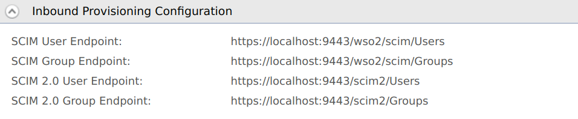

## View inbound provisioning configurations

To view the inbound provisioning configs, expand **Inbound Provisioning Configuration** section.



| Field                   | Description                                                                                                                                                    | Sample Value                                                                                              |
|-------------------------|----------------------------------------------------------------------------------------------------------------------------------------------------------------|-----------------------------------------------------------------------------------------------------------|
| **SCIM User Endpoint**  | This is the identity provider's endpoint for SCIM user operations, e.g., creating and managing users.                                                          | `https://localhost:9443/wso2/scim/Users`  |
| **SCIM Group Endpoint** | This is the identity provider's endpoint for the SCIM user role operations, e.g., creating user roles, assigning user roles to users, and managing user roles. | `https://localhost:9443/wso2/scim/Groups` |

<details>
<summary>Modify the hostname</summary>

To modify the hostname of the URLs mentioned above, add the following configuration to the `deployment.toml` file in the `<IS_HOME>/repository/conf` directory.

```toml
[server]
hostname = "localhost"
```

```toml
[sts.endpoint] 
idp="https://localhost:9443/samlsso"
```

To ensure the client application communicates with the correct identity provider, WSO2 Identity Server compares the destination value in the SAML request with the URL in the above configuration.

</details>
