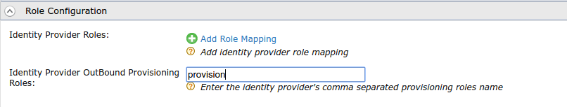
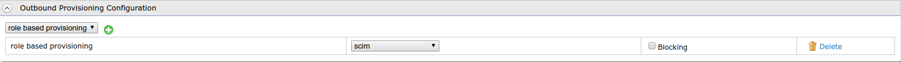

# Configure Role-Based Provisioning

This page guides you through provisioning users  based on the roles they are assigned to. With role-based provisioning, the user is provisioned when the user is added to a pre-configured role, and the user is deleted from the trusted identity provider when the user is removed from the role.

Follow the steps given below to configure role-based provisioning in WSO2 Identity Server. 

----

## Register an identity provider

1. Log in to the Management Console(`https://<IS_HOST>:<PORT>/carbon`) using admin/admin credentials. 
    
2. Navigate to **Main** > **Identity** > **Identity Providers** > **Add**.
    
    

3. Enter an **Identity Provider Name**, **Display Name**, and **Description**.
    
    

1.	Expand the **Outbound Provisioning Connectors** section and select
    [Google](outbound-provisioning-with-google.md),
    [SCIM](outbound-provisioning-with-scim.md)
    or [Salesforce connecter](outbound-provisioning-with-salesforce.md).
2.	Expand the **Role Configuration** section and enter a role name (or
    set of roles as a comma-separated list) for the **Identity Provider
    OutBound Provisioning Roles** field as seen below.  
    For this flow, a role named "provision" was created and has been
    entered here.

    :::info

    If you do not have roles already, see the [Add a User Role](add-user-roles.md)
    topic to add roles.

    :::

    

3.  Click **Update** to save changes.

---

## Configure outbound provisioning

1.  Navigate to **Main** > **Identity** > **Service Providers** >  **Resident**.

2.  Expand the **Outbound Provisioning Configuration** section and enter
    the name of the identity provider you just created, and select the
    connector from the dropdown list.

    :::info

    If you enable **Blocking**, WSO2 Identity Server will wait for the
    response from the Identity Provider to continue.

    :::

1.  Click **Update** to save changes.

	

---

## Try it out

1.  Navigate to **Main** > **Identity** > **Users and Roles** > **Add**.
2.  Click **Add New User**. See [Configuring Users](admin-creation-workflow.md) for
    more information.
3.  Provide a username and a password(with confirmation) and click
    **Next**.
4.  Click **Finish** to create the user.

    :::note

    At this point, the user is **not** yet provisioned to the identity
    provider.

    :::
    

5.  On the **Main** tab in the management console, click **List** under
    **Users and Roles** in the **Identity** menu.
6.  Click **Users** and then click the **Assign Roles** action of the
    newly created user. Select the "provision" role (or any role added
    in the **Role Configuration** section of the identity provider) and
    click **Finish**.

    :::note

    The user is now provisioned to the identity provider.

    :::

---

## Remove users

1.  On the **Main** tab in the management console, click **List** under
    **Users and Roles** in the **Identity** menu.
2.  Click **Users** and then click on the **Assign Roles** action of the
    newly created user. De-select the "provision" role (or any role
    added in the **Role Configuration** section of the identity
    provider) and click **Finish**.

The user will now be removed from the identity provider.

:::info[Related topics]

:::
	- [Concepts: Provisioning Framework](../../references/concepts/provisioning-framework.md#outbound-provisioning)
	- [Guide: Rule-Based Provisioning](rule-based-provisioning.md)
