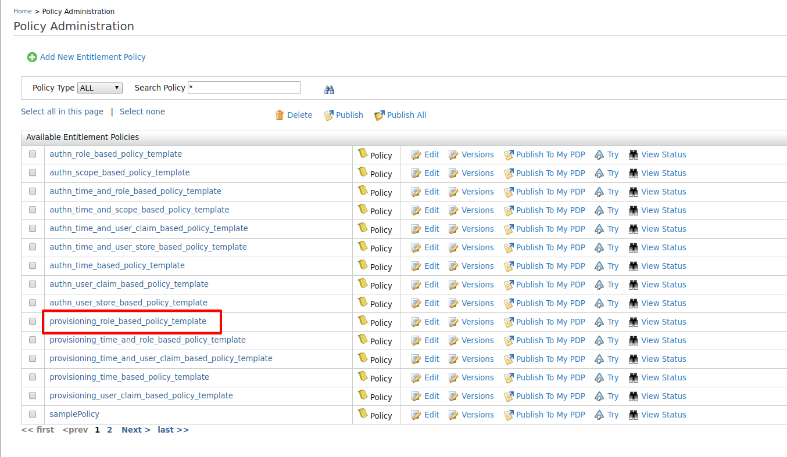
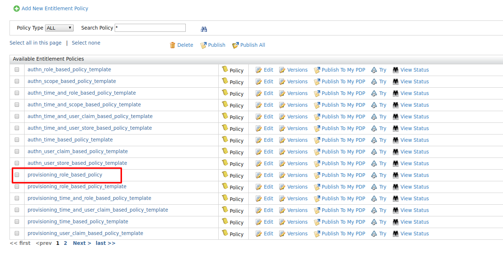
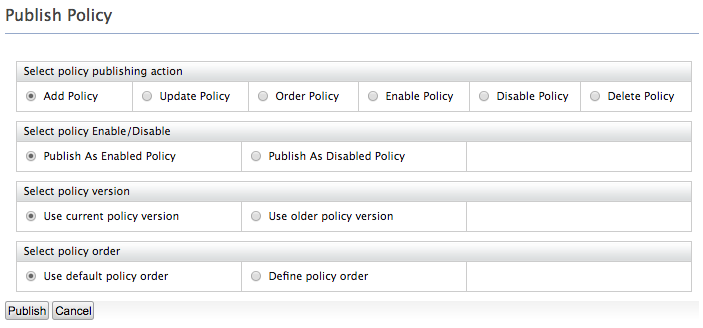
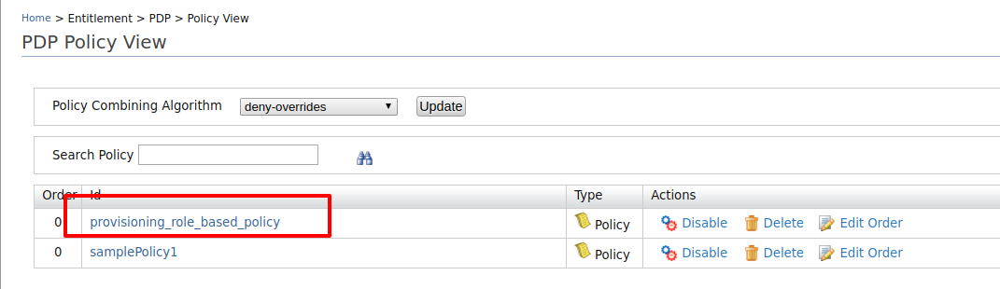

# Configure Rule-Based Provisioning

This page guides you through provisioning users  based on defined XACML rules.

To get a better understanding of rule-based provisioning, consider a scenario where you need to provision users assigned to the finance role from WSO2 Identity Server to the GoogleIDP. To implement this scenario, you can define a XACML policy that permits the provisioning operation if the provisioning user is assigned the finance role.

Follow the steps given below to configure rule-based provisioning in WSO2 Identity Server. 

-----

## Register an identity provider

1. Log in to the Management Console(`https://<IS_HOST>:<PORT>/carbon`) using admin/admin credentials. 
    
2. Navigate to **Main** > **Identity** > **Identity Providers** > **Add**.
    
    

3. Enter an **Identity Provider Name**, **Display Name**, and **Description**.
    
    


1.	Expand the **Outbound Provisioning Connectors** section and select
    [Google](outbound-provisioning-with-google.md),
    [SCIM](outbound-provisioning-with-scim.md)
    or [Salesforce connecter](outbound-provisioning-with-salesforce.md).

---

## Configure a service provider 

To register your application as a service provider in the WSO2 Identity Server:

1. Log in to the WSO2 Identity Server Management Console using administrator credentials.

2. Go to **Main** > **Identity** > **Service Providers** > **Add**.
     
    

3. Enter a **Service Provider Name**. Optionally, enter a **Description**.
    
    

4. Click **Register**.

1.	Expand the **Outbound Provisioning Configuration** section and select the provisioning connector you configured in the previous section.

2.	Click on the **+** button and add the identity provider, then select **Enable Rules** in order to enable rules during provisioning. 

3.	Click **Update** to save.

----

## Configure outbound provisioning


1.  Navigate to **Main** > **Identity** > **Service Providers** >  **Resident**.

2.  Expand the **Outbound Provisioning Configuration** section and enter
    the name of the identity provider you just created, and select the
    connector from the dropdown list.

    :::info

    If you enable **Blocking**, WSO2 Identity Server will wait for the
    response from the Identity Provider to continue.

    :::


1.	Select **Enable Rules**.

2.	Click **Update** to save changes.

----

## Set up XACML rules

1.	Click on **Policy Administration** under the **Entitlement** > **PAP** section on the **Main** tab of the management console.

2.	Since this sample scenario is based on role, we select the policy
    `                       provisioing_role_based_policy_template.                     `

    

     

3.	Once you click **Edit**, the XML based policy will appear in the policy editor. There are placeholders in capitals for entering the service provider and role names.

4.	Edit the placeholders accordingly with the relevant values.
    1.  Change the `             PolicyId            ` as follows:

        ```java
        PolicyId="provisioning_role_based_policy"
        ```

    2.  Edit the `             <Description>            ` tag and enter
        a description relevant to your custom policy.

        ```java
        <Description>This template policy provides ability to authorize provisioning requests initiated from a given service provider(defined by SP_NAME) to a given identity provider(defined by IDP_NAME) in the outbound provisioning flow based on the roles of the user (ROLE_1, ROLE_2). Provisioning attempts to the users with given role(s) will be allowed and all others will be denied.</Description>
        ```

    3.  Locate the IDP `            _NAME           ` placeholder and
        replace it with the identity provider name "WSO2IDP".
    4.  Locate the placeholder `            ROLE_1           ` and
        replace it with the role name "finance".
    5.  In this example, the policy authenticates users to the
        specified service provider based on
        `            ROLE_1           ` or
        `            ROLE_2           `. However, you can authenticate
        using only one role as well. To do this, remove the other role
        by removing that entire section from the start of the
        `            <Apply>           ` tag to the ending
        `            </Apply>           ` tag.  This should be edited in
        both POST and PUT sections as the provisioning is initiated when
        creating the user and when updating the user as well.
    6.  Also for this example, we do not need a service provider.
        Therefore we need to remove the service provider
        `            SP_NAME           ` match block as well.

5.	Once the changes have been made, the policy should be similar to the
    following.

	```xml
	<Policy xmlns="urn:oasis:names:tc:xacml:3.0:core:schema:wd-17"  PolicyId="provisioning_role_based_policy" RuleCombiningAlgId="urn:oasis:names:tc:xacml:1.0:rule-combining-algorithm:first-applicable" Version="1.0">
	<Description>This template policy provides ability to authorize provisioning requests initiated from a given  identity provider(defined by IDP_NAME) in the outbound provisioning flow based on the roles of the user (finace). Provisioning attempts to the users with given role will be allowed and all others will be denied.</Description>
	<Target>
	<AnyOf>
	<AllOf>
	<Match MatchId="urn:oasis:names:tc:xacml:1.0:function:string-equal">
		<AttributeValue DataType="http://www.w3.org/2001/XMLSchema#string">WSO2IDP</AttributeValue>
		<AttributeDesignator AttributeId="http://wso2.org/identity/idp/idp-name" Category="http://wso2.org/identity/idp" DataType="http://www.w3.org/2001/XMLSchema#string" MustBePresent="false"></AttributeDesignator>
	</Match>
	<Match MatchId="urn:oasis:names:tc:xacml:1.0:function:string-equal">
		<AttributeValue DataType="http://www.w3.org/2001/XMLSchema#string">provisioning</AttributeValue>
		<AttributeDesignator AttributeId="http://wso2.org/identity/identity-action/action-name" Category="http://wso2.org/identity/identity-action" DataType="http://www.w3.org/2001/XMLSchema#string" MustBePresent="false"></AttributeDesignator>
	</Match>
	</AllOf>
	</AnyOf>
	</Target>
	<Rule Effect="Permit" RuleId="permit_by_role_when_create">
	<Target>
	<AnyOf>
	<AllOf>
		<Match MatchId="urn:oasis:names:tc:xacml:1.0:function:string-equal">
			<AttributeValue DataType="http://www.w3.org/2001/XMLSchema#string">POST</AttributeValue>
			<AttributeDesignator AttributeId="http://wso2.org/identity/provisioning/provision-operation" Category="http://wso2.org/identity/provisioning" DataType="http://www.w3.org/2001/XMLSchema#string" MustBePresent="true"></AttributeDesignator>
		</Match>
	</AllOf>
	</AnyOf>
	</Target>
	<Condition>
	<Apply FunctionId="urn:oasis:names:tc:xacml:1.0:function:or">
	<Apply FunctionId="urn:oasis:names:tc:xacml:1.0:function:string-is-in">
		<AttributeValue DataType="http://www.w3.org/2001/XMLSchema#string">finance</AttributeValue>
		<AttributeDesignator AttributeId="http://wso2.org/identity/provisioning/claim-group" Category="http://wso2.org/identity/provisioning" DataType="http://www.w3.org/2001/XMLSchema#string" MustBePresent="true"></AttributeDesignator>
	</Apply>
	</Apply>
	</Condition>
	</Rule>
	<Rule Effect="Permit" RuleId="permit_by_role_when_update">
	<Target>
	<AnyOf>
	<AllOf>
		<Match MatchId="urn:oasis:names:tc:xacml:1.0:function:string-equal">
			<AttributeValue DataType="http://www.w3.org/2001/XMLSchema#string">PUT</AttributeValue>
			<AttributeDesignator AttributeId="http://wso2.org/identity/provisioning/provision-operation" Category="http://wso2.org/identity/provisioning" DataType="http://www.w3.org/2001/XMLSchema#string" MustBePresent="true"></AttributeDesignator>
		</Match>
	</AllOf>
	</AnyOf>
	</Target>
	<Condition>
	<Apply FunctionId="urn:oasis:names:tc:xacml:1.0:function:or">
	<Apply FunctionId="urn:oasis:names:tc:xacml:1.0:function:string-is-in">
		<AttributeValue DataType="http://www.w3.org/2001/XMLSchema#string">finance</AttributeValue>
		<AttributeDesignator AttributeId="http://wso2.org/claims/role" Category="http://wso2.org/identity/user" DataType="http://www.w3.org/2001/XMLSchema#string" MustBePresent="true"></AttributeDesignator>
	</Apply>
	</Apply>
	</Condition>
	</Rule>
	<Rule Effect="Deny" RuleId="deny_others"></Rule>
	</Policy>               
	```

6.  Click **Save Policy** to save the changes. You can see the policy
    you just created on the policy list (the original template policy
    will remain unchanged for later use).  
     

7.  Click on the **Publish to My PDP** link corresponding to the new
    policy.  
    
8.  On the UI that appears, leave the default selected values as they
    are and click **Publish**.  
    


    
9.  Click on **Policy View** under the **Entitlement\>PDP** section on
    the **Main** tab of the management console.
10. To ensure that the policy has been published successfully, check if
    the policy is listed.  
      
    
11. To test out whether the policy works, follow the **Try it
    out** section.


---

## Try it out

Once the policies are published to PDP, they are ready to execute during outbound provisioning. You can test rule-based provisioning by creating a user in WSO2 Identity Server that matches the rules you enforced. For example, when you create a user with the role "finance" in WSO2 Identity Server, it should be provisioned to the external IDP you have configured for outbound provisioning as well. A user who is not assigned the "finance" role should not be provisioned.


:::info[Related topics]


:::
	- [Guide: Role-Based Provisioning](role-based-provisioning.md)
