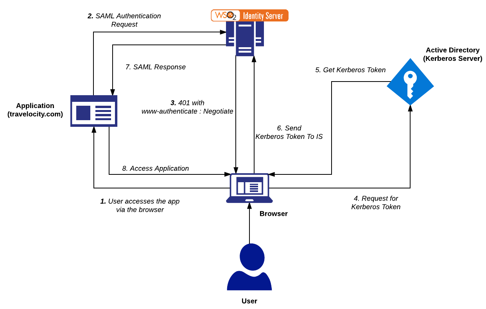
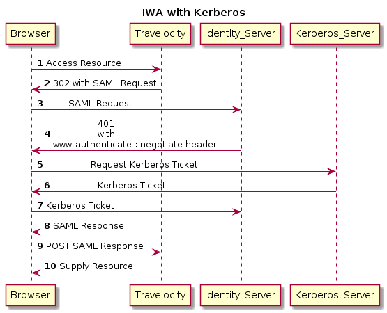
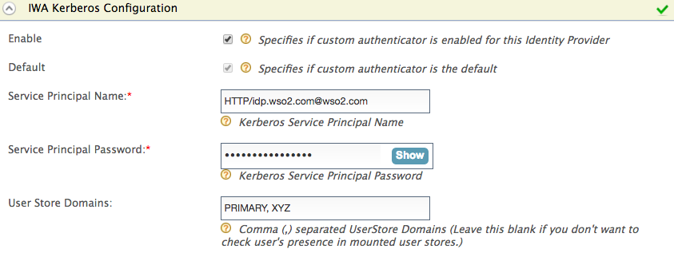
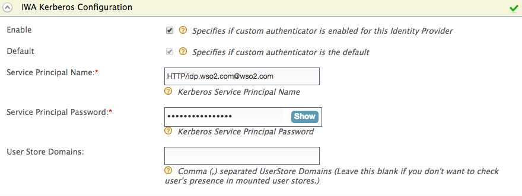
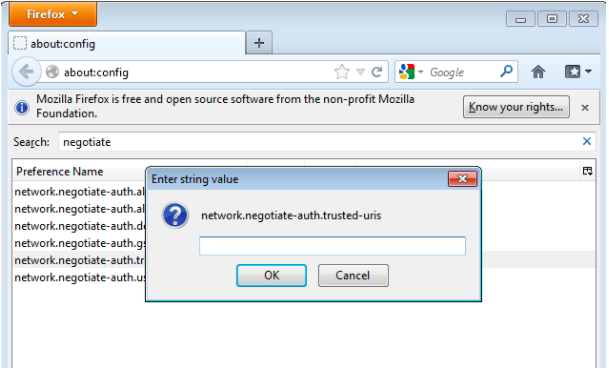
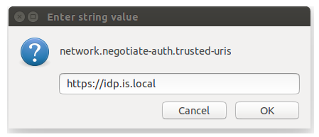
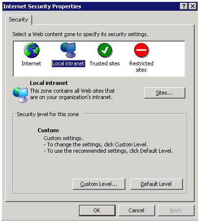
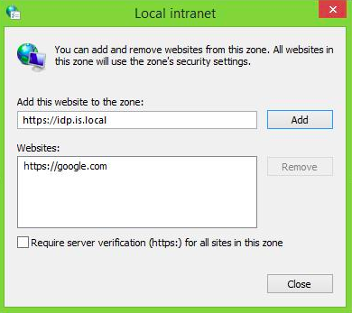
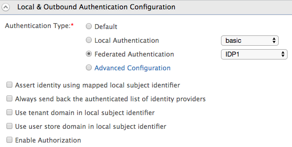

# Configure IWA on Linux

For information on Integrated Windows Authentication (IWA), see [IWA](TO-DO:%20concepts).

:::tip


This IWA authenticator is provided OOTB and was implemented
from WSO2 IS 5.3.0 onwards. It uses Kerberos internally and is the
recommended approach as it overcomes some limitations of the IWA
authenticator provided in previous versions of WSO2 IS which was based
on NTLM. If you still want to use the previous IWA authenticator that
was based on NTLM, it is [available as an extension](https://github.com/wso2-extensions/identity-local-auth-iwa-ntlm)
. For more information on how to setup the NTLM-based IWA authenticator,
see [Configuring IWA Single-Sign-On](configure-iwa-single-sign-on.mdx).

The benefits of using the authenticator based on Kerberos vs the
authenticator based on NTLM are as follows:

-   Can be used on any operating system unlike NTLM which has to be run
    on a Windows server.
-   Performance and security on Kerberos are better.

:::
    

:::info[Related topics]


:::

	-   For more information about IWA, see [Integrated Windows
		Authentication](/identity/6.0.0/references/concepts/authentication/integrated-windows-authentication-overview)
    
	-   To configure Active Directory as a user store, see [Configuring a
		Read-write Active Directory Userstore](/identity/6.0.0/deploy/configuring-a-read-write-active-directory-user-store/).

---

## How IWA with Kerberos works



  

---

## Set up IWA

1.  Add a DNS host entry in the Active Directory (AD) to map the IP
    address of the WSO2 Identity Server to a hostname. If there are
    multiple Kerberos domains, WSO2 IS should have a virtual host name
    for each Kerberos domain.

    :::info

    When adding the DNS entry, generally the first part of the hostname
    is given. The AD will append the rest with its AD domain. For
    example, if the AD domain is 'wso2.com, after you add a DNS host
    entry, the final result will be similar to the following:

    ```java
    idp.wso2.com
    ```
            
    Kerberos does not work with IP addresses, it relies on
    domain names and correct DNS entries only.

    :::

2.  Open the `<IS_HOME>/repository/conf/deployment.toml` file and add the following configuration.

    ```xml
    [server]
    hostname="idp.wso2.com"
    ```

3.  Open the `           jaas.conf          ` file found in the
    `           <IS_HOME>/repository/conf/identity          ` folder and
    check if the configuration is as follows. (Refer
    [this](https://docs.oracle.com/javase/8/docs/technotes/guides/security/jaas/JAASRefGuide.html)
    for more information on JAAS)

    ```java
    Server {
    com.sun.security.auth.module.Krb5LoginModule required
    useKeyTab=false
    storeKey=true
    useTicketCache=false
    isInitiator=false;
    };
    
    Client {
    com.sun.security.auth.module.Krb5LoginModule required
    useTicketCache=false;
    };
    ```

4.  Register WSO2 IS using the same hostname (
    `           idp.wso2.com          ` ) in Active Directory. To do
    this, use the [DNS
    tool](https://technet.microsoft.com/en-us/library/cc753579(v=ws.11).aspx)
    on the machine that is running WSO2 IS to add an entry for the
    hostname (idp.is.local), and map it to the local IP address.

5.  Create a service account in the Active Directory for WSO2 IS or use
    an existing account. (For this tutorial, the sample username of the
    service account is **is_linux** ).

    :::note

    The account used for WSO2 IS needs to be different from
    the one used by the user to login to the application.

    :::

6.  Run the following commands to register WSO2 IS as a service
    principal in Active Directory.

    :::note

    Replace `           is_linux          ` with the username
    of your service account in the command below. The format of the
    command is as follows:
    `           [setspn -A HTTP/<url of Identity Server> <service_account>]          `

    :::
    

    ```java
    setspn -A HTTP/idp.wso2.com is_linux
    setspn -A HTTP/idp is_linux
    ```

You can now set up IWA either as a local authenticator or as a federated
authenticator.

---

## Configure WSO2 IS with IWA as a local or federated authenticator

1.  Follow the steps above to set up IWA.

2.  Start the WSO2 IS server and log in to the management console.
3.  Navigate to **Main\>Identity Providers** and click **Add**. Enter a
    name for the identity provider.
4.  Expand the **Federated Authenticators** section and then expand
    **IWA Federated Configuration**.
5.  Fill in the fields as follows:

    <table><thead><tr className={"header"}><th>{"Field"}</th><th>{"Description"}</th><th>{"Sample Value"}</th></tr></thead><tbody><tr className={"odd"}><td>{"Enable"}</td><td>{"Enable this to enable a custom authenticator for the identity provider."}</td><td>{"Selected"}</td></tr><tr className={"even"}><td>{"Server Principal Name"}</td><td><div className={"content-wrapper"}><p>{"The SPNName should be the SPN you registered in step 6 of "}<strong>{"Setting up IWA,"}</strong>{" with the Active Directory domain. The SPNName follows this format:"}</p><div className={"code panel pdl"}><div className={"codeContent panelContent pdl"}><div className={"sourceCode"} id={"cb1"} data-syntaxhighlighter-params={"brush: bash; gutter: false; theme: Confluence"} data-theme={"Confluence"}><pre className={"sourceCode bash"}><code className={"sourceCode bash"}><a className={"sourceLine"} id={"cb1-1"} title={"1"}><span className={"op"}>{"<"}</span><span className={"ex"}>{"service"}</span>{" class"}<span className={"op"}>{">"}</span>{"/"}<span className={"op"}>{"<"}</span>{"host"}<span className={"op"}>{">"}</span>{"@"}<span className={"op"}>{"<"}</span>{"AD domain"}<span className={"op"}>{">"}</span></a></code></pre></div></div></div><p>{"For example,"}</p><p>{"If the SPN is "}<code>{" HTTP/idp.wso2.com "}</code>{" , where "}<code>{" HTTP "}</code>{" is a service class (in this case, "}<code>{" HTTP "}</code>{" is not the standard protocol; it is the service class) and "}<code>{" IS.wso2.com "}</code>{" is the Active Directory domain, the SPNName will be "}<code>{" HTTP/idp.wso2.com@wso2.com "}</code></p></div></td><td><code>{" HTTP/idp.wso2.com@wso2.com "}</code></td></tr><tr className={"odd"}><td>{"Server Principal Password"}</td><td>{"The SPNPassword should be the password of the service account associated with the SPN (the service account created in step 6 of "}<strong>{"Setting up IWA"}</strong>{" )."}</td><td>{"-"}</td></tr><tr className={"even"}><td>{"User store domains"}</td><td><p><strong>{"[Mandatory only if you want to use IWA as a local authenticator]"}</strong></p><p>{"The mounted user stores in which you want the user’s existence to be checked in."}</p><ul><li>{"To configure IWA as a "}<strong>{"local authenticator"}</strong>{", mount the user store domain names of the relevant user stores that you expect the user to be in."}</li><li>{"To configure IWA as a "}<strong>{"federated authenticator"}</strong>{", leave this field blank."}</li></ul></td><td>{"PRIMARY"}</td></tr></tbody></table>

    -   IWA as a Local Authenticator
    
    
    -   IWA as a Federated Authenticator
    

6.  Configure your browser to support Kerberos and NTLM. The points below
    explain how to configure each browser.

	**Configure firefox**
    
	1. Type `                about:config               ` in the address
	bar, ignore the warning and continue, this will display the advanced
	settings of Firefox.

	2\. In the search bar, search for the key "
	`                network.negotiate-auth.trusted-uris.               `

	

	3\. Add the WSO2 Identity Server URL and click OK.

	

	**Configure Internet Explorer/Chrome**

	1. Go to Tools -\>Internet Options.

	2\. In the “security” tab select local intranet.

	

	3\. Click the **Sites** button. Then add the URL of WSO2 Identity Server
	there.

	

	Chrome simply inherits the settings from Internet Explorer. So you
	don’t have to configure anything additionally.  

---

## Test the IWA authenticator

Set up IWA as a local authenticator or as a federated authenticator by following the steps above.


<Prerequisites>

### Prerequisites

- Download [Apache Tomcat 8.x](https://tomcat.apache.org/download-80.cgi) and install it. Tomcat server installation location will later be referred to as `<TOMCAT_HOME>` in this guide.

- It is recommended that you use a hostname that is not `localhost` to avoid browser errors. Modify your machine's `/etc/hosts` entry to reflect this.

    :::info

    Note that `wso2is.local` is used in this documentation as an example, but you must modify this when configuring the authenticators or connectors with this sample application.

    :::


- Download the [Travelocity application](https://github.com/wso2/samples-is/releases/download/v4.5.2/travelocity.com.war) from the latest release assets.

---

</Prerequisites>

### Register a service provider

1. On the Management Console, go to **Main** > **Identity** > **Service Providers** and click **Add**.

3. Enter `travelocity.com` as the **Service Provider Name**, and click **Register**.

4. Expand the **Inbound Authentication Configuration > SAML2 Web SSO Configuration** section and, click **Configure**.

5. Enter the following values in the fields mentioned.

    | Field name | Value |
    |-----------|-------|
    | **Issuer** | `travelocity.com`  |
    | **Assertion Consumer URL**    | `http://wso2is.local:8080/travelocity.com/home.jsp`    |

    :::info

    Click **Yes** on the dialog that appears after you add the **Assertion Consumer URL**. This dialog appears when you add an `http` URL.

    :::

6. Enable the following by selecting the corresponding checkboxes:
    - **Enable Response Signing**
    - **Enable Signature Validation in Authentication Requests and Logout Requests**
    - **Enable Single Logout**
    - **Enable Attribute Profile**
        - **Include Attributes in the Response Always**  

    :::tip

    For more information on the advanced configurations, see [Advanced SAML Configurations](../../../../guides/login/saml-app-config-advanced).

    :::

7. Click **Register** to add the service provider and save the configurations.  

---
### CORS configuration

SAML2 POST Binding requires CORS configurations to be set up.

Before configuring the service provider, add the following configurations to the `deployment.toml` file found in `<IS_HOME>/repository/conf/`. Adding this configuration allows `HTTP POST` requests.


    ```toml
    [cors]
    allow_generic_http_requests = true
    allow_any_origin = false
    allowed_origins = [
        "http://localhost:8080"
    ]
    allow_subdomains = false
    supported_methods = [
        "GET",
        "POST",
        "HEAD",
        "OPTIONS"
    ]
    support_any_header = true
    supported_headers = []
    exposed_headers = []
    supports_credentials = true
    max_age = 3600
    tag_requests = false
    ```


---

### Deploy the sample web app

To deploy the sample web app on a web container:

1. Copy the downloaded `.war` file of the SAML application into the `webapps` directory of the Tomcat folder.

2. Open a terminal and add the following entry to the `/etc/hosts` file of your machine to configure the hostname.

    ```bash
    127.0.0.1   wso2is.local
    127.0.0.1   localhost.com
    ```

    !!!info "Why is this step needed?"
		Some browsers do not allow you to create cookies for a naked hostname, such as `localhost`. Cookies are required when working with SSO . Therefore, to ensure that the SSO capabilities work as expected in this tutorial, you need to configure the `etc/host` file as explained in this step.

		The `etc/host` file is a read-only file. Therefore, you won't be able to edit it by opening the file via a text editor. Instead, edit the file using the terminal commands. For example, use the following command if you are working on a macOS/Linux environment.

		```java
		sudo nano /etc/hosts
		```

3. Open the `travelocity.properties` file in the `<TOMCAT_HOME>/webapps/travelocity.com/WEB-INF/classes ` directory and configure the following property with the hostname that you configured above.

    ```text
    #The URL of the SAML 2.0 Assertion Consumer
    SAML2.AssertionConsumerURL=http://<HOSTNAME>:8080/travelocity.com/home.jsp
    ```

4. Restart the Tomcat server.

To check the sample application, navigate to `http://<TOMCAT_HOST>:<TOMCAT_PORT>/travelocity.com/index.jsp` on your browser.

:::tip

If you wish to change properties like the `issuer ID`, `consumerURL`, and `IdP URL`, you can edit the **travelocity.properties** file in the `travelocity.com/WEB-INF/classes` directory.
Also if the service provider is configured in a tenant you can use `QueryParams` property to send the tenant domain. For example,`QueryParams=tenantDomain=wso2.com`.

This sample uses the following default values.

| Properties | Description  |
|------------|--------------|
| `SAML2.SPEntityId=travelocity.com`    | A unique identifier for this SAML 2.0 Service Provider application. |
| `SAML2.AssertionConsumerURL=http://wso2is.local:8080/travelocity.com/home.jsp`   | The URL of the SAML 2.0 Assertion Consumer.   |
| `SAML2.IdPURL=https://localhost:9443/samlsso` | The URL of the SAML 2.0 Identity Provider.    |
| `SAML2.IsPassiveAuthn=true`   | Set this to send SAML2 passive authentication requests.   |

For the changes to be effective, restart the Apache Tomcat server after updating the `travelocity.properties` file.

:::


3.  Edit the service provider you created for the Travelocity sample,
    and expand the **Local and Outbound Authentication** section.

4.  Select **Federated Authentication** as the **Authentication Type**
    and select the identity provider you created above.  
    
    
5.  Restart the Apache Tomcat server and run the Travelocity sample
    application from a Windows machine.  

:::note[Troubleshooting Tips]


:::

	-   Use hostnames only (no IP addresses).
	-   Check the configuration of the `            jaas.conf           `
		file, particularly the `            isInitiator=false           `
		property under the `            Server           ` section (see step
		3 of the **Setting Up IWA** section).
	-   Make sure that your service principal (IS) is associated with only
		one account.

	-   If you get an exception with an error message similar to “Checksum
		failed”, check whether you have given the correct password.
