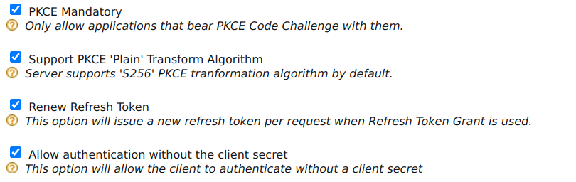

# Enable login using the Authorization Code flow and PKCE for public clients

This guide gives you instructions on how to implement login with OpenID Connect in your application by using the [authorization code flow](../../references/concepts/authorization/authorization-code-grant.mdx) and PKCE. This method is most suitable for public clients, which are applications that cannot keep the client credentials securely.

Single-page applications and native mobile applications are some examples of public clients.

For public clients, it is recommended to use [PKCE](https://datatracker.ietf.org/doc/html/rfc7636) along with the authorization code grant to mitigate [code interception attacks](../../deploy/mitigate-attacks/mitigate-authorization-code-interception-attacks.mdx).

## Register a service provider

To register your application as a service provider in the WSO2 Identity Server:

1. Log in to the WSO2 Identity Server Management Console using administrator credentials.

2. Go to **Main** > **Identity** > **Service Providers** > **Add**.
     
    

3. Enter a **Service Provider Name**. Optionally, enter a **Description**.
    
    

4. Click **Register**.

----

## Configure the service provider

Make the following changes to the created service provider.

1. Expand **Inbound Authentication Configuration** > **OAuth/OpenID Connect Configuration** and click **Configure**.

2. Make sure **Code** is selected from the **Allowed Grant Types** list.

3. Enter the **Callback Url** of your application.

    :::tip

    The **Callback Url** is the exact location in the service provider's application to which an access token will be sent. This URL should be the URL of the page that the user is redirected to after successful authentication.

    :::

4. Enable **PKCE Mandatory** and **Allow authentication without the client secret** to enable PKCE for your public application.

    

5. Click **Update** to save your configurations.

    :::note

    - Note the generated **OAuth Client Key**. You will need this value later when sending the request.

    - To configure more advanced configurations, see [OAuth/OpenID Connect Configurations](oauth-app-config-advanced.mdx).

    :::

----

## Get authorization code

To obtain the `authorization_code`, send an authorization request to the authorization endpoint using the following request format.

:::tip

You can use this [Online PKCE Generator Tool](https://tonyxu-io.github.io/pkce-generator/) to generate PKCE code challenges.

To generate the **challenge** and **verifier** through the tool:

1. Click **Generate Code Verifier**.
2. Click **Generate Code Challenge**.

Note the two values. You will need them to get the authorization code and the tokens. The code challenge you get here is the base64 URL encoded value of the SHA256 hashed `code_verifier`, so the code challenge method will be `S256`.

:::

**Request format**
    ```bash
    https://<host>/oauth2/authorize?scope=openid&response_type=code
    &redirect_uri=<redirect_uri>
    &client_id=<OAuth Client Key>
    &code_challenge=<PKCE_code_challenge>
    &code_challenge_method=<PKCE_code_challenge_method>
    ```

**Sample Request**
    ```bash
    https://localhost:9443/oauth2/authorize?scope=openid&response_type=code
    &redirect_uri=https://localhost/callback
    &client_id=YYVdAL3lLcmrubZ2IkflCAuLwk0a
    &code_challenge=5vEtIy2T-G65yXHc8g5zcJDQXICBzZMrtERq0zhx7hM
    &code_challenge_method=S256
    ```

This authorization request takes the following parameters.

| Request Parameter | Description    |
|-------------------|----------------|
| `redirect_uri`  | This is where the response is redirected to at the end of the process. This needs to be the same as one of the URLs given in the registered apps. |
| `client_id` | The client ID generated when registering the application on IS.
| `code_challenge`    | The client creates and records a secret cryptographical random string (`code_verifier`), which is then encoded using URL-safe base64 encoding to transform it into the `code_challenge`. The `code_challenge` is required for the authorization code flow with PKCE. You can use some [tools](https://tonyxu-io.github.io/pkce-generator/) to generate the `code_challenge` and `code_verifier`.
| `code_challenge_method` | This is the method used for transforming the `code_verifier` into the `code_challenge`. Identity Server supports S256 and `plain`. This is required for the authorization code flow with PKCE. |

## Get tokens

After receiving the authorization code, the application has to exchange it to get the following tokens:

- `access_token`
- `id_token`
- `refresh_token` (only if the `refresh_token` grant type is enabled for the service provider registered on IS)

You can get the tokens by sending the following token request to the token endpoint.

**Request Format**
    ```curl
    curl -k -X POST https://localhost:9443/oauth2/token
    -H 'Content-Type: application/x-www-form-urlencoded'
    -d 'client_id=<OAuth_Client_Key>&grant_type=authorization_code&redirect_uri=<Callback_Url>&code=<Authorization_Code>&code_verifier=<Code_Verifier>'
    ```

**Sample Request**
    ```curl
    curl -k -X POST https://localhost:9443/oauth2/token
    -H 'Content-Type: application/x-www-form-urlencoded'
    -d 'client_id=X_evTCx5txiXfpMLdYGs8zj7eTga&grant_type=authorization_code&redirect_uri=https://example-app.com/redirect&code=86d3735e-e744-3864-92e8-665560e6fac4&code_verifier=uy383dWCPy8D5anX9cK42v3fTBCc10CsnvfXrcfENewIFSJvEm1nEczo8C63Mud7QPPkLQ5GVJvzRaxfzVmWi6rqUrPIVhpPQxywRCaxovGzMhDoLjMpZ0ddLRrMrjpY'
    ```

This token request takes the following parameters.

| Request Parameter | Description    |
|-------------------|----------------|
| `grant_type`    | The grant type. Here, we are using the `authorization_code` grant.   |
| `redirect_uri`  | This is where the response is redirected to at the end of the process. This needs to be the same as one of the URLs given in the registered apps. |
| `code`  | The authorization code received from the authorization request.   |
| `code_verifier` | The plain text cryptographical random string used to generate the `code_challenge`. This is required for the authorization code flow with PKCE.    |


You will receive a response containing the access token, scope, and ID token for the token request.

:::info[Validate the ID token]

The ID token contains basic user information. You can use the [JWT Token Decoder](https://devtoolzone.com/decoder/jwt) tool to check what is encoded within the ID token.

:::

----

:::info[Related topics]

- [Concept: Authorization Code Grant](../../references/concepts/authorization/authorization-code-grant.mdx)
- [Guide: OpenID Connect Authentication](oidc-authentication.mdx)
- [Guide: Authorization Code Grant](../access-delegation/auth-code-playground.mdx)
- [Guide: Manage User Sessions](session-management-logout.mdx)
- [Guide: OpenID Connect Back-Channel Logout](oidc-backchannel-logout.mdx)
- [Guide: Advanced OpenID Connect Configurations](oauth-app-config-advanced.mdx)
- [Deploy: Mitigate Authorization Code Interception Attacks](../../deploy/mitigate-attacks/mitigate-authorization-code-interception-attacks.mdx)

:::
