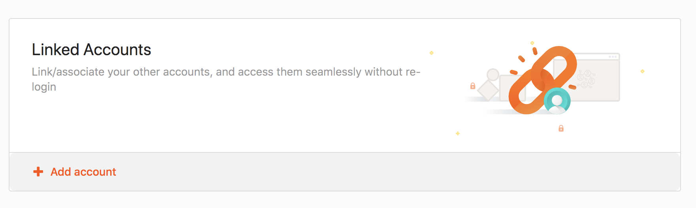
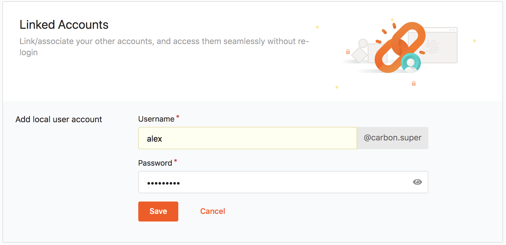

# Link User Accounts

WSO2 IS allows linking multiple accounts that a user has and switching between accounts once the user links their accounts. WSO2 IS also allows to connect a user's federated user credentials with their WSO2 Identity Server account. 

Users can link and manage local and federated accounts seamlessly using **My Account**.

## Link new accounts

1.  Access **My Account** (`https://<IS_HOST>:<PORT>/myaccount`).
2.  Click the **Personal info** tab on the side panel.
3.  Under the linked account sub section, click **Add account**.

    

4.  Enter the username and the password of the account that needs to be linked and click **Save**.

    

## Delete linked accounts

1. Access **My Account** (`https://<IS_HOST>:<PORT>/myaccount`).
2. Click the **Personal info** tab on the side panel.
3. Click on the **delete** button aligning with the linked account that needs to be deleted.
4. Confirm the deletion of the linked account by clicking **OK** in the confirmation popup that appears.
