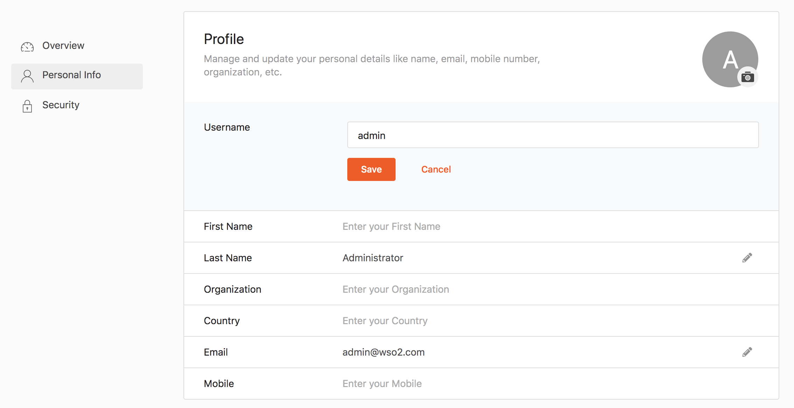
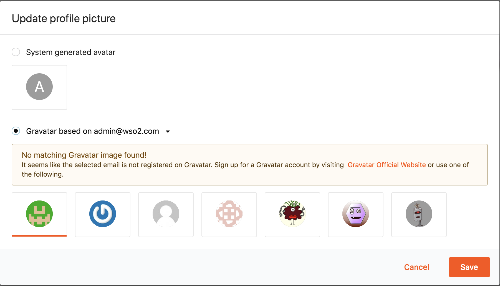

# Manage Own Profile

Various elements of the **My Account** application can be managed by the users themselves by following the instructions given below.

## Add personal details

1. Access **My Account** (`https://<IS_HOST>:<PORT>/myaccount`).
2. Click the **Personal info** tab on the side panel.
3. Under the **Profile** sub section, click on the description aligning with the field that needs to be added.
4. Enter the value to the profile and click **Save**.

## Update personal details

1. Access **My Account** (`https://<IS_HOST>:<PORT>/myaccount`).
2. Click the **Personal info** tab on the side panel.
3. Click on the pencil icon aligning with the field that needs to be edited.
4. Update the new value in the profile and click **Save**.

:::tip

To add custom attributes to the user profile, see [Extend SCIM 2.0 User Schemas](../../references/extend/provisioning/extend-scim2-user-schemas.md).

:::

## Add and update profile picture

1. Access **My Account** (`https://<IS_HOST>:<PORT>/myaccount`).
2. Click the **Personal info** tab on the side panel.
3. Click on the camera icon.

    

4. In the pop-up that appears, you can choose a Gravatar image.

    

5. Click **Save**.
