# Recover password via Challenge Questions

WSO2 Identity Server enables resetting user passwords by correctly responding to predefined challenge questions (also known as security questions).

## Prerequisites
-   [Create a user](../identity-lifecycles/admin-creation-workflow.md)

## Enable password reset via challenge questions

### Enable password reset via challenge questions for a specific tenant

Follow the steps below to configure WSO2 Identity Server to enable password reset by answering a challenge question.  

1.  Sign in to the WSO2 Identity Server Management Console (`https://<HOST>:<PORT>/carbon`) as an administrator. 	  

2.  On the **Main** tab, click **Identity** > **Identity Provider** > **Resident**.

	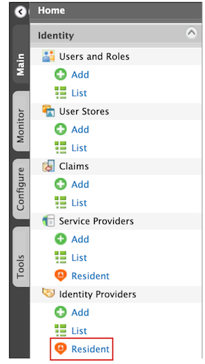  

3.	Under the **Account Management** section, click **Account Recovery**.

	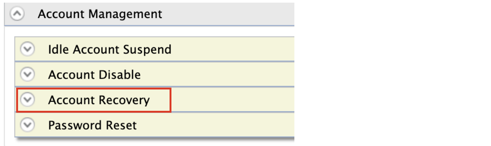  	

4.	Enter the required values as given below:

	-	**Security question based password recovery**: Selected

	-	**Number of questions required for password recovery**: `2` 
	
	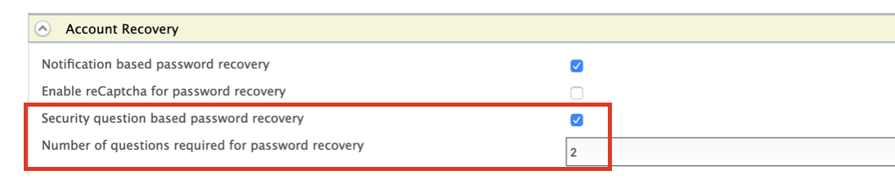

    :::note

    Select **Enable reCaptcha for security questions based password recovery** and configure the **Max failed attempts for reCaptcha** to enable reCAPTCHA after maximum number of failed attempts of security questions. See [Setting Up reCAPTCHA](../../deploy/configure-recaptcha.md) for more information.

    This **Max failed attempts for reCaptcha** value should be less than the number of failed attempts configured in the account locking connector.

    To view the number of failed attempts configured for the account lock feature, expand the **Login Attempts Security** tab and then expand the **Account Lock** tab.

    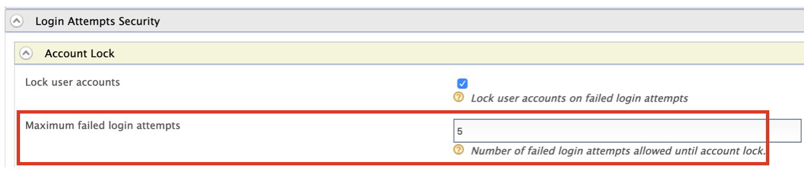

    :::

5.	Click **Update**. 

### Enable password reset via challenge questions globally

:::note

`<IS_HOME>` refers to the root directory where your WSO2 Identity Server is installed or extracted. For example, `/home/user/wso2is-6.0.0`.

:::

1.  Navigate to the `<IS_HOME>/repository/conf/deployment.toml`file and add the following configurations.

    :::tip

    To avoid any configuration issues, do this before starting the WSO2 Identity Server product instance.

    :::
    

    ```toml
    [identity_mgt.password_reset_challenge_questions]
    enable_password_reset_challenge_questions=true
    min_required_answers="2"      
    ```

    :::note

    If you want to enable reCAPTCHA for password recovery via email, you can set `enable_recaptcha` true as a property of `[identity_mgt.password_reset_challenge_questions]` in the `deployment.toml` file. See [Setting Up reCAPTCHA](../../deploy/configure-recaptcha.md) for more information.

    ```toml
    enable_recaptcha=true
    failures_before_recaptcha="2"
    ```

    :::

2.  You have now successfully configured reCAPTCHA for the password recovery flow.

## Configure the challenge questions

1. Access the WSO2 Identity Server My Account (`https://<HOST>:<PORT>/myaccount`) application.		

2.	Log in with the credentials of the user account that you created.

	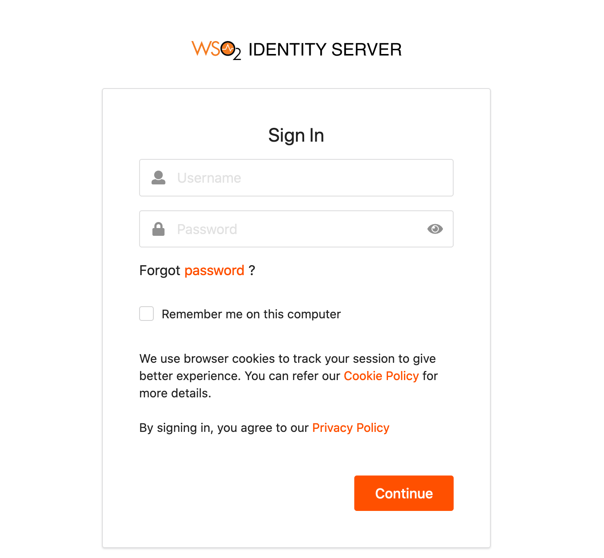
 
3. Select the **Security** tab.

    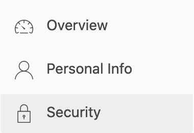

3.	Under **Account Recovery**, click **+** to add or update security questions.

	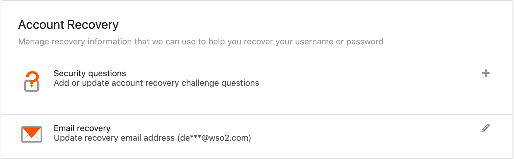

4.	Configure the challenge questions as given below:

	-	**Challenge Question 1**: `Name of your first pet?`
	-	**Your Answer**: `Tommy`
	-	**Challenge Question 2**: `Favourite food?`
	-	**Your Answer**: `Pizza`

    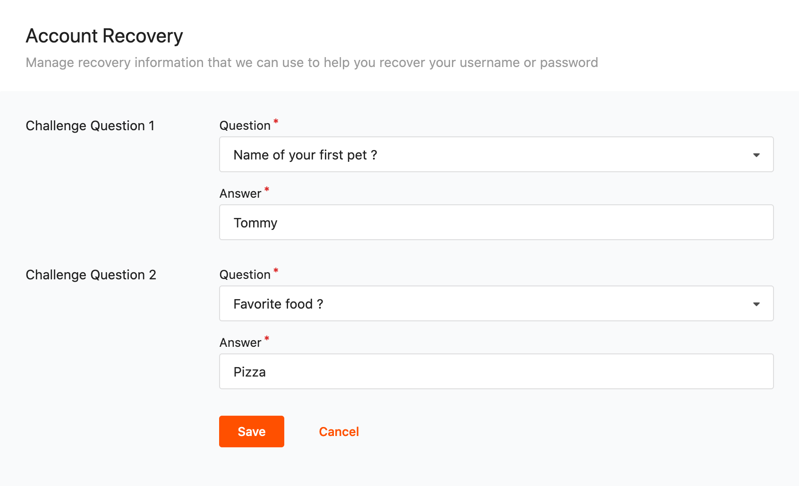
    
5. Click **Save**.

6. Sign out.  

---

## Try it out

### Recover password using the My Account application

1. Access the WSO2 Identity Server My Account (`https://<HOST>:<PORT>/myaccount`) application.

2.	Click **Password**.

    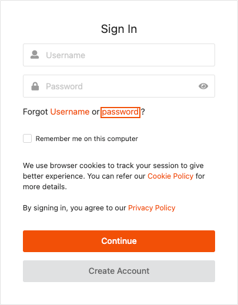

3.	Enter the user name of the newly created user and if multiple recovery options are displayed, select the **Recover with Security Questions** option.

    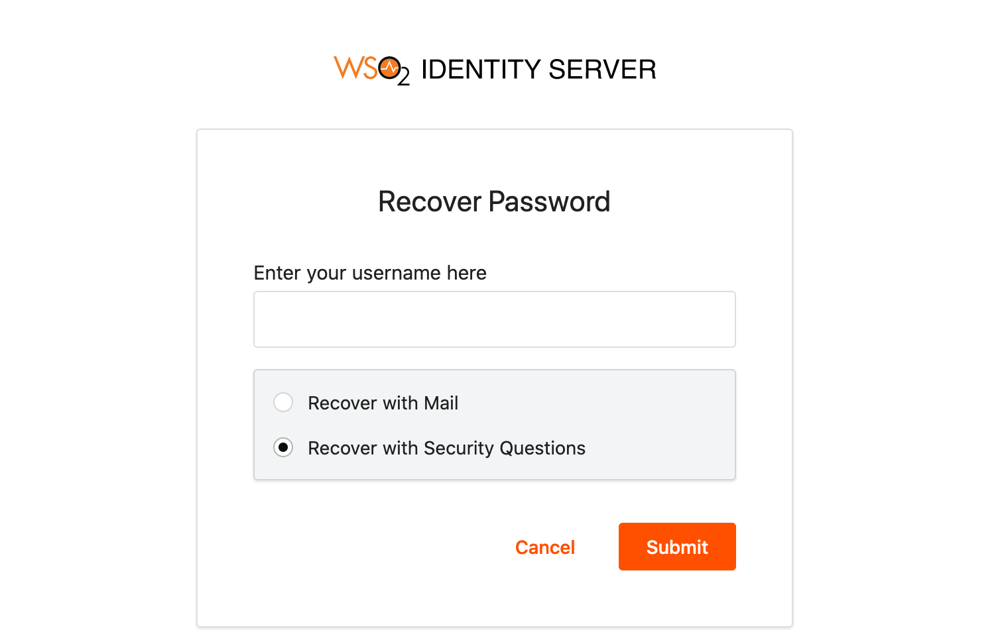
    
4.	Click **Submit**. 

5.	Enter the first challenge question answer as `Tommy` and click **Submit**.

    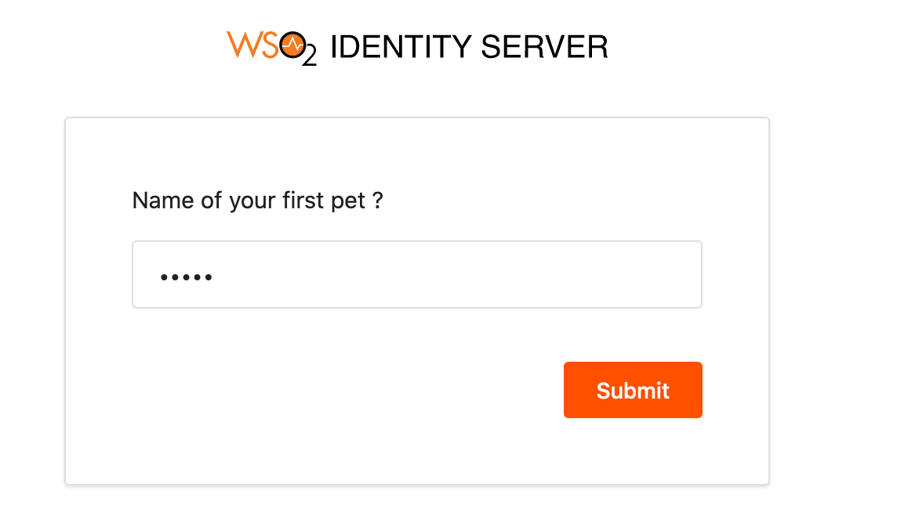

6.	Enter the second challenge question answer as `Pizza` and click **Submit**.

	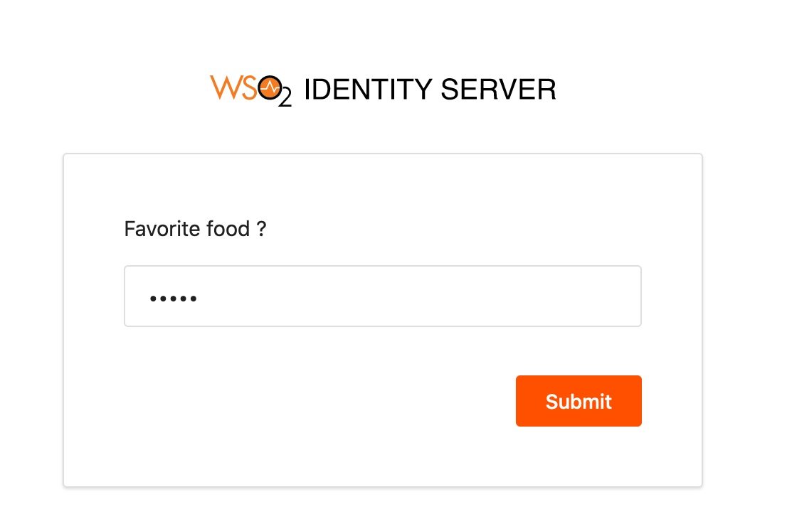  

7.	Enter the new password and click **Proceed**.

    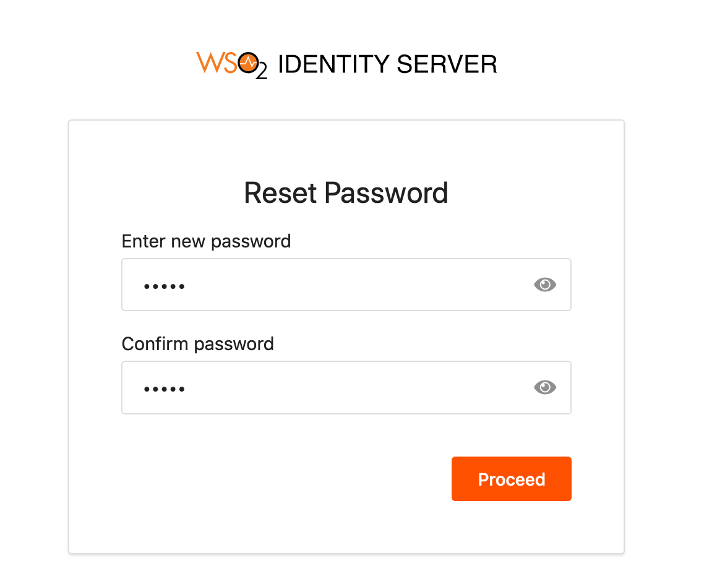 

8.	Enter the username and new password and click **Sign In**. The My Account home screen appears. 

---

### Recover password using the REST API

You can use the following CURL command to recover a password using REST API. 

#### Get challenge question of user

This API is used to initiate password recovery using user challenge questions, one at a time. Response will be a random challenge question with a confirmation key.

:::note

**Request**
```curl
curl -X GET -H "Authorization: Basic YWRtaW46YWRtaW4=" -H "Content-Type: application/json"  "https://localhost:9443/api/identity/recovery/v0.9/security-question?username=[USERNAME]"
```
---
**Sample Request**
```curl
curl -X GET -H "Authorization: Basic YWRtaW46YWRtaW4=" -H "Content-Type: application/json"  "https://localhost:9443/api/identity/recovery/v0.9/security-question?username=kim"
```
---
**Sample Response**
```
{
    "key":"7ced9ef0-7f3f-4f65-a115-ddbcce3a6b49",
    "question":{
        "question":"Place of birth ?",
        "question-set-id":"http://wso2.org/claims/challengeQuestion1"
    }
}
```

:::

#### Validate user challenge answer/answers

:::note

**Request**
```curl
curl -k -X POST -H "Authorization: Basic YWRtaW46YWRtaW4=" -H "Content-Type: application/json" -d '{"key": "[VALIDATION KEY]","answers": [{ "question-set-id": "http://wso2.org/claims/challengeQuestion1","answer": "[ANSWER]"},{"question-set-id": "http://wso2.org/claims/challengeQuestion2","[ANSWER2]": "car"}],"properties": []}' "https://localhost:9443/api/identity/recovery/v0.9/validate-answer"
```
---
**Sample Request**
```curl
curl -k -X POST -H "Authorization: Basic YWRtaW46YWRtaW4=" -H "Content-Type: application/json" -d '{"key": "0b20bd4d-cd82-4e8f-8ca4-4d265360b56b","answers": [{ "question-set-id": "http://wso2.org/claims/challengeQuestion1","answer": "Sri Lanka"},{"question-set-id": "http://wso2.org/claims/challengeQuestion2","answer": "BMW"}],"properties": []}' "https://localhost:9443/api/identity/recovery/v0.9/validate-answer"
```
---
**Sample Response**
```
{
    "key":"c45d7251-59f1-468d-9844-8a6d7c5fe9d9",
    "question":null,
    "link":{"rel":"set-password","uri":"/api/identity/recovery/v0.9"}
}              
```

:::

#### Get challenge questions of user

This API is used to initiate password recovery by answering all the challenge questions at once. The response will have random challenge questions from the ones configured and a confirmation key.

:::note

**Request**
```curl
curl -X GET -H "Authorization: Basic YWRtaW46YWRtaW4=" -H "Content-Type: application/json"  "https://localhost:9443/api/identity/recovery/v0.9/security-questions?username=[USERNAME]"
```
---
**Sample Request**
```curl
curl -X GET -H "Authorization: Basic YWRtaW46YWRtaW4=" -H "Content-Type: application/json"  "https://localhost:9443/api/identity/recovery/v0.9/security-questions?username=kim"
```
---
**Sample Response**
```
{
    "key":"f9f04fd7-3666-4bc6-bc99-9190b04b0ccc",
    "questions":[
        {"question":"Place of birth?","question-set-id":"http://wso2.org/claims/challengeQuestion1"},
        {"question":"Model of your first car?","question-set-id":"http://wso2.org/claims/challengeQuestion2"}
    ],
    "link":{"rel":"validate-answer","uri":"/api/identity/recovery/v0.9"}
}
```

:::

#### Update password

This API is used to reset user password using the confirmation key received through the recovery process. Input the key and the new password.

:::note

**Request**
```curl
curl -X POST -H "Authorization: Basic YWRtaW46YWRtaW4=" -H "Content-Type: application/json" -d '{"key": "[CONFIRMATION KEY]", "password": "[NEW PASSWORD]","properties": []}' "https://localhost:9443/api/identity/recovery/v0.9/set-password"
```
---
**Sample Request**
```curl
curl -X POST -H "Authorization: Basic YWRtaW46YWRtaW4=" -H "Content-Type: application/json" -d '{"key": "5c765a47-6764-4048-b5cf-55864cb654c0", "password": "Password1!","properties": []}' "https://localhost:9443/api/identity/recovery/v0.9/set-password"
```
---
**Sample Response**
```curl
"HTTP/1.1 200 OK"        
```

:::


#### Manage challenge questions using REST APIs

There are a number of operations related to challenge questions that you can perform using REST APIs. To manage the challenge questions and answers of a user using REST APIs, see [Manage Challenge Questions](../../apis/challenge-rest-api.md).

---

:::info[Related topics]

- [Guide: Recover Password via Email](recover-password.md)
- [API: Challenge Questions](../../apis/challenge-rest-api.md)

:::
