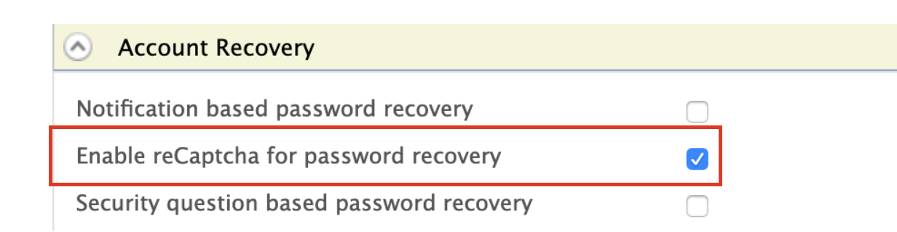
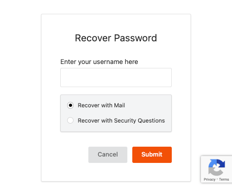

# Configure reCAPTCHA for Password Recovery

The password account recovery feature implemented in the WSO2 Identity Server helps to recover the password of the account in case the user forgets it. This recovery process can also be secured with captcha verification.

By configuring reCAPTCHA, you can mitigate or block brute force attacks.

:::info

For more information on setting up password recovery, see [Password Recovery Using Email Verification](recover-password.mdx) and [Password Recovery Using Challenge Question](challenge-question.mdx).

For more information on brute force attacks, see [Mitigating Brute Force Attacks](../../deploy/mitigate-attacks/mitigate-brute-force-attacks.mdx).

:::

You can either configure the reCAPTCHA for a tenant or configure it globally. 

<Prerequisites>

## Prerequisites

[Setting Up reCAPTCHA](/identity/6.0.0/deploy/configure-recaptcha.md) with WSO2 Identity Server.

</Prerequisites>

## Enable password recovery with reCAPTCHA for a specific tenant

Follow the instructions given below to configure password recovery with reCAPTCHA for a specific tenant.

1. Start WSO2 Identity Server and log in to the management console as tenant admin.

2. On the **Main** tab, click **Identity Provider** > **Resident Identity Provider**.
    
3.  Expand the **Account Management** tab, then click on
    **Account Recovery.**

4.  Select **Enable reCaptcha for password recovery**.

     

5.  You have now successfully configured reCAPTCHA for the password
    recovery flow. 


## Enable password recovery with reCAPTCHA globally

Alternatively, follow the instructions given below to configure password recovery with reCAPTCHA globally.  

1.  Add the following properties to the `deployment.toml` file in the `<IS_HOME>/repository/conf` folder to enable password recovery with reCAPTCHA.

    :::tip


    To avoid any configuration issues, perform **step-1** before starting the WSO2 Identity Server product instance.

    :::
    
    ```toml
    [identity_mgt.password_reset_email] 
    enable_recaptcha=true
    ```

2.  You have now successfully configured reCAPTCHA for the password recovery flow.

## Try it

Start WSO2 Identity Server and log in to the My Account (`https://<HOST>:<PORT>/myaccount`) application.

:::tip

If you have changed the port offset or modified the hostname, change the port or hostname accordingly.

:::

Click **Password**.
    


You are redirected to the **Recover Password** page where the reCAPTCHA is displayed.



---

:::info[Related topics]

- [Guide: Recover password via Email](recover-password.mdx)
- [Guide: Recover password via Challenge Questions](challenge-question.mdx)

:::
