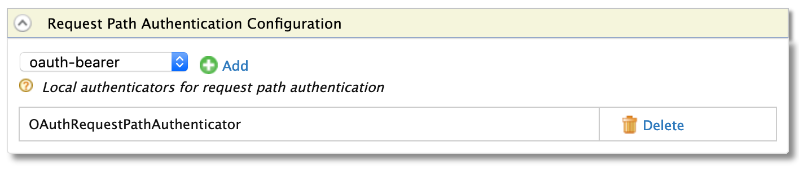

1. Expand the **Local & Outbound Authentication Configuration** section and then further expand the **Request Path Authentication Configuration** subsection.

2. Select **OAuth Bearer** from the dropdown list and click **Add**.

    

3. Click **Update** to save changes to the service provider.
