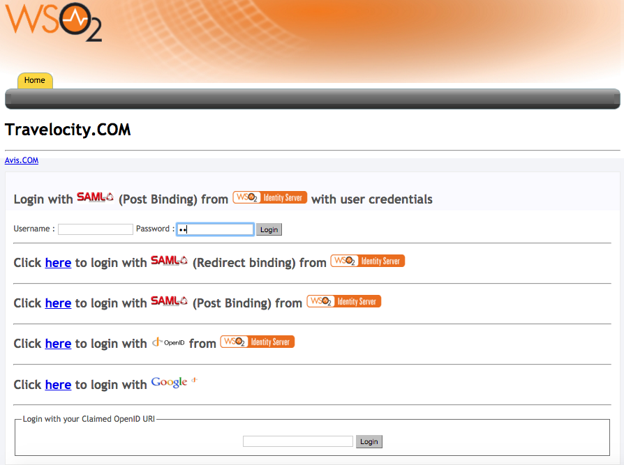
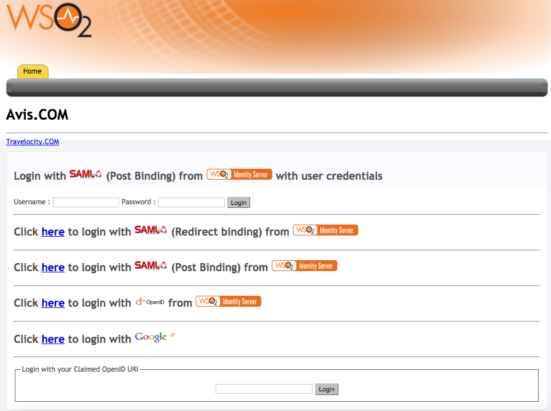
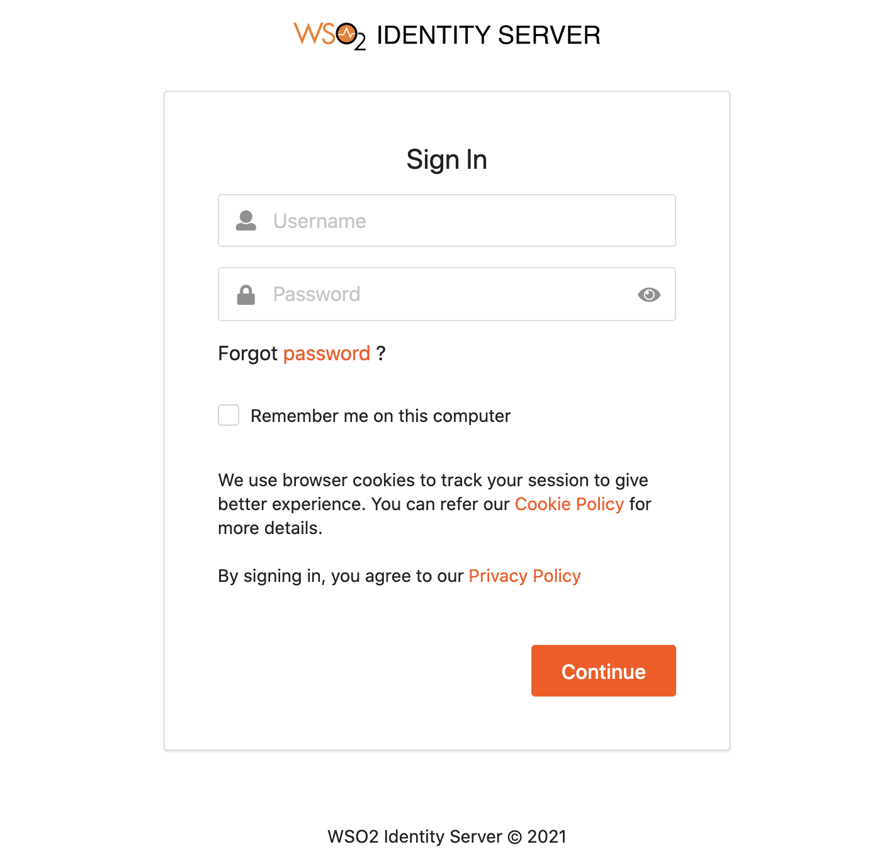
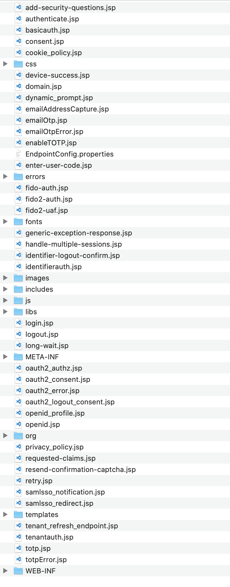
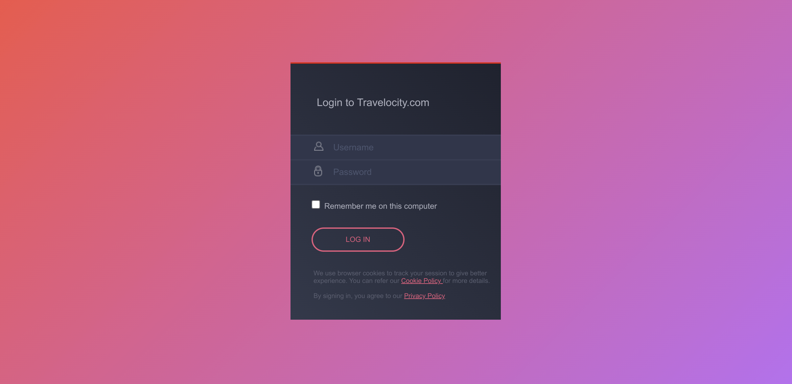

# Re-brand the Default Login Page for Your Application

WSO2 Identity Server usually displays a default login page for all service provider applications that send authentication requests to it. WSO2 IS supports re-branding the login page according to your requirements for SAML2 SSO, OAuth, or OpenID Connect applications.

The login pages and other pages, such as error and notification screens of SAML SSO, OAuth, OpenID Connect, and Passive STS are located in the **authenticationendpoint** webapp file, which is found in the `<IS_HOME>/repository/deployment/server/webapps` directory.

You can easily re-brand these pages within this web application by updating the respective JSPs, JavaScript and CSS. If you want to point to a different web application, you can do so by redirecting or forwarding from **authenticationendpoint** to your webapp. In the case of SAML SSO, the `issuer id` of the service provider is also sent to this webapp.
Therefore, different login pages can be given to different service providers by looking at the ' **issuer** ' request parameter.

This page guides you through re-branding the login page for a sample SAML2 SSO web application.

---

First, register two service providers in WSO2 Identity Server.

## Configure travelocity application


<Prerequisites>

### Prerequisites

- Download [Apache Tomcat 8.x](https://tomcat.apache.org/download-80.cgi) and install it. Tomcat server installation location will later be referred to as `<TOMCAT_HOME>` in this guide.

- It is recommended that you use a hostname that is not `localhost` to avoid browser errors. Modify your machine's `/etc/hosts` entry to reflect this.

    :::info

    Note that `wso2is.local` is used in this documentation as an example, but you must modify this when configuring the authenticators or connectors with this sample application.

    :::


- Download the [Travelocity application](https://github.com/wso2/samples-is/releases/download/v4.5.2/travelocity.com.war) from the latest release assets.

</Prerequisites>

---

### Register a service provider

1. On the Management Console, go to **Main** > **Identity** > **Service Providers** and click **Add**.

3. Enter `travelocity.com` as the **Service Provider Name**, and click **Register**.

4. Expand the **Inbound Authentication Configuration > SAML2 Web SSO Configuration** section and, click **Configure**.

5. Enter the following values in the fields mentioned.

    | Field name | Value |
    |-----------|-------|
    | **Issuer** | `travelocity.com`  |
    | **Assertion Consumer URL**    | `http://wso2is.local:8080/travelocity.com/home.jsp`    |

    :::info

    Click **Yes** on the dialog that appears after you add the **Assertion Consumer URL**. This dialog appears when you add an `http` URL.

    :::

6. Enable the following by selecting the corresponding checkboxes:
    - **Enable Response Signing**
    - **Enable Signature Validation in Authentication Requests and Logout Requests**
    - **Enable Single Logout**
    - **Enable Attribute Profile**
        - **Include Attributes in the Response Always**  

    :::tip

    For more information on the advanced configurations, see [Advanced SAML Configurations](../../../../guides/login/saml-app-config-advanced).

    :::

7. Click **Register** to add the service provider and save the configurations.  

---
### CORS configuration

SAML2 POST Binding requires CORS configurations to be set up.

Before configuring the service provider, add the following configurations to the `deployment.toml` file found in `<IS_HOME>/repository/conf/`. Adding this configuration allows `HTTP POST` requests.


    ```toml
    [cors]
    allow_generic_http_requests = true
    allow_any_origin = false
    allowed_origins = [
        "http://localhost:8080"
    ]
    allow_subdomains = false
    supported_methods = [
        "GET",
        "POST",
        "HEAD",
        "OPTIONS"
    ]
    support_any_header = true
    supported_headers = []
    exposed_headers = []
    supports_credentials = true
    max_age = 3600
    tag_requests = false
    ```


---

### Deploy the sample web app

To deploy the sample web app on a web container:

1. Copy the downloaded `.war` file of the SAML application into the `webapps` directory of the Tomcat folder.

2. Open a terminal and add the following entry to the `/etc/hosts` file of your machine to configure the hostname.

    ```bash
    127.0.0.1   wso2is.local
    127.0.0.1   localhost.com
    ```

    !!!info "Why is this step needed?"
		Some browsers do not allow you to create cookies for a naked hostname, such as `localhost`. Cookies are required when working with SSO . Therefore, to ensure that the SSO capabilities work as expected in this tutorial, you need to configure the `etc/host` file as explained in this step.

		The `etc/host` file is a read-only file. Therefore, you won't be able to edit it by opening the file via a text editor. Instead, edit the file using the terminal commands. For example, use the following command if you are working on a macOS/Linux environment.

		```java
		sudo nano /etc/hosts
		```

3. Open the `travelocity.properties` file in the `<TOMCAT_HOME>/webapps/travelocity.com/WEB-INF/classes ` directory and configure the following property with the hostname that you configured above.

    ```text
    #The URL of the SAML 2.0 Assertion Consumer
    SAML2.AssertionConsumerURL=http://<HOSTNAME>:8080/travelocity.com/home.jsp
    ```

4. Restart the Tomcat server.

To check the sample application, navigate to `http://<TOMCAT_HOST>:<TOMCAT_PORT>/travelocity.com/index.jsp` on your browser.

:::tip

If you wish to change properties like the `issuer ID`, `consumerURL`, and `IdP URL`, you can edit the **travelocity.properties** file in the `travelocity.com/WEB-INF/classes` directory.
Also if the service provider is configured in a tenant you can use `QueryParams` property to send the tenant domain. For example,`QueryParams=tenantDomain=wso2.com`.

This sample uses the following default values.

| Properties | Description  |
|------------|--------------|
| `SAML2.SPEntityId=travelocity.com`    | A unique identifier for this SAML 2.0 Service Provider application. |
| `SAML2.AssertionConsumerURL=http://wso2is.local:8080/travelocity.com/home.jsp`   | The URL of the SAML 2.0 Assertion Consumer.   |
| `SAML2.IdPURL=https://localhost:9443/samlsso` | The URL of the SAML 2.0 Identity Provider.    |
| `SAML2.IsPassiveAuthn=true`   | Set this to send SAML2 passive authentication requests.   |

For the changes to be effective, restart the Apache Tomcat server after updating the `travelocity.properties` file.

:::


## Configure avis application

1. Copy the downloaded `travelocity.com.war` file and rename it to `avis.com.war`.

2. Add it to `<TOMCAT_HOME>/webapps/` folder and restart the Tomcat server.

3. Open the `<TOMCAT_HOME>/webapps/avis.com/avis.properties` file and update the following configurations.
    ```
    #The URL of the SAML 2.0 Assertion Consumer
    SAML2.AssertionConsumerURL=http://wso2.is:8080/avis.com/home.jsp
        
    #openid.return_to parameter
    OpenId.ReturnToURL=http://wso2.is:8080/avis.com/home.jsp
    ```

4. Restart the Tomcat server to apply the configuration changes.

5. Register a new service provider with the name `avis.com` similarly by following the steps given in [configure travelocity application](#register-a-service-provider) by replacing `travelocity.com` references to `avis.com`.

Start the application server and access the following URLs to make sure both apps are running.

- **travelocity.com**

    URL:
    [http://wso2is.local:8080/travelocity.com/index.jsp](http://localhost:8080/travelocity.com/index.jsp)

    

- **avis.com**

    URL:
    [http://wso2is.local:8080/avis.com/index.jsp](http://localhost:8080/avis.com/index.jsp)

     

When attempting to log in with SAML from WSO2 Identity Server in **Travelocity.com** and **Avis.com** applications, you can see the following default page located at `<IS_HOME>/repository/deployment/server/webapps/authenticationendpoint/login.jsp`.
  


---

## Configure the login page

### authenticationendpoint web application

The login page that is displayed during SAML2 SSO, OAuth, OpenID Connect and Passive-STS flows is located inside the webapp named **authenticationendpoint**. The reason for storing this in a web app is:

- To easily customize the page according to user requirements.
- To place the whole web application in an external application server, if needed.

WSO2 Identity Server is aware of the location of this web application as it is specified with the configurations in the `<IS_HOME>/repository/conf/deployment.toml` file. The configurations are as follows:

```
[authentication.endpoints] 
login_url="/authenticationendpoint/login.do"
retry_url="/authenticationendpoint/retry.do" 
```

By default, the configuration points to a location inside WSO2 Identity Server itself, which is reprensted by the relative path. If it is necessary to point to an external application, the full path should be given instead.

:::note

If this web app is moved outside the Identity Server, ensure that no one can access the login credentials that are passed between this application and the Identity Server. This means that the external location should ideally be either inside a secured intranet or the transport should be HTTPS. Other similar precautions may be necessary to secure the communication.

:::

The structure of this web app is as follows:



The **authenticationendpoint** web application uses a carbon component called `org.wso2.carbon.identity.application.authentication.endpoint.util`. This bundle includes a filter called the `org.wso2.carbon.identity.application.authentication.endpoint.util.filter`. `AuthenticationEndpointFilter` acts as the Front Controller.

When a request is made to the **authenticationendpoint** web application, based on the authentication protocol type identified by the request parameter ‘type’, the controller first forwards the request to the protocol based login url patterns defined.
For example, if the request to the **authenticationendpoint** web application is initiated as a result of a SAML SSO authentication request, the controller will forward the request to the url pattern `/samlsso_login.do` . In **web.xml**, this URL is mapped to the **login.jsp** file. The request is finally forwarded to this **login.jsp** page.

Everything on the **authenticationendpoint** web application can be modified according to your requirements. You can either add JSP pages or modify them and configure the **web.xml** respectively.

The only restriction involved is that the content already sent back by the pages inside the default web app must be submitted to the Identity Server. Additionally, you must point to the correct location via the `<IS_HOME>/repository/conf/identity/application-authentication.xml` file.

---

## Re-brand the login page

When a request comes to the default login page, you will see several parameters being passed in the address bar. For this example, the focus is on the following two parameters:

- **sessionDataKey** : This is an identifier used by the Identity Server to maintain state information related to this particular request by the service provider.

    :::note

    The 'sessionDataKey' query parameter is used to coordinate the request state across components participating in the request flow. It does not correlate with the user session. Furthermore, the request state maintained against the 'sessionDataKey' parameter value is cleared by each participating component at the end of request flow. This means that even if an external party grabs the 'sessionDataKey' they will not be able to get into the authentication sequence, as the user session is not associated with that key.

    :::

 -   **relyingParty** : This is the value we gave for the "Issuer" field when we registered the SAML2 SSO service provider (e.g.,travelocity.com). This value is used to display different login pages to different service providers.

When modifying the pages, ensure that the following is applied.

1. Form submissions should happen to the "commonauth" servlet as a POST.

    ```xml
    <form id="form" name="form" action="/identity/6.0.0/commonauth" method="POST"> 
    ```

2. Make sure to send back the "sessionDataKey" with the form submission, by using a hidden input field.

    ```xml
    <%@ page import="org.owasp.encoder.Encode" %>

    <input type="hidden" name="sessionDataKey" value="<%=Encode.forHtmlAttribute(request.getParameter("sessionDataKey"))%>"/>
    ```

#### **Use a JSP to redirect to SP relevant pages**

1. Rename the existing `login.jsp` as `default\_login.jsp`
2. Create a new file named `login.jsp` and add the following code:

    ```java
    <%  
    String relyingParty = request.getParameter("relyingParty");

    if (relyingParty.equals("travelocity.com")) {
        RequestDispatcher dispatcher = request.getRequestDispatcher("travelocity_login.jsp");
        dispatcher.forward(request, response);
    } else {
        RequestDispatcher dispatcher = request.getRequestDispatcher("default_login.jsp");
        dispatcher.forward(request, response);
    } 
    %>
    ```

    This code forwards the request to a different login page by checking the value of `relyingParty` parameter.

3. Get the [`travelocity\_login.jsp`](https://github.com/wso2/samples-is/blob/master/re-branding-the-default-login-page/authenticationendpoint/travelocity_login.jsp) file and add it parallel to `login.jsp`. 

4. Download the contents of the `css` and `images` folders from this [link](https://github.com/wso2/samples-is/tree/master/re-branding-the-default-login-page/authenticationendpoint) and add them inside the respective folders in the `authenticationendpoint`.

5. Log in to the travelocity.com web app again. You are presented with the re-branded page.


