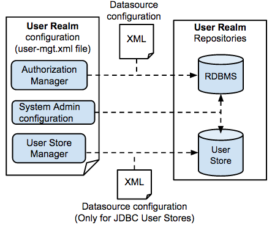

# Configure the Realm

The user management functionality is provided by default in WSO2 Identity Server and is configured in the
`         deployment.toml        ` file found in the
`         <IS_HOME>/repository/conf/        ` directory. 

The complete functionality and contents of the User Management module is
called a **user realm**. The realm includes the user management
classes, configurations and repositories that store information.
Therefore, configuring the User Management functionality in WSO2 Identity Server involves setting up the relevant repositories and updating the
relevant configuration files.

The following diagram illustrates the required configurations and
repositories. 

