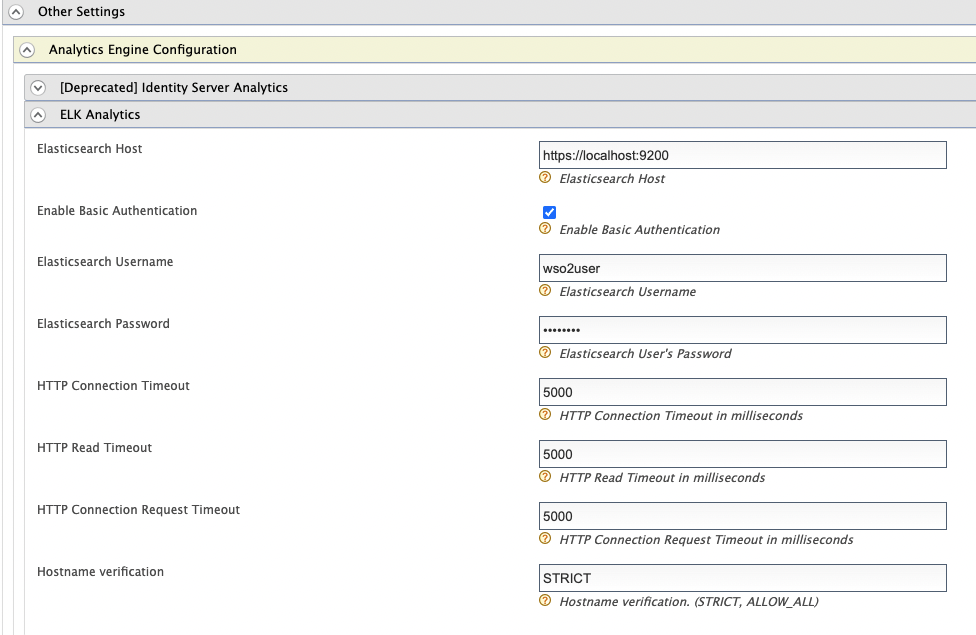

# Configure ELK Analytics for Adaptive Authentication

The following guide shows you how to prepare the WSO2 Identity server for adaptive authentication using ELK analytics.

## Prerequisite

[Configure ELK Analytics](./elk-analytics-installation-guide.md) in WSO2 Identity Server.

## Configure the analytics engine in WSO2 IS

Follow the steps below to configure the analytics engine in WSO2 Identity Server that establishes the connection between WSO2 Identity Server and ELK.

1. Access the WSO2 Identity Server Management Console and sign in as an admin user.
2. Under **Identity Providers** click **Resident**.
3. Expand **Other Settings** > **Analytics Engine Configuration** > **ELK Analytics**.
4. Configure the following properties.
   
   <table>
   <thead>
   <tr className="header">
   <th>Property</th>
   <th>Description</th>
   </tr>
   </thead>
   <tbody>
   <tr className="odd">
   <td>Elasticsearch Host</td>
   <td>The target hostname and target port for the Elasticsearch.</td>
   </tr>
   <tr className="even">
   <td>Enable Basic Authentication</td>
   <td>Select to enable authentication with username and password credentials.</td>
   </tr>
   <tr className="odd">
   <td>Elasticsearch Username</td>
   <td>The username of the Elasticsearch admin user.</td>
   </tr>
   <tr className="even">
   <td>Elasticsearch Password</td>
   <td>The password of the Elasticsearch admin user.</td>
   </tr>
   <tr className="odd">
   <td>HTTP Connection Timeout</td>
   <td>The connection timeout interval in milliseconds. If the endpoint does not respond within this time, the connection attempt has failed.</td>
   </tr>
   <tr className="even">
   <td>HTTP Read Timeout</td>
   <td>The timeout interval in milliseconds for each call of <code>               read()              </code> on the <code>               InputStream              </code> . If the server does not respond with data within this time, the connection is terminated.</td>
   </tr>
   <tr className="odd">
   <td>HTTP Connection Request Timeout</td>
   <td>The timeout interval in milliseconds for requesting a connection with Elasticsearch.</td>
   </tr>
   <tr className="even">
   <td>Hostname Verification</td>
   <td>Possible values are: STRICT or ALLOW_ALL.<br />
   <strong>STRICT</strong> - When this mode is enabled, hostnames will be strictly verified against the hostname specified in the product's SSL certificate. For example, if "*. <a href="http://foo.com/">foo.com</a> " is specified as the hostname in the certificate, only this specific hostname is authorized by the server. That is, subdomains such as " <a href="http://a.b.foo.com/">a.b.foo.com</a> " or ip addresses such as "127.10.11.1" will <strong>not</strong> be authorized. <br /><strong>ALLOW_ALL</strong> - This option turns off hostname verification for the server. Note that this is not recommended in a production setup and should only be used for demonstrations and testing.</td>
   </tr>
   </tbody>
   </table>
5. Click **Update**

## Add Elasticsearch certificate to WSO2 Identity Server

 An HTTP connection is used to communicate between WSO2 IS and Elasticsearch. Therefore the Elasticsearch certificate needs to be imported to the WSO2 IS.

To import the certificate, open a terminal window and run the following command.

 ```bash
   keytool -trustcacerts -keystore <IS_HOME>/repository/resources/security/client-truststore.jks -storepass wso2carbon -importcert -alias elk -file <ELASTICSEARCH_HOME>/config/certs/http_ca.crt
 ```

:::info

  This example uses the default keystores and certificates. Replace &lt;IS_HOME> and &lt;ELASTICSEARCH_HOME> accordingly. The default keystore password is `wso2carbon`.

:::

## What's Next?

Now that you have prepared WSO2 Identity server for adaptive authentication using ELK analytics, [try a scenario](../guides/elk-analytics/elk-configuring-risk-based-adaptive-authentication.md).
