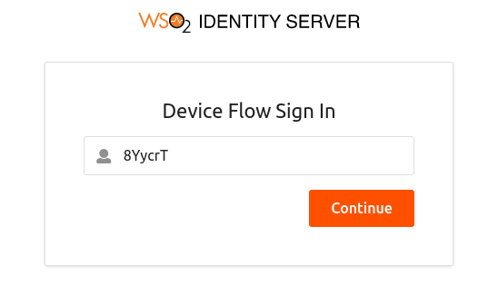
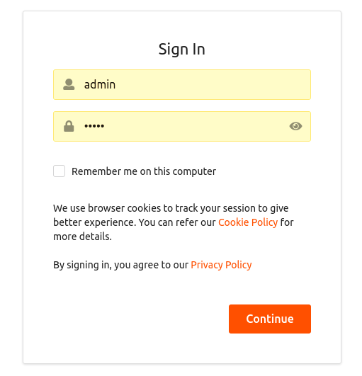
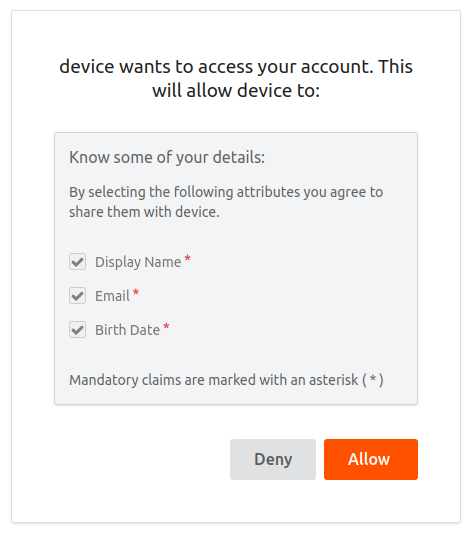

# Try Device Authorization Grant

The Device Authorization Grant is a grant type in the OAuth 2.0
specification.

:::info

For more information, see [Device Authorization Grant](../../references/concepts/authorization/device-flow-grant.mdx).

:::
    
Follow the topics given below to try out the Device Authorization grant type.

## (Optional) Configure WSO2 Identity Server

:::info

This change is optional unless you want to change the default values of the properties mentioned below.

:::

Open the `deployment.toml` file (stored in the `<IS_HOME>/repository/conf` folder), add the following configuration, and change the values of the properties below:

```toml
[oauth.grant_type.device_code]
key_length = 7
expiry_time = "10m"
polling_interval = "5s"
key_set = "BCDFGHJKLMNPQRSTVWXYZbcdfghjklmnpqrstvwxyz23456789"
```

The parameters in this configuration are explained below.

<table>
    <thead>
        <tr className="header">
            <th>
                Name
            </th>
            <th>
                Description
            </th>
            <th>
                Parameter
            </th>
        </tr>
    </thead>
    <tbody>
        <tr className="even">
            <td>
                <p>Key length</p>
            </td>
            <td>
                <p>The length of the user code.</p>
            </td>
            <td>
                key_length
            </td>
        </tr>
        <tr className="odd">
            <td>
                <p>Expiry time</p>
            </td>
            <td>
                <p>The expiry time of the user code and the device code.</p>
            </td>
            <td>
                expiry_time
            </td>
        </tr>
        <tr className="even">
            <td>
                <p>Polling interval</p>
            </td>
            <td>
                <p>The minimum delay of the client between each polling request to the
                 token endpoint.</p>
            </td>
            <td>
                polling_interval
            </td>
        </tr>
        <tr className="odd">
            <td>
                <p>Key set</p>
            </td>
            <td>
                <p>The set of characters that is used to generate the user code.</p>
            </td>
            <td>
                key_set
            </td>
        </tr>
    </tbody>
</table>

## Enable the Device Authorization grant

Follow the steps given below to enable the Device Authorization grant for your application (service provider).

1. Sign in to the Management Console.

2. Go to **Main** > **Identity** > **Service Providers** and click **Add**.

    

3. Give a name for your service provider and click **Register**.
    
    

4. On the screen that follows, expand **Inbound Authentication Configuration**  > **OAuth/OpenID Connect Configuration** and click **Configure**.

    

5. Select `urn:ietf:params:oauth:grant-type:device_code` to enable the device flow grant type. 

    :::info

    Since these are public clients, ensure that **Allow authentication without the client secret** is checked.

    :::

6. Click **Add** to save the service provider configurations. 

    :::info

    Note of the generated OAuth client key and client secret. When configuring your device, use the client ID as your OAuth client-key.

    :::


## Try it out

Let's try out the device flow.

1. Open a terminal and run the following command to send a request to the `device_authorize` endpoint.

    :::info

    The client (the device) initiates this request to the authorization server. In the response, the client receives a **device code**, a **user code**, and a **verification URI**. The client starts polling the **/token** endpoint of the authorization server using the **device_code** at an interval as specified in the response.

    :::

    <table>
    <tbody>
    <tr className="odd">
    <td>Request</td>
    <td>
    <div className="code panel pdl">
    <div className="codeHeader panelHeader pdl">
    <strong>Request</strong>
    </div>
    <div className="codeContent panelContent pdl">
    <div className="sourceCode" id="cb1" data-syntaxhighlighter-params="brush: bash; gutter: false; theme: Confluence" data-theme="Confluence"><pre className="sourceCode bash"><code className="sourceCode bash"><a className="sourceLine" id="cb1-1" title="1"><span className="ex">curl</span> -k -X POST -H <span className="st">&#39;Content-Type: application/x-www-form-urlencoded&#39;</span> --data-urlencode <span className="st">'client_id=<span className="op">&lt;</span>CLIENT_ID<span className="op">&gt;</span>'</span> https://localhost:9443/oauth2/device_authorize</a></code></pre></div>
    </div>
    </div>
    <div className="code panel pdl">
    <div className="codeHeader panelHeader pdl">
    <strong>Sample cURL</strong>
    </div>
    <div className="codeContent panelContent pdl">
    <div className="sourceCode" id="cb1" data-syntaxhighlighter-params="brush: bash; gutter: false; theme: Confluence" data-theme="Confluence"><pre className="sourceCode bash"><code className="sourceCode bash"><a className="sourceLine" id="cb1-1" title="1"><span className="ex">curl</span> -k -X POST -H <span className="st">&#39;Content-Type: application/x-www-form-urlencoded&#39;</span> --data-urlencode <span className="st">'client_id=bbwJEayR_OMwPkAgm9VOMzLnYLga'</span> https://localhost:9443/oauth2/device_authorize</a></code></pre></div>
    </div>
    </div></td>
    </tr>
    <tr className="even">
    <td>Response</td>
    <td><div className="code panel pdl">
    <div className="codeContent panelContent pdl">
    <div className="sourceCode" id="cb3" data-syntaxhighlighter-params="brush: java; gutter: false; theme: Confluence" data-theme="Confluence"><pre className="sourceCode java"><code className="sourceCode java"><a className="sourceLine" id="cb3-1" title="1">\{"user_code":"s2DqSNK","device_code":"d3fe0db1-2334-48fa-b7d9-821ecfad10d5","interval":5000,"verification_uri_complete":"https://localhost:9443/authenticationendpoint/device.do?user_code=s2DqSNK","verification_uri":"https://localhost:9443/authenticationendpoint/device.do","expires_in":3600\}</a></code></pre></div>
    </div>
    </div></td>
    </tr>
    </tbody>
    </table>

2. From a device with no input constraints, access the <code>verification_uri</code> and enter the user code. 

    :::info

    You can alternatively access the <code>verification_uri_complete</code> link obtained in the response.

    :::

    

3. Click **Continue** to proceed. 

    :::info

    -   If the user code is correct, you are prompted to enter your credentials.
    -   Note that the user code is for one-time use only. If your code is expired or if you have entered a wrong user code, get a new user code by following the previous steps.

    :::
 
    

4. Once you log in successfully, you are redirected to the configured callback URL of the service provider.

    

    The client, who has been polling the **/token** endpoint, receives the access token and the refresh token.

5.  Open a terminal window and send the following token request to the authorization server.
    
    <table>
    <tbody>
    <tr className="odd">
    <td>Request</td>
    <td>
    <div className="code panel pdl">
    <div className="codeHeader panelHeader pdl">
    <strong>Request</strong>
    </div>
    <div className="codeContent panelContent pdl">
    <div className="sourceCode" id="cb1" data-syntaxhighlighter-params="brush: bash; gutter: false; theme: Confluence" data-theme="Confluence"><pre className="sourceCode bash"><code className="sourceCode bash"><a className="sourceLine" id="cb1-1" title="1"><span className="ex">curl</span> -k -X POST -H <span className="st">&#39;Content-Type: application/x-www-form-urlencoded&#39;</span> --data-urlencode <span className="st">'grant_type=urn:ietf:params:oauth:grant-type:device_code'</span> --data-urlencode <span className="st">'client_id=<span className="op">&lt;</span>CLIENT_ID<span className="op">&gt;</span>'</span> --data-urlencode <span className="st">'device_code=<span className="op">&lt;</span>DEVICE_CODE<span className="op">&gt;</span>'</span> https://localhost:9443/oauth2/token</a></code></pre></div>
    </div>
    </div>
    <div className="code panel pdl">
    <div className="codeHeader panelHeader pdl">
    <strong>Sample cURL</strong>
    </div>
    <div className="codeContent panelContent pdl">
    <div className="sourceCode" id="cb1" data-syntaxhighlighter-params="brush: bash; gutter: false; theme: Confluence" data-theme="Confluence"><pre className="sourceCode bash"><code className="sourceCode bash"><a className="sourceLine" id="cb1-1" title="1"><span className="ex">curl</span> -k -X POST -H <span className="st">&#39;Content-Type: application/x-www-form-urlencoded&#39;</span> --data-urlencode <span className="st">'grant_type=urn:ietf:params:oauth:grant-type:device_code'</span> --data-urlencode <span className="st">'client_id=bbwJEayR_OMwPkAgm9VOMzLnYLga'</span> --data-urlencode <span className="st">'device_code=7411f395-2f3a-4cb5-8562-d7059d69c66f'</span> https://localhost:9443/oauth2/token</a></code></pre></div>
    </div>
    </div></td>
    </tr>
    <tr className="even">
    <td>Response</td>
    <td><div className="code panel pdl">
    <div className="codeContent panelContent pdl">
    <div className="sourceCode" id="cb3" data-syntaxhighlighter-params="brush: java; gutter: false; theme: Confluence" data-theme="Confluence"><pre className="sourceCode java"><code className="sourceCode java"><a className="sourceLine" id="cb3-1" title="1">\{"access_token":"74d610ab-7f4a-3b11-90e8-279d76644fc7","refresh_token":"fdb58069-ecc7-3803-9b8b-6f2ed85eff19","token_type":"Bearer","expires_in":3042\}</a></code></pre></div>
    </div>
    </div></td>
    </tr>
    </tbody>
    </table>

6. To validate the token that you received, [use the introspection endpoint](invoke-oauth-introspection-endpoint.mdx).
