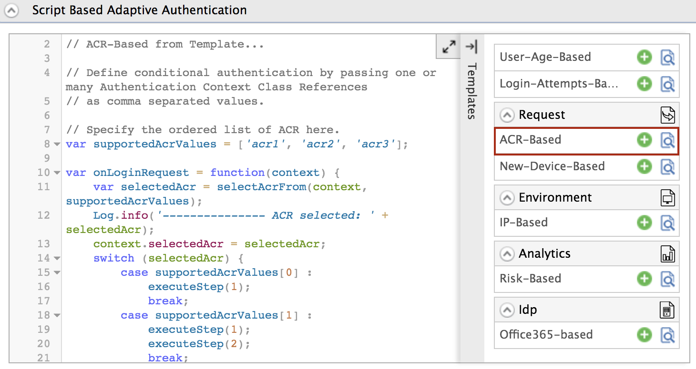
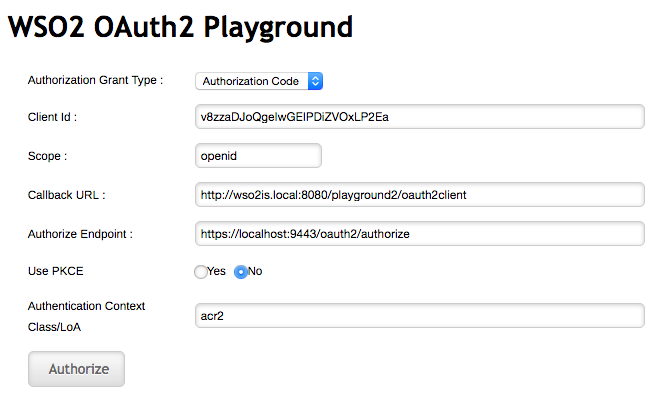
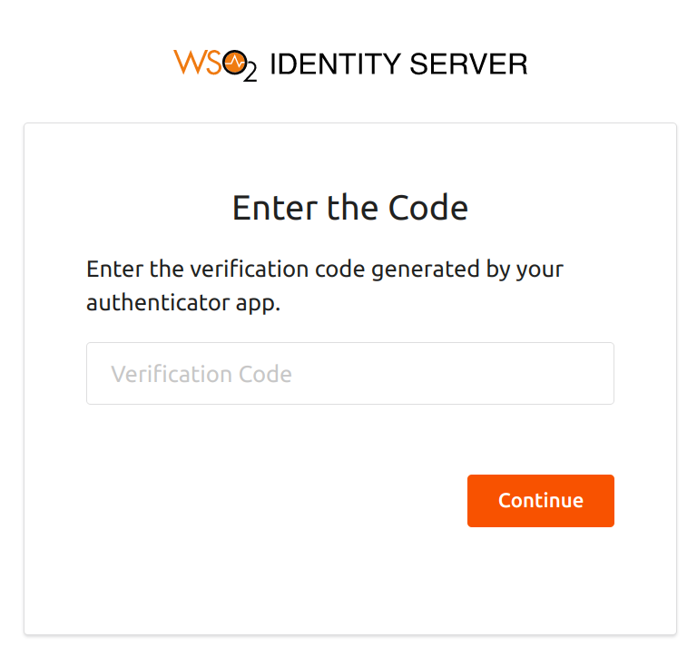
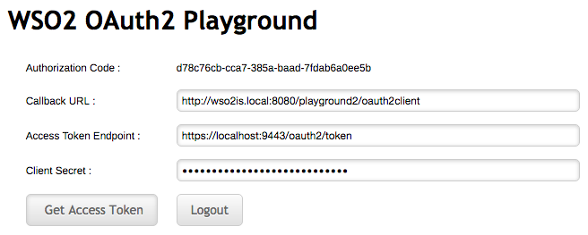

# Configure ACR-based adaptive authentication

This page guides you through configuring Authentication-Context-Reference-based (ACR-based) adaptive authentication for a sample web application.

## Scenario

Consider a scenario where you want users to be authenticated into an application based on the authentication context value used when logging in.

----

:::info[General prerequisites]

See the [general prerequisites](configure-adaptive-auth.mdx#prerequisites-for-adaptive-authentication) for all adaptive authenticaiton scenarios.

:::

----

<Prerequisites>

### Prerequisites

- Download [Apache Tomcat 8.x](https://tomcat.apache.org/download-80.cgi) and install it. Tomcat server installation location will later be referred to as `<TOMCAT_HOME>` in this guide.

- It is recommended that you use a hostname that is not `localhost` to avoid browser errors. Modify your machine's `/etc/hosts` entry to reflect this.

    :::info

    Note that `wso2is.local` is used in this documentation as an example, but you must modify this when configuring the authenticators or connectors with this sample application.

    :::

</Prerequisites>


### Download the sample

To deploy a WSO2 Identity Server sample application, you need [download the `playground2.war`](https://github.com/wso2/samples-is/releases/download/v4.5.2/playground2.war) file from the latest release assets.

### Deploy the sample web app

To deploy the sample web app on a web container:

1. Copy the downloaded `playground2.war` file into the `<TOMCAT_HOME>/apache-tomcat-<version>/webapps` folder.

2. Start the Tomcat server.

3. Access the applcation through this URL: `http://wso2is.local:8080/playground2/oauth2.jsp`

    :::info

    By default, Tomcat runs on port 8080. If you have configured it to run on a different port, update the URL and access the playground application.  

    :::


You will now be redirected to the landing page of the sample application.

:::tip[Troubleshooting tip]


:::
	If you are getting the following error, the sample applications do not have a keystore in them. Therefore, you may get this error after changing the tomcat hostname because the public key of the WSO2 Identity Server does not exist in the Java certificate store.
	
	```java
	javax.net.ssl.SSLHandshakeException: sun.security.validator.ValidatorException: PKIX path building failed: 			sun.security.provider.certpath.SunCertPathBuilderException: unable to find valid certification path to requested target
	```

---

## Register a service provider

1. On WSO2 Identity Server Management Console, go to **Main** > **Identity** > **Service Providers** and click **Add**.

2. Enter `playground2` as the **Service Provider Name** text box, and click **Register**.

3. Expand the **Inbound Authentication Configuration > OAuth/OpenID Connect Configuration** and click **Configure**.

4. Fill in the form that appears. By default, all **Allowed Grant Types** are selected; you can disable the grant types that are not required.

    :::note

    The **custom** grant type will only appear on the UI if you have configured the JWT grant type. The value specified as the `name` of the `oauth.custom_grant_type` in the `deployment.toml` file when creating the custom grant type is the value that will appear on the UI. For more information on writing a custom grant type, see [Write a Custom OAuth 2.0 Grant Type](../../references/extend/oauth2/write-a-custom-oauth-2.0-grant-type.mdx).

    :::

5. Enter the **Callback Url** as `http://wso2is.local:8080/playground2/oauth2client`.

    :::tip

    For more information on other advanced configurations refer, [Advanced OpenID Connect](../login/oidc-parameters-in-auth-request.mdx).

    :::

7. Click **Add**. Note that `client key` and `client secret` are generated.

8. Click **Update**.

----

## Configure acr-based authentication

To configure ACR-based authentication for an application:

1. On the management console, go to **Main** > **Identity** > **Service Providers** > **List**.

2. Click **Edit** on the `saml2-web-app-pickup-dispatch.com` service provider.

3. Expand the **Local and Outbound Authentication Configuration** section and click **Advanced Configuration**.

4. You will be redirected to **Advanced Configuration**, expand **Script Based Conditional Authentication**.

5. In the **Templates** section, click on the **`+`** corresponding to the **ACR-Based** template.

    

6. Click **Ok** to add the authentication script. The authentication script and authentication steps will be configured.

    :::info

    The authentication script prompts authentication steps based on the acr values as follows.

    - 'acr1' - step 1 (basic authentication)
    - 'acr2' - step 1 and 2 (basic authentication and TOTP)
    - 'acr3' - step 1 and 3 (basic authentication and Security Key/Biometrics (FIDO))

    :::

7. Click **Update** to save your configurations.

----

## Try it out

1. Access the following sample Playground application URL: `http://wso2is.local:8080/playground2/index.jsp`

2. Click **Import Photos**.  

3. Enter the `client ID` of the OAuth service provider application you registered above and enter 'acr2' as the **Authentication Context Class** value.  

    Leave the rest of the configurations as they are.  

    

4. You are now prompted for basic authentication followed by TOTP authentication. Step 1 and Step 2 are prompted as the ACR value entered was `acr2`.

    :::tip

    You can re-try this flow using the ACR value 'acr3'. Note that you
    are then prompted for steps 1 and 3 (basic authentication and Security Key/Biometrics (FIDO) authentication).

    :::

    

6. Enter the TOTP code and click **Continue**.
    

7. Logout from the application and try this flow with different ACR values.
