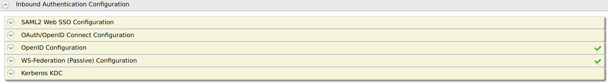

# Configuring inbound authentication for a service provider

The inbound authenticator component of WSO2 Identity Server identifies
and parses all the incoming authentication requests and builds the
corresponding response. A given inbound authenticator has two parts:

| Authenticator process | Functionality   |
|-----------------------|---------------|
| Request Processor | Accept a request from a service provider, validate the request, build a common object model that is understood by the authentication framework, and hand over the request to it.    |
| Response Builder  | Accept a common object model from the authentication framework and build a response.  |

The request processors and the response builders are protocol-aware, while the authentication framework is not coupled to any protocol.

WSO2 Identity Server includes inbound authenticators for SAML 2.0, OpenID Connect, OAuth 2.0, Kerberos KDC, and WS-Federation (passive).

:::info

See the [Identity Server Architecture](../../references/architecture/architecture.mdx) for more information on how inbound authentication fits into the overall scheme.

:::

<Prerequisites>

## Prerequisites

You need to [register a service provider](register-sp.mdx) on the Management Console.

:::warning[Removed Feature!]

OpenID 2.0 has been removed from the base product in WSO2 Identity Server version 5.3.0 onwards as it is now an obsolete specification and has been superseded by OpenID Connect. Alternatively, we recommend that you use [OpenID Connect](../../references/concepts/authentication/intro-oidc.mdx).

:::

</Prerequisites>

## Configure inbound authentication

To configure inbound authentication for the registered service provider:

1. On the Management Console, go to **Main > Identity > Service Providers**.
2. Click **List**, select the service provider you want to configure, and click on the corresponding **Edit** link.
3. Expand the **Inbound Authentication Configurations** section and expand the section that you wish to configure.

    

    You can configure inbound authentication for the following protocols:

    - [SAML2 Web SSO Configuration](../login/saml-app-config-advanced.mdx)
    - [OAuth/OpenID Connect Configuration](../login/oauth-app-config-advanced.mdx)
    - OpenID Configuration
    - WS-Federation (Passive) Configuration
    - Kerberos KDC

:::info[Related Topics]

See [Single Sign-On](../login/enable-single-sign-on.mdx) for details on configuring single sign-on for service provider using inbound authentication. See the following topics for samples of configuring single sign-on:

- [Configuring Single Sign-On Using SAML](../login/sso-for-saml.mdx)
- [Configuring Single Sign-On Using OpenID Connect](../login/sso-for-oidc.mdx)

:::
