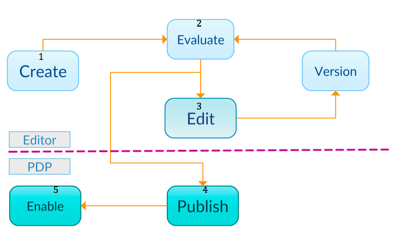
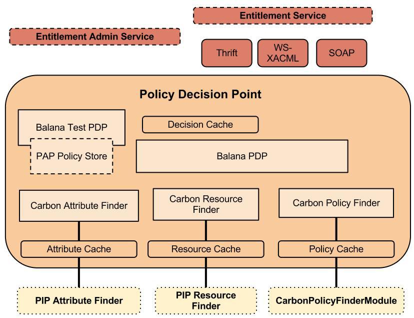

# Access Management  / Entitlement Management
Entitlement management is a technology that grants, resolves, enforces,
revokes and administers fine-grained access privileges. The Entitlement Management
component of WSO2 Carbon facilitates the management and control of policies
defined in XACML.

## XACML Policies

At the root of all XACML policies is a **Policy** or a **PolicySet**.

A **Policy** represents a single access control policy, expressed through
a set of rules.

A **PolicySet** is a container that can hold other
Policies or PolicySets, as well as references to policies found in
remote locations.

Each XACML policy document contains exactly one Policy
or PolicySet root XML tag.

WSO2 Identity Server XACML support provides two methods to create a XACML policy.

- [Create a XACML policy from the UI](create-a-policy.md)

- [Customize a policy template](customize-a-policy-template.md)

## The Policy Administration Point
The Policy Administration Point (PAP) is the system entity that creates
a policy or a set of policies and manages them. WSO2 Identity Server can act as
a PAP that provides comprehensive support for managing policies.

A XACML policy has a clearly identifiable life cycle inside a PAP.

The following illustration shows the life cycle of a policy within WSO2
Identity Server.

1.  Create XACML policies using the provided editors.
2.  Evaluate the policies for expected behavior with sample requests without
    putting the policy into action.
3.  Make necessary amendments to the policies. The
    Identity Server will automatically keep versioning the policy so
    that you can revert to a previous version if necessary.
4.  Once the policies are tested throughly, publish them to the [Policy Decision Point (PDP)](#the-policy-decision-point).
5.  View available policies in PDP and enable them as desired.

## The Policy Decision Point

The Policy Decision Point (PDP) is the system entity that evaluates an
applicable policy and returns an authorization decision. All PDP configurations have been exposed via an API as a web service. The following
diagram shows the components of the PDP.
.

Explore the following topics to learn how to configure the PAP.

- [Create a policy](create-a-policy.md)

- [Edit a policy](edit-a-policy.md)

- [Policy version controlling](version-control.md)

- [Publish a policy](publish-a-policy.md)

- [View status of a policy](view-status.md)

- [Enable and Disable a policy](enable-disable-policy.md)

- [Clear cache](clear-cache.md)
