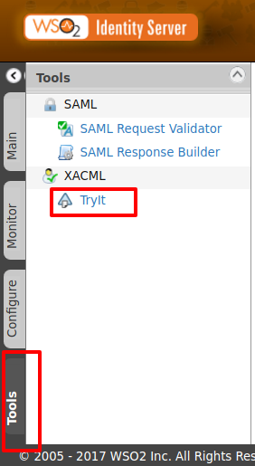

# Using the XACML TryIt Tool

WSO2 Identity Server provides you with an easy tool to try out and test
XACML 3.0 requests. This provides you with an easy UI and several
functionalities such as the following.

-   You can build your XACML request from scratch by providing attribute
    values.
-   You can evaluate the created XACML request using PDP and verify your
    created requests.

Therefore, this will help you to verify your XACML policies by creating
sample requests for testing purposes. We recommend you to use this to
evaluate your created policy in order to verify that it works as
expected.

The XACML TryIt Tool is available in the **Tools** menu as shown in the
figure.

The following topics provide information on how to use the XACML TryIt
tool.

-   [Evaluate a XACML Policy](evaluate-a-xacml-policy.mdx)
