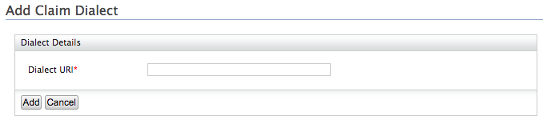
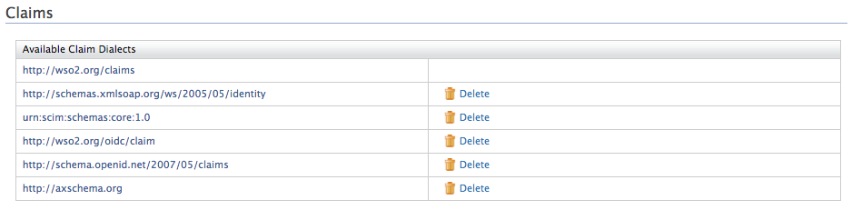

# Add Claim Dialects

A set of claims are identified as a dialect. Different dialects represent the same piece of information with different claim URIs. The following dialects are defined by default with the [Claim Management](../../references/concepts/claim-management.mdx) Feature in WSO2 IS.

- `http://schemas.xmlsoap.org/ws/2005/05/identity` - Default dialect for STS
- `http://wso2.org/claims` - Default dialect for WSO2 Carbon
- `http://axschema.org` - Default dialect for OpenID Attribute Exchange
- `http://schema.openid.net/2007/05/claims` - Default dialect for OpenID Simple Registration
- `http://wso2.org/oidc/claim` - Default dialect for OpenID Connect
- `urn:scim:schemas:core:1.0` - Default dialect for SCIM

---

In WSO2 Identity Server, there are two ways you can add a new dialect.

## Use the management console

Follow the instructions below to add a new dialect using the management console. 

1.  Access the Management Console (`https://<IS_HOST>:<PORT>/carbon`).
2.  Go to **Main** > **Identity** > **Claims** and click **Add**.
3.  Click **Add Claim Dialect** and enter a value for the **Dialect URI**.

    :::info

    The Dialect URI is a unique URI identifying the dialect (for example, `http://schema.openid.net/2007/05/claims`).

    :::

    

4.  Click **Add** and the claim dialect will appear on the list as follows.

    

## Use the configuration file

Follow the instructions below to add a new dialect through the configuration file.

:::note


    The dialects configured in the `<IS_HOME>/repository/conf/claim-config.xml` file get applied only **when you start the product** for the first time or for any newly created tenants.
    
With the first startup, dialects and claims are loaded from the file and persisted in the database. Any consecutive updates to the file will not be picked up.

:::

1.  Open the `claim-config.xml` file found in the
    `<IS_HOME>/repository/conf/` folder.

2.  Add the following configuration to the
    file along with the new claims you want to add under the dialect.

    ```xml
    <Dialect dialectURI="http://wso2.org/SampleAppClaims">
        <Claim>
            <ClaimURI>http://wso2.org/SampleAppClaims/givenname</ClaimURI>
            <DisplayName>First Name</DisplayName>
            <MappedLocalClaim>http://wso2.org/claims/givenname</MappedLocalClaim>
        </Claim>
        <Claim>
            <ClaimURI>http://wso2.org/SampleAppClaims/nickName</ClaimURI>
            <DisplayName>Nick Name</DisplayName>
            <MappedLocalClaim>http://wso2.org/claims/nickname</MappedLocalClaim>
        </Claim>
    </Dialect>
    ```

3.  Once you have edited the `claim-config.xml` file, restart WSO2 Identity Server. 

You can now view the new dialect via the management console.
    
----

:::info[Related topics]


-   [Guides: Add Claim Mapping](add-claim-mapping.mdx)
-   [Concepts: Claim Management](../../references/concepts/claim-management.mdx)

:::
