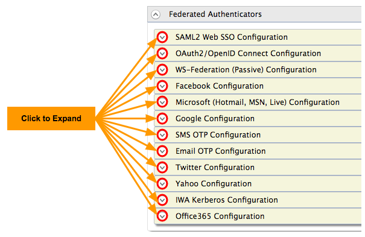

# Identity Federation - Overview

You can define connections to external identity providers (IdPs) and use them to authenticate users who log in to your applications. This process of authenticating users with external IdPs is known as identity federation.

You can configure the following federated authenticators from the management console:

:::info

Some authenticators such as LinkedIn are not provided OOTB with WSO2 Identity Server but can be downloaded from the [WSO2 store](https://store.wso2.com/store/pages/top-assets) and plugged in to work with WSO2 IS.

:::

