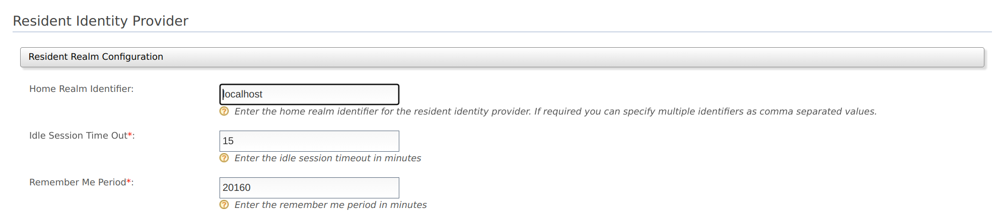

# Set up a resident IdP

WSO2 Identity server can also act as an IdP, which provides identity for applications, rather than mediating authentication requests between service providers and identity providers.

In such cases, the Identity Server is known as the **resident identity provider**.

To configure a resident identity provider:

1. On the WSO2 Identity Server Management Console, go to **Main \> Identity \> Identity Providers \> Resident**.

2. On the expanded **Resident Realm Configurations** tab enter the required values as given below.
    

    <table>
    <thead>
    <tr className="header">
    <th>Field</th>
    <th>Description</th>
    <th>Sample Value</th>
    </tr>
    </thead>
    <tbody>
    <tr className="odd">
    <td><strong>Home Realm Identifier</strong></td>
    <td>This is the domain name of the identity provider. If you do not enter a value here, when an authentication request comes to WSO2 Identity Server, a user will be prompted to specify a domain. You can enter multiple identifiers as a comma-separated list.</td>
    <td><code>localhost</code></td>
    </tr>
    <tr className="even">
    <td><strong>Idle Session Time Out</strong></td>
    <td>This is the duration in minutes for which an SSO session can be idle for. The default value is <code>15</code> .</td>
    <td><code>15</code></td>
    </tr>
    <tr className="odd">
    <td><strong>Remember Me Period</strong></td>
    <td>

    
This is the duration in weeks for which WSO2 Identity Server should remember an SSO session given that you have selected the <strong>Remember Me</strong> option in the WSO2 Identity Server login screen.

    
The default value is <code>2</code> weeks.

    
</td>
    <td><code>2</code></td>
    </tr>
    </tbody>
    </table>

3. Click **Update** to save the configurations.
