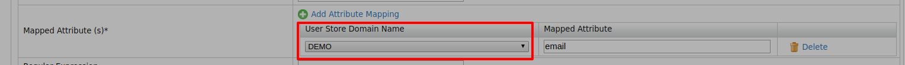

# Manage User Attributes

When using the WSO2 Identity Server (WSO2 IS) for user and role management, it is
important to understand how to manage the attributes of users within it. The claim management functionality helps to map each user attribute to a relevant claim and thereafter manage it.

There two main ways to view, add, edit, and delete attributes of a user.

- By accessing the profile of the user and changing the attributes using the Management Console. 
- You can use the REST API according to the SCIM 2.0 provisioning specification. For more information on this, see [Use the SCIM 2.0 REST APIs](../../apis/scim2-rest-apis.mdx).


## Claim mapping when using multiple user stores

When you are using more than one user store, you must map the attributes
correctly by [adding a claim mapping](../dialects/add-claim-mapping.mdx).

Under “Mapped Attribute(s)”, you need to follow the pattern.



However, for the default user store, you do not need to provide the
domain name. As an example, if you have two user stores, one is the
default and another one with domain “DEMO” then the pattern would be as
follows for `http://wso2.org/claims/emailaddress`.

```java
DEMO/mail
```
