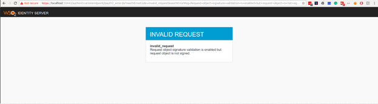

# Pass OIDC Authentication Parameters as a Request Object

This page guides you through passing OpenID Connect authentication request parameters in a self contained JWT, instead of passing plain request parameters using a sample application. A JWT that contains a set of request parameters as its claims is known as a request object.

<Prerequisites>

### Prerequisites

- Download [Apache Tomcat 8.x](https://tomcat.apache.org/download-80.cgi) and install it. Tomcat server installation location will later be referred to as `<TOMCAT_HOME>` in this guide.

- It is recommended that you use a hostname that is not `localhost` to avoid browser errors. Modify your machine's `/etc/hosts` entry to reflect this.

    :::info

    Note that `wso2is.local` is used in this documentation as an example, but you must modify this when configuring the authenticators or connectors with this sample application.

    :::

</Prerequisites>


### Download the sample

To deploy a WSO2 Identity Server sample application, you need [download the `playground2.war`](https://github.com/wso2/samples-is/releases/download/v4.5.2/playground2.war) file from the latest release assets.

### Deploy the sample web app

To deploy the sample web app on a web container:

1. Copy the downloaded `playground2.war` file into the `<TOMCAT_HOME>/apache-tomcat-<version>/webapps` folder.

2. Start the Tomcat server.

3. Access the applcation through this URL: `http://wso2is.local:8080/playground2/oauth2.jsp`

    :::info

    By default, Tomcat runs on port 8080. If you have configured it to run on a different port, update the URL and access the playground application.  

    :::


You will now be redirected to the landing page of the sample application.

:::tip[Troubleshooting tip]


:::
	If you are getting the following error, the sample applications do not have a keystore in them. Therefore, you may get this error after changing the tomcat hostname because the public key of the WSO2 Identity Server does not exist in the Java certificate store.
	
	```java
	javax.net.ssl.SSLHandshakeException: sun.security.validator.ValidatorException: PKIX path building failed: 			sun.security.provider.certpath.SunCertPathBuilderException: unable to find valid certification path to requested target
	```

---

## Register a service provider

1. On WSO2 Identity Server Management Console, go to **Main** > **Identity** > **Service Providers** and click **Add**.

2. Enter `playground2` as the **Service Provider Name** text box, and click **Register**.

3. Expand the **Inbound Authentication Configuration > OAuth/OpenID Connect Configuration** and click **Configure**.

4. Fill in the form that appears. By default, all **Allowed Grant Types** are selected; you can disable the grant types that are not required.

    :::note

    The **custom** grant type will only appear on the UI if you have configured the JWT grant type. The value specified as the `name` of the `oauth.custom_grant_type` in the `deployment.toml` file when creating the custom grant type is the value that will appear on the UI. For more information on writing a custom grant type, see [Write a Custom OAuth 2.0 Grant Type](../../references/extend/oauth2/write-a-custom-oauth-2.0-grant-type.mdx).

    :::

5. Enter the **Callback Url** as `http://wso2is.local:8080/playground2/oauth2client`.

    :::tip

    For more information on other advanced configurations refer, [Advanced OpenID Connect](oidc-parameters-in-auth-request.mdx).

    :::

7. Click **Add**. Note that `client key` and `client secret` are generated.

8. Click **Update**.

----

## Configure the public certificate

The following steps describe how to configure a service provider public certificate.

1.  Create a new keystore.

    ```java
    keytool -genkey -alias wso2carbon -keyalg RSA -keysize 2048 -keystore testkeystore.jks -dname "CN=*.test.com,OU=test,O=test,L=MPL,ST=MPL,C=FR" -storepass wso2carbon -keypass wso2carbon -validity 10950
    ```

2.  Create a file and name it as the client ID of the OAuth application service provider. Export the public key of the new keystore to the file you created.

    ```java
    keytool -export -alias wso2carbon -file <client-id> -keystore testkeystore.jks
    ```

3.  Get the cert in X509 format.

    ```java
    keytool -printcert -rfc -file <client-id>
    ```

    You will see the public certificate in X509 format in the console.
    
4. Copy the content of the certificate. A sample output is shown below. 

    ```java
	-----BEGIN CERTIFICATE-----
	MIIDVzCCAj+gAwIBAgIETCZA8zANBgkqhkiG9w0BAQsFADBcMQswCQYDVQQGEwJG
	UjEMMAoGA1UECBMDTVBMMQwwCgYDVQQHEwNNUEwxDTALBgNVBAoTBHRlc3QxDTAL
	BgNVBAsTBHRlc3QxEzARBgNVBAMMCioudGVzdC5jb20wHhcNMTgwMjE0MDYzNjE3
	WhcNNDgwMjA3MDYzNjE3WjBcMQswCQYDVQQGEwJGUjEMMAoGA1UECBMDTVBMMQww
	CgYDVQQHEwNNUEwxDTALBgNVBAoTBHRlc3QxDTALBgNVBAsTBHRlc3QxEzARBgNV
	BAMMCioudGVzdC5jb20wggEiMA0GCSqGSIb3DQEBAQUAA4IBDwAwggEKAoIBAQCz
	Gc/BcXCiIagLhXs1g90H+PbfZyXLzwFJ+YmsKMikcffhyopDD+fnFjHb1+XXSnUh
	4XzQlFba6m2vIOK8uquMhZKMv/E7Vxkl/ADTuw/BgpZRut4p88Fn8OWZlrJfoi3o
	hvgfxSMratvxLMp1Qe0BzjwoBDB9r+h9pj8kCpHC824eUGIR0FZsW9lnoJP2LegL
	nAcOJuNBoeWC0wwNu0sgIJwjsKp3G3glm8B4GdZvbF8aW1QRAk36sh8+0GXrRnAz
	aGcRAqt7CjeZmt5Dsuy0lfp5i1xf5myPOH7MwKHqQQ56Wu9O479NdDVLkJ0xne2r
	ZTCwMeGhQQH5hI+SYlxjAgMBAAGjITAfMB0GA1UdDgQWBBTzS+bja//25xb+4wcP
	gMN6cJZwoDANBgkqhkiG9w0BAQsFAAOCAQEAdhZ8romzQQKF9c8tJdIhUS4i7iJh
	oSjBzN+Ex9+OJcW6ubcLb8pai/J3hcvMadAybR1A17FkETLFmG9HkuEN9o2jfU7c
	9Yz5d0pqO8qNKXSqHky5c+zA4vzLZGsgKyDZ5a0p9Qpsat3wnA3UGZPRoVGV5153
	Mb0J1n1uubxGobEEzR2BXaKO9YEWAMQwGRdQCGBaIeGUOpqSUJMLYirDXL03je3g
	mYzWclLTEHpIYy+a66tmF9uTGgyys33LPm2pQ+kWd8FikWolKKBqp+IPU5QdUQi1
	DdFHsyNqrnms6EOQAY57Vnf91RyS7lnO1T/lVR6SDk9+/KDBEL1b1cy7Dg==
	-----END CERTIFICATE-----
    ```

4.  Click **Service Providers > List** and **Edit** the service provider you created. 

5. Select **Upload SP Certificate** under  **Select SP Certificate Type**.

6. Paste the certificate content copied in step 4 as the **Application Certificate**.

    
    
    :::note


    :::

		Instead of uploading the service provider certificate as shown
		above, you can choose to use the JWKS enpoint as shown below and
		add the relevant JWKS URI.

		

7. Click **Update**.

----

## Configure claims

1. Add two new external claims as follows for the `http://wso2.org/oidc/claim` dialect.

    **customClaim1**
    - Dialect URI: `http://wso2.org/oidc/claim`
    - Claim URI: `customClaim1`
    - Mapped Local Claim: `http://wso2.org/oidc/claims/challengeQuestion1`

    **customClaim2**
    - Dialect URI: `http://wso2.org/oidc/claim`
    - Claim URI: `customClaim2`
    - Mapped Local Claim: `http://wso2.org/oidc/claims/challengeQuestion2`

    :::info

    Here, **customClaim1** and **customClaim2** are selected as claim URIs because they are not configured as requested claims in the OIDC scope. For the purpose of testing, these claims are mapped to existing local claims `http://wso2.org/claims/challengeQuestion1` and `http://wso2.org/claims/challengeQuestion2`. If necessary, you can [create two new local claims](../../../../guides/dialects/add-claim-mapping/#add-local-claim) for this purpose.

    :::

2. Make sure you select **Supported by default** for the mapped local claims to ensure that the claims will be prompted during user registration.

3. Click **Service Providers > List** and **Edit** the service provider you created for the playground application.

4. Expand **Claim Configuration**.

5. Enter the following as requested claims.
    - `http://wso2.org/claims/challengeQuestion1`
    - `http://wso2.org/claims/challengeQuestion2`
    - `http://wso2.org/claims/country`
    - `http://wso2.org/claims/emailaddress`

6. If a user has already consented once to the requested claims that are configured on the service provider, any further changes/additions to the requested claims will not apply. If you are facing this issue, do one of the following.

    -   Mark the claims given above as **Mandatory Claims**. This will ensure that the user will be prompted once again to provide consent for the newly added/changed claims.

    -   Log in to the My Account and revoke the consent receipt for the application.  When you attempt to log in to the application again, you will be prompted to provide consent for all requested claims, including the newly added/changed claims. For more information on revoking/accepting user consent, see [Consent management](../../../../references/concepts/consent-management/).

7. Click **Update**.

-----

## Create request object

1. Create a user called "Tom" with login permission.

    For instructions, see [Add a User](../identity-lifecycles/admin-creation-workflow.mdx) and [Add a Role](../identity-lifecycles/add-user-roles.mdx).

2. Edit Tom's user profile and enter values for **email**, **country**, **challenge Question1**, and **challenge Question 2**. 
    For instructions, see [Edit User Profile](../identity-lifecycles/update-profile.mdx).

3. Create a JWT with the following payload and sign(RSA256) it with the private key of the keystore you created above.

    ```
    {
      "client_id": "<client-id>",
      "sub": "<client-id>",
      "aud": [
        "https://localhost:9443/oauth2/token"
      ],
      "claims": {
        "userinfo": {
          "given_name": {
            "essential": true
          },
          "nickname": null,
          "email": {
            "essential": true
          },
          "customClaim2": {
            "essential": true
          }
        },
        "id_token": {
          "gender": null,
          "birthdate": {
            "essential": true
          },
          "customClaim1": {
            "essential": true
          }
        }
      },
      "iss": "<client-id>",
      "exp": 1516786878,
      "iat": 1516783278,
      "jti": "1003"
    }
    ```

    This creates a signed request object.

----

## Try it out

Try out both of the following flows and observe the responses.

1. First, test the flow without a signed request object:
    
    Use the `authorization_code` grant type for the user, and use the OIDC scope from the playground application to obtain an `id_token`. Then, retrieve user information using the access token.

2. Next, test the flow with a signed request object:

    Use the `authorization_code` grant for the user, and specify the authentication endpoint as `https://localhost:9443/oauth2/authorize?request=<JWT>`. Next, obtain the `id_token` and retrieve user information.

    :::tip

    The JWT used here is the signed JWT created in the previous section of this guide.

    :::

When you analyze the responses of the two tests, you will observe that together with `customClaim2` retrieved in the userinfo response, an additional claim `customClaim1` is retrieved via the `id_token` when you configure the authorization code flow with a signed request object.   

-----

## Configure signature validation for request objects

Now that you understand how to pass OIDC authentication request parameters in a signed request object via WSO2 IS, you can configure a service provider to only accept signed request objects.

Request objects can either be signed or unsigned. Therefore, if you want to only accept signed request objects in an authorization request, you need to enable request object signature validation in the OAuth/OIDC configuration of the service provider.

1. Click **Service Providers > List** and **Edit** the service provider you created for the application.

2. Expand **Inbound Authentication Configuration**, and then expand **OAuth2/OpenID Connect Configuration**.

3. Select **Enable Request Object Signature Validation** to enforce signature validation for request object.

4. To verify that signature validation has been configured successfully, send a plain JWT instead of a signed one in the authorization code grant request.

    If signature validation is successfully enforced, the request should get rejected and you should see an error page.

    

---- 

:::info[Related topics]

- [Use Advanced Parameters in Authentication Requests ](oidc-parameters-in-auth-request.mdx)

:::
