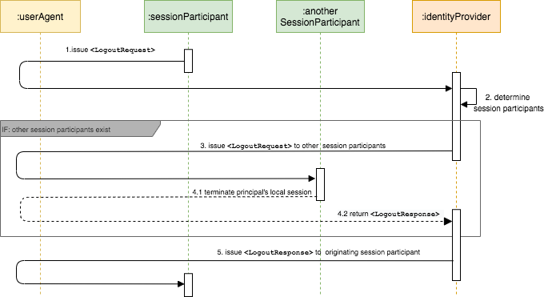

# SAML Front-Channel Logout

SAML logout enables a user to log out of an application and simulatenously log out of other connected applications without having to explicitly log out of them one by one. The SAML 2.0 protocol has two approaches for single logout. 

1. Synchronous binding (back-channel)
2. Asynchronous binding (front-channel)

The main difference between back-channel logout and front-channel logout is that the front-channel method uses web browser redirections and user sessions to handle the logout, but the back-channel method is handled via server-to-server communication, and the need for browser redirections is eliminated. When using the back-channel protocol, you can rely on mutually authenticated TLS (Transport Layer Security) for end-to-end security since the communication is point-to-point. 

The SAML 2.0 specification specifies three types of asynchronous (front-channel) bindings to send a request to the identity provider through the user agent.

- **HTTP Redirect binding**: This method transfers data using HTTP redirects and query parameters. The logout request is signed and the signature is sent as a query parameter. 

- **HTTP POST binding**: This method transfers data using HTTP POST forms. The logout request is signed and the signature is embedded in the SAML request body. 

- **Artifact binding**: Generally, SAML authentication requests and assertion data are sent through the browser using POST or HTTP Redirect binding. To avoid exposing the entire message to the browser this way, use [artifact binding](../../../guides/login/use-artifact-binding.mdx) instead. 

---

## The flow

Front-channel logout has two different use cases:

1. **SP-initiated logout**: Logout initiated by the service provider application.

2. **IdP-initiated logout**: Logout initiated by the identity provider. 

The following diagram illustrates the flow for **SP-initiated logout**. 

1. Issue `<LogoutRequest>` 

    The session participant initiates a single logout request and terminates the principal's session(s) by sending a `<LogoutRequest>` message through the user agent to the identity provider from whom it received the corresponding authentication assertion. 

2. Determines session participants

    The identity provider uses the contents of the `<LogoutRequest>` message to determine the session(s) being terminated. If there are no other session participants, the profile proceeds with step 5. Else, steps 3 and 4 are repeated for each session participant identified.

3. Issue `<LogoutRequest>` to other session participants

    The identity provider issues a `<LogoutRequest>` message through the user agent to another session participant or a session authority related to one or more of the session(s) being terminated.

4. Terminate principal's session and return `<LogoutResponse>`

    The session participant or session authority terminates the principal's session(s) as directed by the request (if possible) and returns a `<LogoutResponse>` to the identity provider through the user agent. 

5. Issue `<LogoutResponse>` to originating session participant

    The identity provider issues a `<LogoutResponse>` message to the original requesting session participant through the user agent. 

:::tip

In steps 1,3,4, and 5 either HTTP Redirect, HTTP POST, or HTTP Artifact binding can be used to transfer the message to the identity provider through the user agent. 

:::

In an **IdP-initiated logout** scenario, the identity provider (acting as session authority) initiates this profile at step 2 and issues a `<LogoutRequest>` message to all session participants. Step 5 is skipped in this scenario. 

:::info[Related topics]

- [Concept: SAML 2.0](/identity/6.1.0/intro-saml)
- [Concept: SAML Back-Channel Logout](/identity/6.1.0/saml-back-channel)
- [Guide: SAML Front-Channel Logout](../../../guides/login/saml-front-channel-logout.mdx)
- [Quick Start: SAML Front-Channel Logout](/identity/6.1.0/quick-starts/saml-front-channel-logout)
- [Guide: Use SAML Artifact Binding](../../../guides/login/use-artifact-binding.mdx)
- [Quick Start: Use SAML Artifact Binding](/identity/6.1.0/quick-starts/use-artifact-binding-sample)

:::
