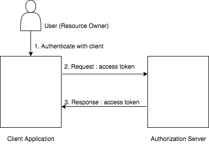

# Client Credentials Grant Type

This grant is suitable for machine-to-machine authentication or for a client making requests to an API that does not 
require the user’s permission. This grant should be allowed for use only by trusted [confidential clients](client-types.mdx#confidential-clients).

---

## How does it work?

The client can request an access token using only its client credentials with this grant type. It is similar to the 
[resource owner password credentials](resource-owner-grant.mdx) grant type except in this case, only the client’s credentials 
are used to authenticate a request for an access token.

The diagram below illustrates the implicit grant flow.




One of the following cURL commands can be used to try this grant type.

:::note

**Request 1**
```java
curl -v -X POST -H "Authorization: Basic <Base64Encoded(CLIENT_ID:CLIENT_SECRET)>" -k -d "grant_type=client_credentials" -H "Content-Type:application/x-www-form-urlencoded" <TOKEN_ENDPOINT>
```
---
**Request 2**
```java
curl -u <CLIENT_ID>:<CLIENT_SECRET> -k -d "grant_type=client_credentials" -H "Content-Type:application/x-www-form-urlencoded" <TOKEN_ENDPOINT>
```
---
You will receive a response similiar to the format below.
```
{
    "token_type":"Bearer",
    "expires_in":2061,
    "access_token":"ca19a540f544777860e44e75f605d927"
}
```

:::

:::info[Support for refresh token grant]

This grant type doesn't issue a refresh token which can be used to obtain new access tokens using the [refresh token grant](refresh-token-grant.mdx).

:::
    
:::info[Related topics]

    
    - [Guides: Client Credentials Grant](../../../guides/access-delegation/client-credentials-playground.mdx)

:::
