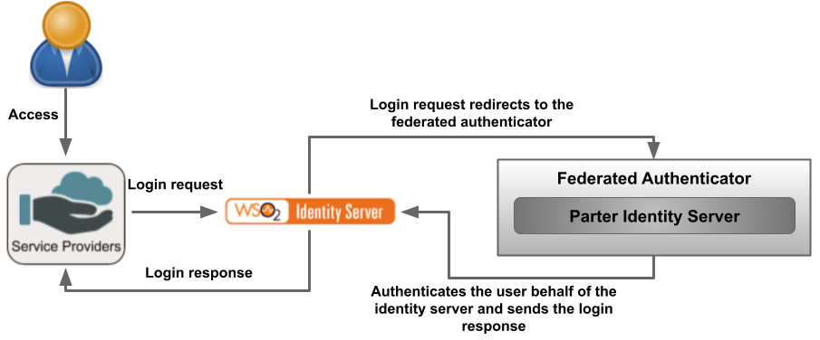
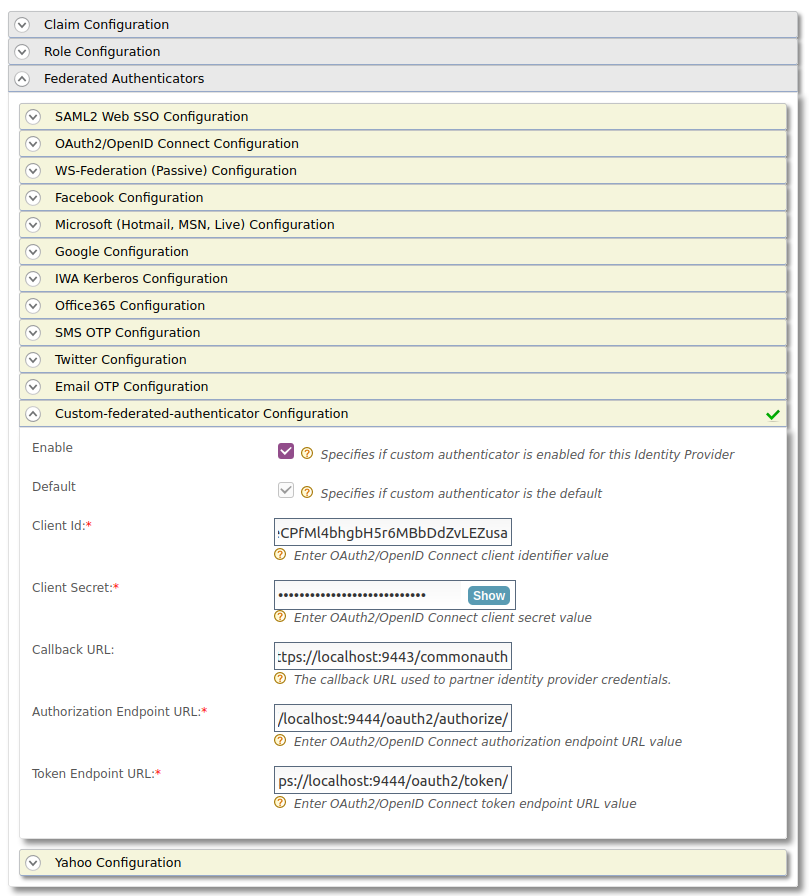
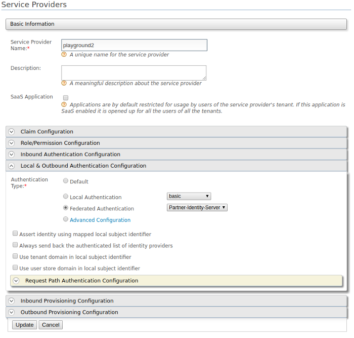

# Write a Custom Federated Authenticator

A custom federated authenticator can be written to authenticate a user with an external system.
The external system can be any identity provider such as Facebook, Twitter, Google, Yahoo, etc.
You can use the extension points available in WSO2 Identity Server to create custom federated authenticators.



---

## Authenticator API

The following is the API used to implement a custom federated
authenticator.

<details>
<summary>Click to view the API of the Application Authenticators</summary>

```java
  /*
  *  Copyright (c) 2005-2013, WSO2 Inc. (http://www.wso2.org) All Rights Reserved.
  *
  *  WSO2 Inc. licenses this file to you under the Apache License,
  *  Version 2.0 (the "License"); you may not use this file except
  *  in compliance with the License.
  *  You may obtain a copy of the License at
  *
  *    http://www.apache.org/licenses/LICENSE-2.0
  *
  * Unless required by applicable law or agreed to in writing,
  * software distributed under the License is distributed on an
  * "AS IS" BASIS, WITHOUT WARRANTIES OR CONDITIONS OF ANY
  * KIND, either express or implied.  See the License for the
  * specific language governing permissions and limitations
  * under the License.
  */
  
  package org.wso2.carbon.identity.application.authentication.framework;
  
  import java.io.Serializable;
  import java.util.List;
  
  import javax.servlet.http.HttpServletRequest;
  import javax.servlet.http.HttpServletResponse;
  
  import org.wso2.carbon.identity.application.authentication.framework.context.AuthenticationContext;
  import org.wso2.carbon.identity.application.authentication.framework.exception.AuthenticationFailedException;
  import org.wso2.carbon.identity.application.authentication.framework.exception.LogoutFailedException;
  import org.wso2.carbon.identity.application.common.model.Property;
  
  /**
   * API of the Application Authenticators.
   *
   */
  public interface ApplicationAuthenticator extends Serializable {
  
      /**
       * Check whether the authentication or logout request can be handled by the
       * authenticator
       * 
       * @param request
       * @return boolean
       */
      public boolean canHandle(HttpServletRequest request);
      
      /**
       * Process the authentication or logout request.
       * 
       * @param request
       * @param response
       * @param context
       * @return the status of the flow
       * @throws AuthenticationFailedException
       * @throws LogoutFailedException
       */
      public AuthenticatorFlowStatus process(HttpServletRequest request,
              HttpServletResponse response, AuthenticationContext context)
              throws AuthenticationFailedException, LogoutFailedException;
      
      /**
       * Get the Context identifier sent with the request. This identifier is used
       * to retrieve the state of the authentication/logout flow
       * 
       * @param request
       * @return
       */
      public String getContextIdentifier(HttpServletRequest request);
      
      /**
       * Get the name of the Authenticator
       * @return name
       */
      public String getName();
      
      /**
       * @return
       */
      public String getFriendlyName();
      
      /**
       * Get the claim dialect URI if this authenticator receives claims in a standard dialect
       * and needs to be mapped to the Carbon dialect http://wso2.org/claims
       * @return boolean
       */
      public String getClaimDialectURI();
      
      /**
       * @return
       */
      public List<Property> getConfigurationProperties();
  }
```

</details>

---

## Write the federated authenticator

To write the federated authenticator:

1. Create a `maven` project for the custom federated authenticator. Refer the following files:
    - The [pom.xml](https://github.com/wso2/samples-is/blob/master/authenticators/components/org.wso2.carbon.identity.sample.federated.authenticator/pom.xml) file used for the sample custom federated authenticator.
    - The [service component class](https://github.com/wso2/samples-is/blob/master/authenticators/components/org.wso2.carbon.identity.sample.federated.authenticator/src/main/java/org/wso2/carbon/identity/custom/federated/authenticator/internal/CustomFederatedAuthenticatorServiceComponent.java) file to deploy in WSO2 Identity Server and register it as a federated authenticator.

2. Write the [custom federated authenticator](https://github.com/wso2/samples-is/blob/master/authenticators/components/org.wso2.carbon.identity.sample.federated.authenticator/src/main/java/org/wso2/carbon/identity/custom/federated/authenticator/CustomFederatedAuthenticator.java) by extending the
[AbstractApplicationAuthenticator](https://github.com/wso2/carbon-identity-framework/blob/v5.18.187/components/authentication-framework/org.wso2.carbon.identity.application.authentication.framework/src/main/java/org/wso2/carbon/identity/application/authentication/framework/AbstractApplicationAuthenticator.java) class and implementing the
[FederatedApplicationAuthenticator](https://github.com/wso2/carbon-identity-framework/blob/v5.18.187/components/authentication-framework/org.wso2.carbon.identity.application.authentication.framework/src/main/java/org/wso2/carbon/identity/application/authentication/framework/FederatedApplicationAuthenticator.java) class.

:::info

See the sample [custom federated authenticator](https://github.com/wso2/samples-is/tree/master/authenticators/components/org.wso2.carbon.identity.sample.federated.authenticator) for your reference.

:::

??? "Methods in `AbstractApplicationAuthenticator` class and `FederatedApplicationAuthenticator` interface"
    | Method    | Description   |
    |-----------|---------------|
    |[**public String getName()**](https://github.com/wso2/samples-is/blob/master/authenticators/components/org.wso2.carbon.identity.sample.federated.authenticator/src/main/java/org/wso2/carbon/identity/custom/federated/authenticator/CustomFederatedAuthenticator.java#L73-L77)    | Return the name of the authenticator. |
    |[**public String getFriendlyName()**](https://github.com/wso2/samples-is/blob/master/authenticators/components/org.wso2.carbon.identity.sample.federated.authenticator/src/main/java/org/wso2/carbon/identity/custom/federated/authenticator/CustomFederatedAuthenticator.java#L67-L71) | Returns the display name for the custom federated authenticator. In this sample, we are using a custom-federated-authenticator.    |
    | [**public String getContextIdentifier(HttpServletRequest request**)](https://github.com/wso2/samples-is/blob/master/authenticators/components/org.wso2.carbon.identity.sample.federated.authenticator/src/main/java/org/wso2/carbon/identity/custom/federated/authenticator/CustomFederatedAuthenticator.java#L215-L224)   | Returns a unique identifier that will map the authentication request and the response. The value returned by the invocation of the authentication request and the response should be the same.    |
    | [public boolean canHandle(HttpServletRequest request)](https://github.com/wso2/samples-is/blob/master/authenticators/components/org.wso2.carbon.identity.sample.federated.authenticator/src/main/java/org/wso2/carbon/identity/custom/federated/authenticator/CustomFederatedAuthenticator.java#L60-L65)|Specifies whether this authenticator can handle the authentication response.  |
    | [protected void initiateAuthenticationRequest(HttpServletRequest request,HttpServletResponse response, AuthenticationContext context)](https://github.com/wso2/samples-is/blob/master/authenticators/components/org.wso2.carbon.identity.sample.federated.authenticator/src/main/java/org/wso2/carbon/identity/custom/federated/authenticator/CustomFederatedAuthenticator.java#L138-L139) | Redirects the user to the login page to authenticate and in this sample, the user is redirected to the login page of the application which is configured in the partner identity server which acts as the external service. |
    | [protected void processAuthenticationResponse(HttpServletRequest request,HttpServletResponse response, AuthenticationContext context)](https://github.com/wso2/samples-is/blob/master/authenticators/components/org.wso2.carbon.identity.sample.federated.authenticator/src/main/java/org/wso2/carbon/identity/custom/federated/authenticator/CustomFederatedAuthenticator.java#L169-L171) | Implements the logic of the custom federated authenticator.    |

---

## Deploy the authenticator

To deploy the custom federated authenticator:

1. Open a terminal, navigate to the root of your project, and compile the service by running the following command:

    ```xml
    mvn clean install
    ```

2. Copy the generated `org.wso2.carbon.identity.custom.federated.authenticator-1.0.0.jar` file from `<Custom-federated-authenticator>/target` folder to the `<IS_HOME>/repository/components/dropins` folder.

---

## Configure the partner identity server

In this guide, the partner identity server acts as the external system. 
Therefore, it is required to run a second WSO2 Identity Server instance as the partner identity server.

### Set up partner IS
Add the following config to the `<PARTNER_IS_HOME>/repository/conf/deployment.toml` file to be able to run the partner identity server  on the same machine in a different port.

```toml
[server]
offset=1
```

After starting that partner identity server, it will run on [localhost:9444](https://localhost:9444/carbon).


### Register a service provider

To register and configure the service provider on the partner IS:

1. On the management console (`https://<PARTNER_IS_HOST>:<PARTNER_IS_PORT>/carbon`) of the partner identity server, go to **Main** > **Identity** > **Service Providers** > **Add**.

2. Enter `pickup-dispatch` as the **Service Provider Name** and click **Register**.

3. Expand **Inbound Authentication Configuration > OAuth/OpenID Connect Configuration** and, click **Configure**.

4. Enter `https://localhost:9443/commonauth` as the **Callback Url**.

5. Click **Add**. Note that the `client key` and `client secret` are generated.

6. Click **Update** to save the configurations.

:::info[Download and deploy the application]

On the partner identity server:

- Download the [OIDC pickup-dispatch sample](https://github.com/wso2/samples-is/releases/download/v4.5.2/pickup-dispatch.war) application.
- [Deploy the sample pickup-dispatch](../../../guides/login/webapp-oidc.md#deploy-the-sample-web-app) application on the partner identity server.

:::

### Add a new user

To add a new user:
1. On the management console (`https://<PARTNER_IS_HOST>:<PARTNER_IS_PORT>/carbon`) of the partner identity server, go to **Users and Roles** > **Add**.

2. Click **Add New User**.

3. Enter a **Username** and **Password** for the new user.

4. Click **Finish** to add the new user.

---

## Configure the Identity Server

This section guides you on how to configure the identity server to use the custom federated authenticator.

### Prerequisites
- You need to [set up the sample](../../../guides/login/webapp-oidc.md) application.
- You need to [register an Identity Provider](../../../guides/identity-federation/add-idp.md) named `Partner-Identity-Server`.

### Configure federated authenticator

To configure the custom fedrated authenticator:

1. On the management console, go to **Identity Providers > List**.
2. Click on **Edit** corresponding to the `Partner-Identity-Server` identity provider.
3. Expand **Federated Authenticators > Custom-federated-authenticator configurations**.
4. Enter the following details

    | Field name    | Value |
    |---------------|-------|
    | **Enable**    | Selected  |
    | **Default**   | Selected  |
    | **Client Id** | The Client Id value generated by the external service provider of the partner identity server.    |
    | **Client Secret** | The Client Secret value generated by the external service provider of the partner identity server.    |
    | **Callback URL**  | `https://localhost:9443/commonauth`   |
    | **Authorization Endpoint URL**    | `https://localhost:9444/oauth2/authorize/`    |
    | **Token Endpoint URL**    | `https://localhost:9444/oauth2/token/`    |

    

5. Click **Update** to save the configurations.

### Configure the SP with the custom federated authenticator

To configure the custom federated authenticator for the SP:

1. On the management console, go to **Main** > **Identity** > **Service Providers** > **List**.

2. Click **Edit** on the `pickup-dispatch` service provider.

3. Expand the **Local and Outbound Authentication Configuration** and select `Partner-Identity-Server` from the **Federated Authentication** list.
    

4. Click **Update** to save the configurations.

    :::tip

    To configure more advanced configurations, see [OAuth/OpenID Connect Configurations](../../../guides/login/oauth-app-config-advanced.md).

    :::


5. Expand the **Local & Outbound Authentication Configuration** section.

6. Select **Federated Authentication** and select the configured federated authenticator.
    

7. Click **Update** to save the configurations.

---

## Try it out

1. Access the application URL of the service provider: `http://localhost:8080/pickup-dispatch/home.js`

2. Click **Login** and enter the credentials of the the new user created in the partner identity server.

3. Provide the required consent. You will be redirected to the Pickup Dispatch application home page.

The user is successfully authenticated by the partner Identity Server.

Similarly, you can write a federated authenticator to authenticate the users using an external system.

## Contributing your connectors


You are welcome to share and host your connectors in our [connector store](https://store.wso2.com/store/assets/isconnector/list). As an organization that believes in the open source paradigm, we always encourage our community to make contributions so that our community around WSO2 Identity server can benefit from using an open source product.
Contributions can be made by following the procedure below.

1. Create an issue in the [product-is git repository](https://github.com/wso2/product-is/issues/new?assignees=&labels=feature&template=feature_request.md&title=).
2. Provide a basic description of the purpose and functionality of your connector. Include the following information in the git issue.
   - Downloadable connector artifact (ex: JAR files).
   - Documentation on setup and testing instructions for the connector.
   - Source code repository of the connector.
3. Make sure your source code follows WSO2 coding standards and [secure development guidelines](https://wso2.com/technical-reports/wso2-secure-engineering-guidelines/).
4. Our team will perform necessary functionality, security, and usability testing on the connector and provide suggestions for improvements.
5. If your code and the functionality are deemed to comply with the standards of WSO2, you will be able to get the connector hosted on our connector store and contribute the source code to WSO2.
6. You will be required to sign the [Contributor License Agreement](https://wso2.com/files/wso2-cla.pdf) once the connector is accepted.

You can also contact us through our [slack channel](https://is-slack.wso2.com) if you need more information.
