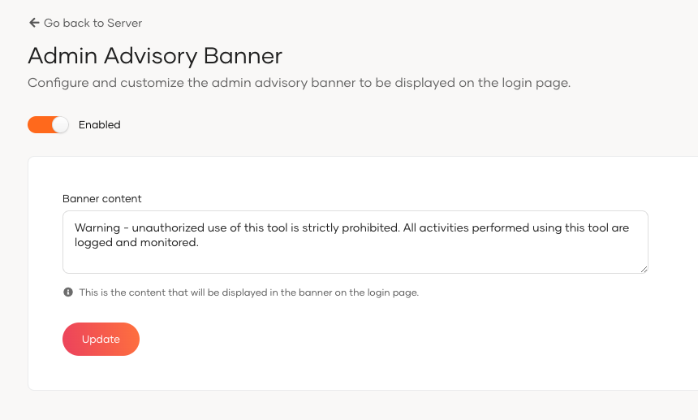
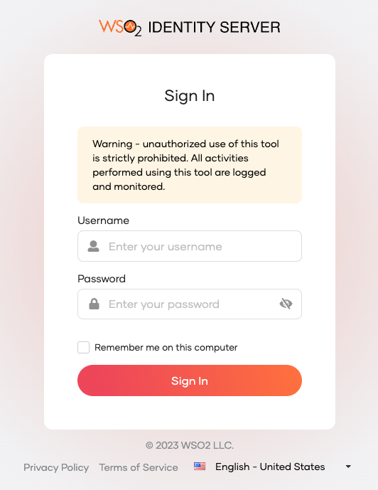

# Admin Advisory Banner Configuration

## Overview
The Admin Advisory Banner feature in WSO2 Identity Server enhances security by displaying a customizable warning banner during the administrative login process. This ensures that administrators are aware that their session activities are being monitored and logged.

## Configuring the Admin Advisory Banner

Follow the steps below to configure the Admin Advisory Banner:

1. Navigate to the WSO2 Identity Server Console.
2. Go to the **Server** section to click the **Admin Advisory Banner** settings.
3. Toggle the **Enabled** switch to activate or deactivate the advisory banner.
4. Enter the desired warning message in the **Banner content** text box. This message will be displayed on the login page to warn administrators about monitoring policies.
5. Click the **Update** button to save the changes and implement the banner with the specified message.

The advisory banner will appear on the WSO2 Identity Server Console login page as below, reminding administrators that their credentials are validated through the Identity Server platform and that usage is subject to monitoring.

