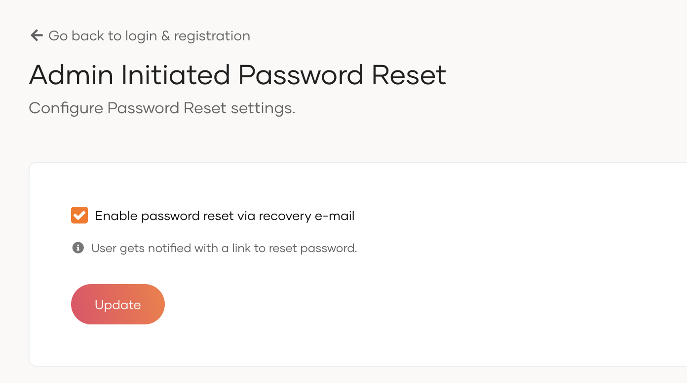

# Admin initiated password reset

Administrators can initiate password reset for users. Once initiated, an email will be sent to the user with a password reset link which can be used to reset the password.

To configure admin-initiated password reset:

1. On the WSO2 Identity Server Console, go to **Login & Registration**.

2. Under **Account Recovery**, click on **Admin Initiated Password Reset**.

3. Check the option to **Enable password reset via recovery email**.

4. Click **Update** to save the changes.

:::info

Once an administrator initiates a password reset, the user's previous password will be invalidated immediately. The user must complete the password reset process using the provided method to regain access to their account.

:::
