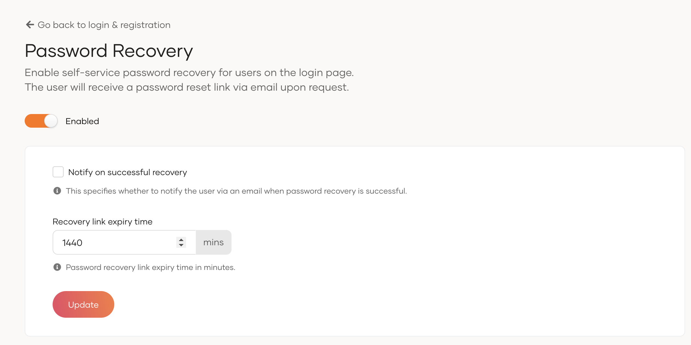

# Password recovery

You may enable self-service password recovery for users so that they may reset their forgotten passwords right from the login page. Once enabled, users can click the `Forgot password?` option and receive a password reset link to their registered emails.

To do so,

1. On the WSO2 Identity Server Console, go to **Login & Registration**.
2. Under **Account Recovery**, click on **Password Recovery**.
3. Toggle the switch on to enable password recovery.
4. Configure the following options:

    <table>
    <tr>
      <td><b>Notify on Successful Recovery</b></td>
      <td>When checked, the user will be notified via email after a successful password recovery.</td>
    </tr>
    <tr>
      <td><b>Recovery Link Expiry Time</b></td>
      <td>Time in minutes until the password recovery link expires.</td>
    </tr>
    </table>

5. Click **Update** to save the changes.

