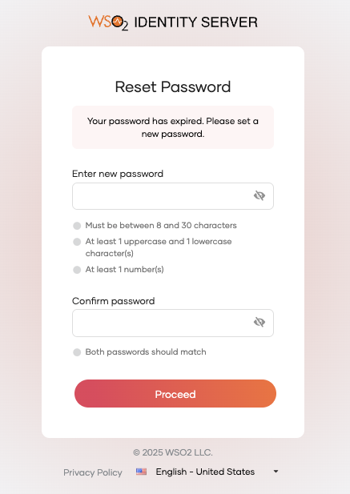
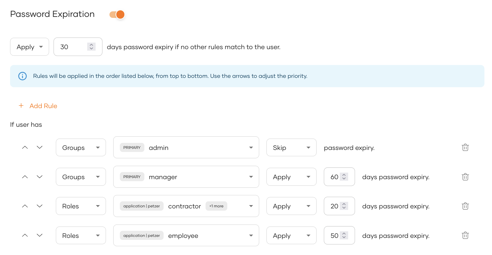
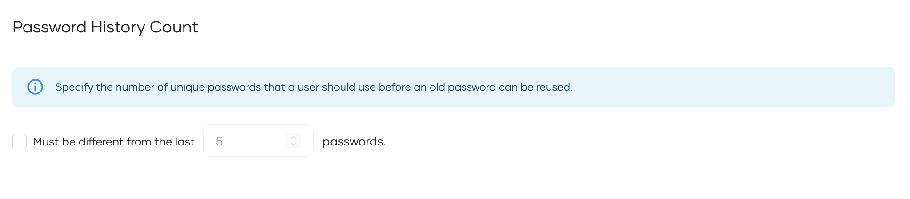
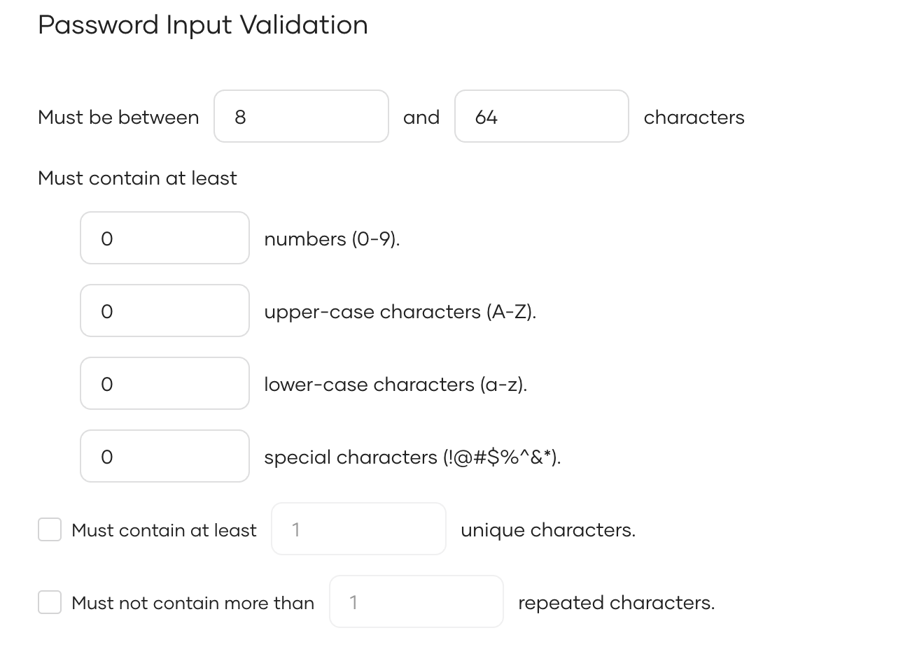

# Password validation

WSO2 Identity Server provides several password validation mechanisms to ensure user passwords meet the required complexity standards and are regularly updated to maintain security. This guide walks you through enabling and configuring these options for your organization.

## Configure password validation

You can find the password configuration options by following the steps below.

1. On the WSO2 Identity Server Console, navigate to **Login & Registration**.

2. Under **Login Security**, select **Password Validation**.

3. On the **Password Validation** page, you can configure the following [options](#password-validation-options):

    - [Rule-based password expiration](#rule-based-password-expiration): Passwords expire based on the rules you define for users' groups and roles. If users with expired passwords log in, they get redirected to the password reset screen.

        
    
    - [Password history count](#password-history-count): Specify how often users can reuse old passwords. When resetting a password, if a user chooses a previously used password (within the stored history), the password reset fails with the following error:

        
    
    - [Password input validation](#password-input-validation): Set requirements for password complexity by defining its length constraints and required character types. When a user creates/resets a password, if it does not meet the complexity requirements, the validation checks fail as follows.

        
    
3. Click **Update** to save the changes.

## Password validation options

The following are the password validation options available for your organization.

### Rule-Based password expiration

Rule-based password expiration allows administrators to set custom password expiration rules based on the user's groups and roles. The higher a rule appears on the list, the greater its priority. Rules are evaluated based on their priorities and the first rule that matches the user's condition will take effect.

To configure rule-based password expiration,

1. Turn the **Password Expiration** toggle on to enable password expiration.


2. Set a default password expiry rule that applies to any user who does not meet the custom criteria.


3. Click **Add Rule** and start defining custom rules. Each rule you add will be added to the top of the list. You may use the arrows on the left to change their priorities.


    

Refer to the following table for more information on rule parameters.

<table><tbody><tr><th>{"Parameter"}</th><th>{"Description"}</th></tr><tr><td>{"Attribute"}</td><td>{"User attribute against which you are enforcing password expiry. Select either "}<code>{"Groups"}</code>{" or "}<code>{"Roles"}</code>{"."}</td></tr><tr><td>{"Values"}</td><td>{"Select the specific group/role. You may also select multiple values thus making the rule act as an AND operator, and is enforced only on users belonging to all selected groups/roles."}</td></tr><tr><td>{"Operator"}</td><td><ul><li><b>{"Apply:"}</b>{" Password expiry will be enforced for users who meet the rule criteria."}</li><li><b>{"Skip:"}</b>{" Password expiry will not be enforced for users who meet the rule criteria."}</li></ul></td></tr><tr><td>{"Expiration (days)"}</td><td>{"Passwords of users meeting the criteria expire after this number of days."}</td></tr></tbody></table>


### Password history count

The **Password History Count** feature allows you to specify the number of unique new passwords a user must use before an old password can be reused. This enhances account security by preventing the reuse of old passwords.



To enable this, select the corresponding checkbox and configure the following option.

<table><tbody><tr><th>{"Parameter"}</th><th>{"Description"}</th></tr><tr><td>{"Password History Count"}</td><td>{"[Optional] The number of unique passwords that must be set before reusing an old password. "}<br />{" "}<b>{" Example: "}</b>{" If set to "}<code>{"3"}</code>{", the user cannot reuse the last three passwords they have set."}</td></tr></tbody></table>

### Password input validation

The **Password Input Validation** feature enables you to set password complexity requirements which include minimum password length and required character types.



Configure the following parameters to enforce input validation.

<table><tbody><tr><th>{"Parameter"}</th><th>{"Description"}</th></tr><tr><td>{"Number of characters"}</td><td>{"You can add the minimum and maximum length of the password users should use."}</td></tr><tr><td>{"Mandatory characters"}</td><td>{"By default, a user password should contain at least one of the following characters. "}<ul><li>{"Numbers"}</li><li>{"Upper-case characters"}</li><li>{"Lower-case characters"}</li><li>{"Special characters"}</li></ul></td></tr><tr><td>{"Number of unique characters"}</td><td>{"[Optional] This field identifies the number of unique (non-repeated) characters the password should contain."}</td></tr><tr><td>{"Number of repeated characters"}</td><td>{"[Optional] This field identifies the number of characters that can be repeated consecutively in a user password. "}<br />{" "}<b>{" Example: "}</b>{" If you assign "}<code>{"1"}</code>{" as the number of repeated characters, the password cannot contain any repeated characters consecutively. "}<br />{" The password "}<code>{"aa1@Znlq"}</code>{" is incorrect as it has the character "}<code>{"a"}</code>{" appearing consecutively."}</td></tr></tbody></table>

:::note[Validation for whitespace in passwords]


WSO2 Identity Server automatically trims leading and trailing whitespace from passwords when creating, updating, or entering passwords to login.

:::


:::note[Password maximum allowed length]


In WSO2 Identity Server, the maximum allowed password length is 64 by defualt and if you need to increase this value for your need you neeed to add below configuration.

```toml
[identity_mgt.password_policy]
max_password_allowed_length = 128
```

:::
