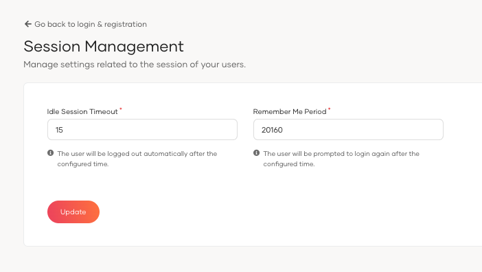

# Session management

Customize session timeout and remember me settings to maintain optimal security and user experience in WSO2 Identity Server.

## Configuration instructions

To adjust session management settings, follow these steps:

1. On the WSO2 Identity Server Console, go to **Login & Registration** > **Login Security** > **Session Management**.
2. Configure the **Idle Session Timeout** and **Remember Me Period** to suit your security policies.

3. Click **Update** to save the changes.

## Parameters

<table>
  <tr>
    <th>Parameter</th>
    <th>Description</th>
  </tr>
  <tr>
    <td><code>Idle Session Timeout</code></td>
    <td>Time in minutes before an inactive user session is automatically ended.</td>
  </tr>
  <tr>
    <td><code>Remember Me Period</code></td>
    <td>Duration in minutes that the system will remember a user's session.</td>
  </tr>

</table>
