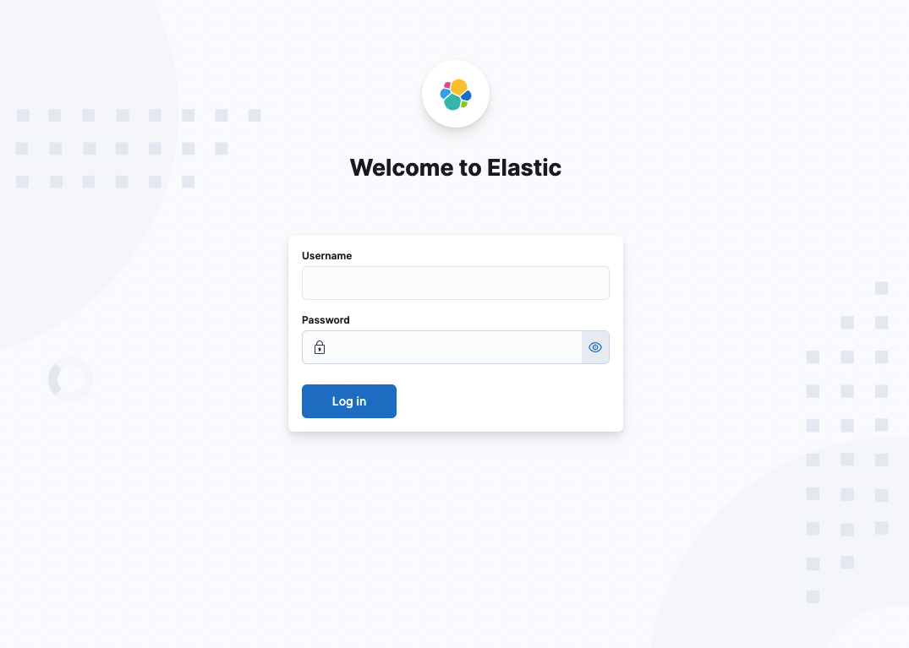
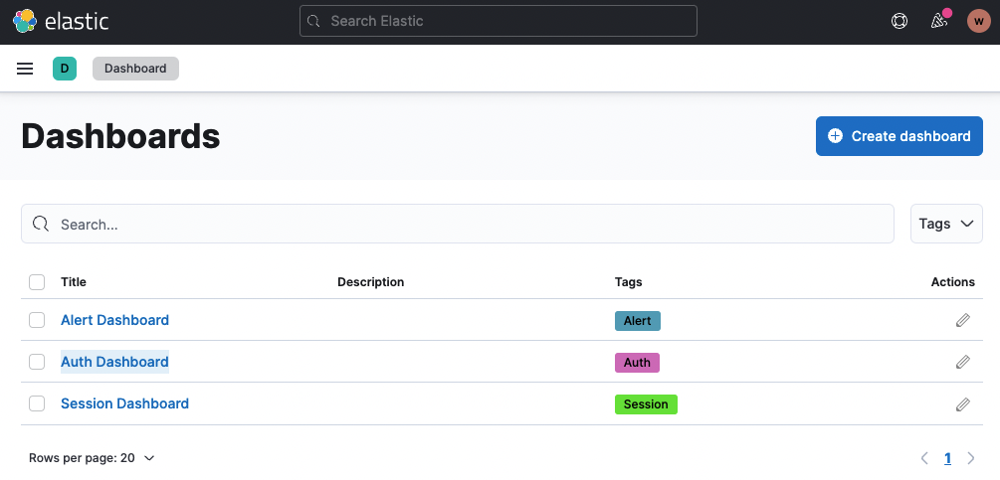
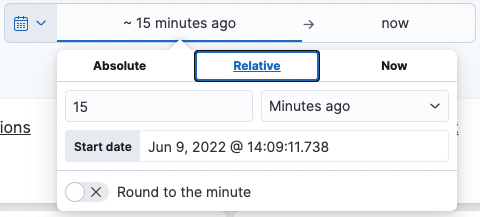
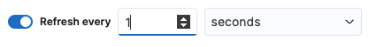
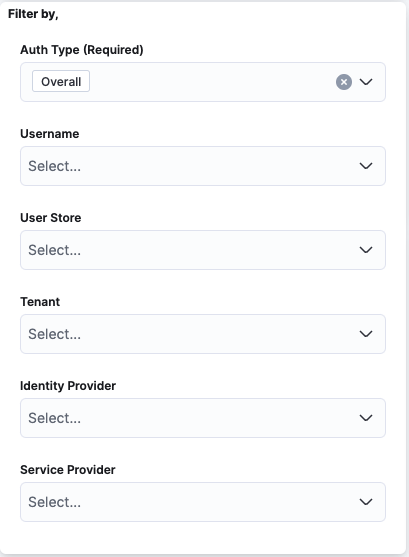

# Access the ELK Analytics Dashboard

Once you have [setup ELK analytics dashboards](../../../deploy/elk-analytics-installation-guide.md), follow the guide below to learn how to access the analytics dashboard.

1. Access Kibana using the following URL:
    <code>http://\{KIBANA_HOST\}:5601</code>

    

2. You can login to Kibana with the default `elastic` user or refer to the [elastic documentation](https://www.elastic.co/guide/en/elasticsearch/reference/current/users-command.html) and learn how to create a new user.

3. On the left panel, navigate to **Analytics** > **Dashboard** and click on **Auth Dashboard**.

    

4. Use the filter to set the time range in which to view the statistics and click **Update**.

    

5. To synchronize analytics automatically:
    1. Click the calendar icon in the time range filter.
    2. Toggle **Refresh every** at the bottom of the dropdown.
    3. Set your desired time interval.

        

6. You can use the following filters to narrow down your analytics further.

    

## What's Next?

Explore the following topics:

- [Analyze Login Attempts](/identity/7.0.0/guides/analytics/analyzing-login-attempts/)
- [Analyze Session Statistics](/identity/7.0.0/guides/analytics/analyzing-active-sessions/)
