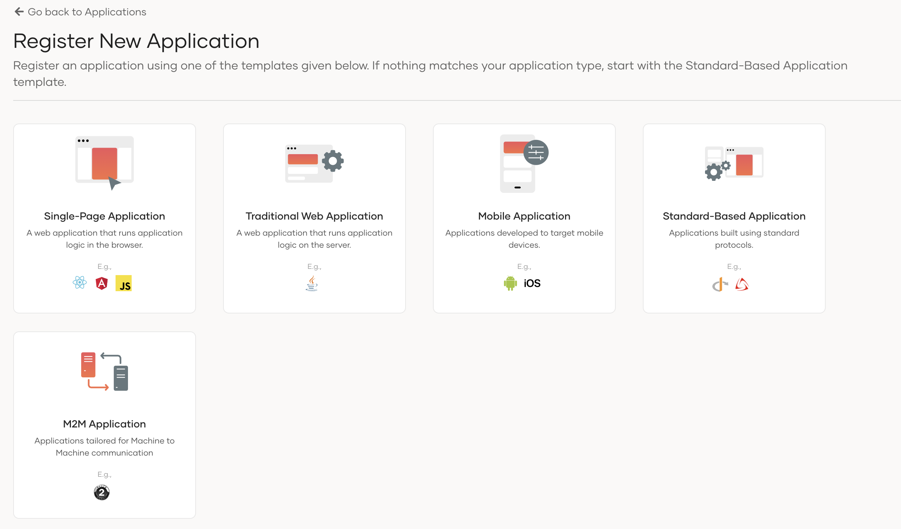
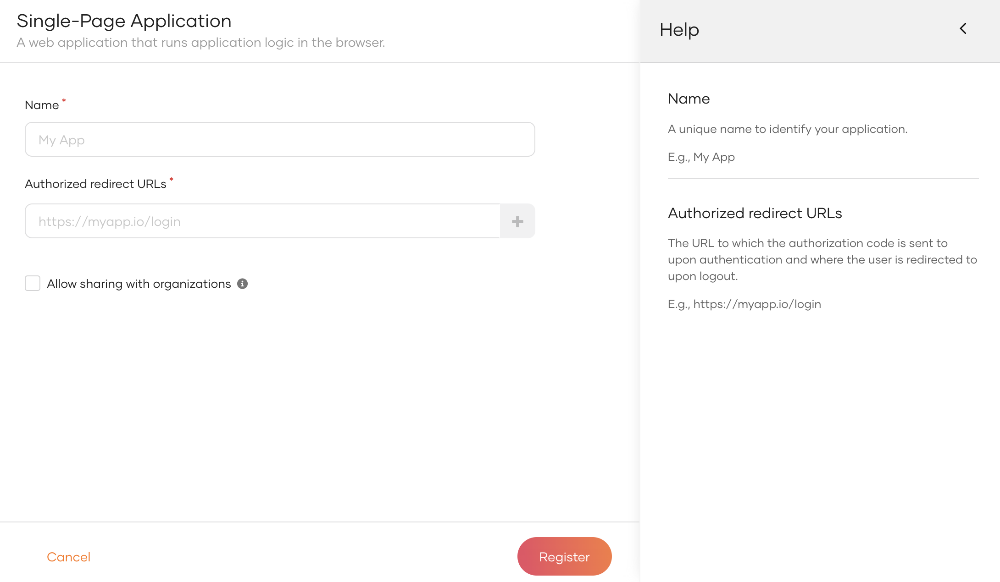
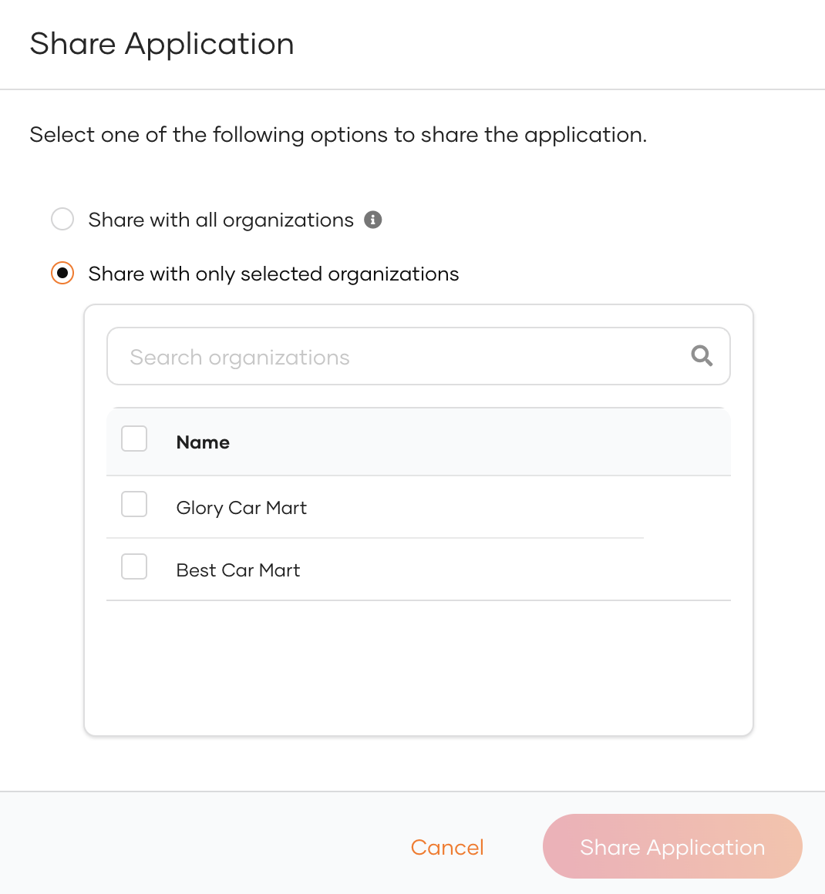
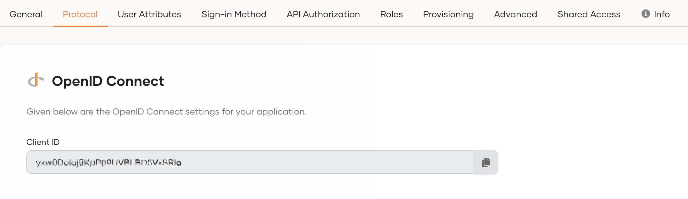

# Register an OpenID Connect single-page app

To add login to your single-page application with WSO2 Identity Server, you need to first register your app in WSO2 Identity Server.

Your app will be registered as an OpenID Connect single-page app, and a client ID will be issued. Note that client secrets are not issued because single-page apps are public clients. However, the [PKCE (Proof Key for Code Exchange)](../../references/app-settings/oidc-settings-for-app.md#proof-key-for-code-exchangepkce) extension is enabled by default as a security measure.

Follow the instructions given below.

## Register the app

To register the app:

1. On the WSO2 Identity Server Console, go to **Applications**.

2. Click **New Application** and select **Single-Page Application**.

    

3. Enter the following details:

    

    <table>
        <tr>
            <th>Parameter</th>
            <th>Description</th>
        </tr>
        <tr>
            <td>Name</td>
            <td>A unique name to identify your application.</td>
        </tr>
        <tr>
            <td>Authorized redirect URLs</td>
            <td>The URL to which the authorization code is sent upon user authentication and where the user is redirected upon logout.  Click <b>Add Now</b> if you want to try a sample app.</td>
        </tr>
        <tr>
            <td>Allow sharing with organizations</td>
            <td>Enable this to share the new application with all or any selected B2B organizations that belong to your primary organization.</td>
        </tr>
    </table>

4. Click **Register** to complete the registration.

    

    
Sharing with selected organizations

    If you have enabled **Allow sharing with organizations** while registering the application, you will see a popup window with the following options.

    

    <table>
        <tr>
            <th>Option</th>
            <th>Description</th>
        </tr>
        <tr>
            <td>Share with all organizations</td>
            <td>If selected, the application will be shared with all existing organizations and any new organizations you may create in the future.</td>
        </tr>
        <tr>
            <td>Share with only selected organizations</td>
            <td>If selected, you can select the organizations you wish to share the application with.</td>
        </tr>
    </table>

    

5. [Enable the application](index.md#enabledisable-an-application) when it is ready for use.

## Get the client ID

When you register your single-page application, a client ID is generated. Your application will identify itself to WSO2 Identity Server with this client ID.

You can get this client ID from the **Protocol** tab of the application as shown below.

## What's next?

- [Add login to your single-page app](../authentication/add-login-to-single-page-app.md)
