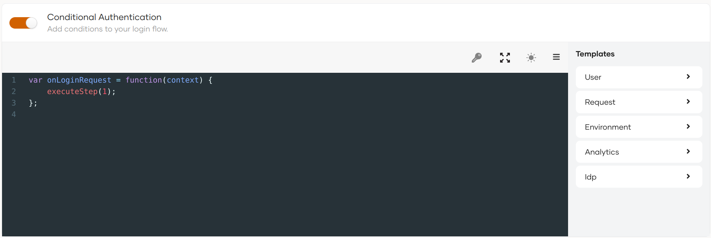

# Configure conditional authentication

Given below are the high-level steps for enabling conditional authentication in your applications.

:::note

- **Limitations**: Adaptive scripts do not support `Log.warn` logs or stringifying Java objects using `JSON.stringify()`.

:::
    

<Prerequisites>

## Prerequisites

[Register your application](../add-login-to-apps.mdx) on the WSO2 Identity Server Console.

:::warning[Before you proceed (only for JDK 17)]

If your system operates on JDK 17, refer to [Enable adaptive authentication](../../../deploy/enable-adaptive-authentication.mdx) to deploy WSO2 Identity Server with conditional authentication.

:::

</Prerequisites>

## Enable conditional authentication

Follow the steps given below.

1. On the WSO2 Identity Server Console, click **Applications**.
2. Select the application for which you wish to apply a conditional login flow and go to its **Login Flow** tab.
3. Click **Start with default configuration** to define the login flow starting with the `username and password` login.
4. Turn on **Conditional Authentication** by switching the toggle on. You can define your conditional authentication script in the editor.

    

    !!! warning Important
        As a security measure, WSO2 Identity Server does not allow the usage of two consecutive periods (`..`) in authentication scripts.

## Add conditional authentication script

There are two ways to add a conditional authentication script:

- Use a [predefined template](index.mdx#script-templates).
- Write a [new conditional auth script](write-your-first-script.mdx).
