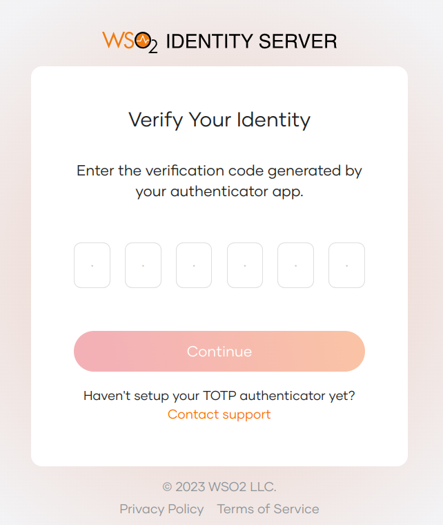

# Add MFA based on user group

You can enable a more secure login flow for users that belong to specific groups by applying the **Group-Based** conditional authentication template for **Adaptive MFA**. This template enables two-factor authentication with TOTP for users who belong to the user groups you specify.

## Scenario

Consider a scenario with two user groups, `manager` and `employee`. For users assigned to these groups, the login flow in applications should be stepped up with TOTP as follows:

1. Username and password
2. TOTP


<Prerequisites>

## Prerequisites

- You need to [register an application with WSO2 Identity Server](../../applications/index.mdx). You can register your own application or use one of the [sample applications](../../../get-started/try-samples/index.mdx) provided.

- Create two user groups named `manager` and `employee` and assign user accounts to them. For instructions, see the following:

      - [Managing groups](../../users/manage-groups.mdx)
      - [Managing users](../../users/manage-groups.mdx)

</Prerequisites>

## Configure the login flow

To enable conditional authentication:

1. On the WSO2 Identity Server Console, click **Applications**.

2. Select the relevant application and go to its **Login Flow** tab.

3. Add group-based adaptive MFA as follows:

    
1. Go to **Predefined Flows** > **Conditional Login Flows**.

2. Click **Adaptive MFA** > **Group-Based** > **ADD**.

    

3. Click **Confirm** to replace any existing script with the selected predefined script.


4. Verify that the login flow is now updated with the following two authentication steps:

    - Step 1: Username and Password
    - Step 2: TOTP

5. Update the following parameter in the script.

      <table>
         <thead>
            <tr>
               <th>Parameter</th>
               <th>Description</th>
            </tr>
         </thead>
         <tbody>
            <tr>
               <td><code>groupsToStepUp</code></td>
               <td><p>Comma separated list of user groups. Two-factor authentication should apply to users from these groups.</p> For this example scenario, enter <code>manager</code> and <code>employee</code>.</td>
            </tr>
         </tbody>
      </table>

6. Click **Update** to confirm.

## How it works

Shown below is the script of the group-based conditional authentication template.

```js
var groupsToStepUp = ['manager', 'employee'];

var onLoginRequest = function (context) {
   executeStep(1, {
      onSuccess: function (context) {
            // Extracting authenticated subject from the first step.
            var user = context.currentKnownSubject;
            // Checking if the user is assigned to one of the given groups.
            var isMember = isMemberOfAnyOfGroups(user, groupsToStepUp);
            if (isMember) {
               Log.info(getMaskedValue(user.username) + ' is a member of one of the groups: ' + groupsToStepUp.toString());
               executeStep(2);
            }
      }
   });
};
```

Let's look at how this script works.

1. When step 1 of the authentication flow is complete, the **onLoginRequest** function retrieves the user from the context.
2. The user and the configured list of groups are passed to the following function: `isMemberOfAnyOfGroups`.
3. This function (which is available in WSO2 Identity Server by default) verifies whether the given user belongs to any of the listed groups.
4. If the user belongs to any of the configured groups, authentication step 2 (TOTP) is prompted.

:::note

  Find out more about the scripting language in the [Conditional Authentication API Reference](../../../references/conditional-auth/api-reference.mdx).

:::

## Try it out

Follow the steps given below.

1. Access the application URL.
2. Try to log in with a user who does not belong to any of the configured groups (manager or employee). You will
   successfully sign in to the application.
3. Log out of the application.
4. Log in with a user who belongs to the `manager` or `employee` group or both. TOTP authentication is prompted.

    
