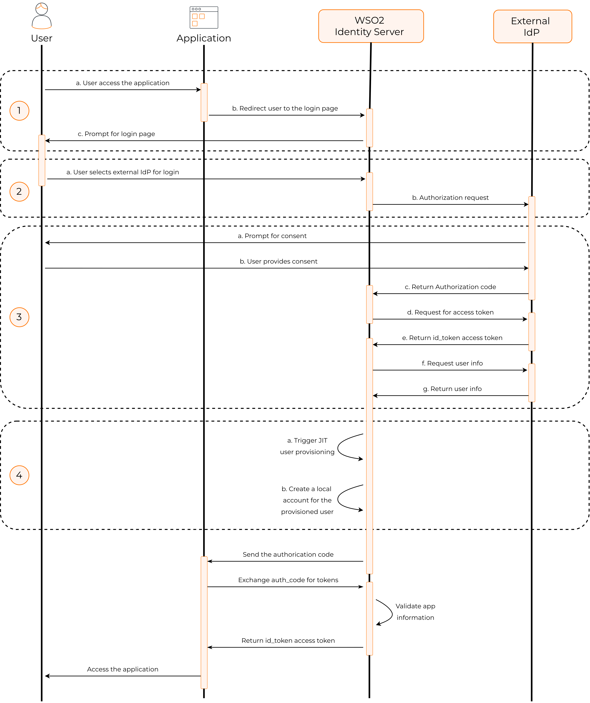
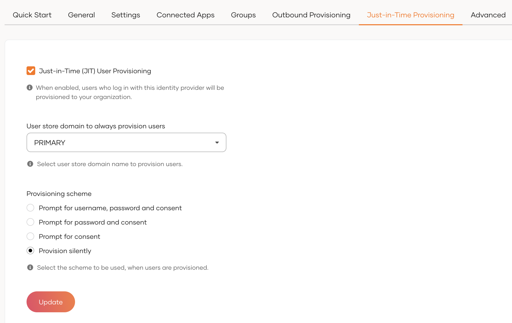

# Configure Just-in-Time user provisioning

This guide explains the concept of Just-In-Time (JIT) user provisioning, why and when to use it, and also the instructions for configuring it.

## Overview

Just-in-Time (JIT) user provisioning allows WSO2 Identity Server to automatically create a user account in its internal user store when a user successfully logs in using an external Identity Provider (IdP) for the first time.

This eliminates the need for manual user account creation in WSO2 Identity Server before users can log in using external IdPs.

JIT user provisioning works follows:

1. When an application initiates an authentication request, the user gets redirected to WSO2 Identity Server.

2. If the user selects an external IdP for authentication, WSO2 Identity Server redirects the user to the relevant IdP.

3. If WSO2 Identity Server receives a positive authentication response from the external IdP, JIT provisioning is triggered.

4. WSO2 Identity Server creates a user account in its internal user store along with the user attributes obtained from the authentication response.



With this process, new user accounts are automatically provisioned to WSO2 Identity Server when users log in with external IdPs.

## Enable JIT user provisioning

:::note


[Register the external IdP](federated-login/index.md) as a connection in WSO2 Identity Server.

:::

To enable JIT user provisioning for an external Identity provider:

1. On the WSO2 Identity Server Console, click **Connections** and select the relevant connection.

2. Go to the **Just-in-Time Provisioning** tab of the selected connection.

3. Check the **Just-in-Time (JIT) User Provisioning** checkbox to enable it. Uncheck to disable it.

    

4. Click **Update** to save.

:::warning


When JIT user provisioning is disabled, the following restrictions apply:

- Since WSO2 Identity Server does not create local user accounts for federated users, those users' attributes will not be stored in WSO2 Identity Server. Instead, attributes from the external IdP are passed directly to the application.

- If you have configured multi-factor authentication (MFA) that rely on a local user account, disabling JIT user provisioning breaks the application login flow for JIT provisioned users. Learn more about [troubleshooting sign-in flow errors with JIT](#troubleshoot-sign-in-flow-errors).

:::


### Preserve locally added claims of JIT provisioned users

If a user already having an account in WSO2 Identity Server logs in using federated login with the same email address, WSO2 Identity Server deletes any locally added claims of the user and retains only the claims provided by the federated authenticator.

If you wish to change this default behavior and preserve the locally added claims of the user, go to the `deployment.toml` file found in the `<IS_HOME>/repository/conf` directory and add the following configuration.

```toml
[authentication.jit_provisioning]
preserve_locally_added_claims = "true"
```

:::note

If an identity provider is created using the [Identity Provider REST APIs](../../apis/idp.md) with the `provisioning.jit.attributeSyncMethod` property set, this will take precedence over the above configuration.

:::


## Troubleshoot sign-in flow errors

If you have disabled JIT provisioning for an IdP, applications that use [multi-factor authentication](mfa/index.md) may break as certain MFA mechanisms (such as TOTP and Email OTP) require users to have local accounts in WSO2 Identity Server.

When configuring an application's sign-in flow involving JIT-disabled IdPs and such MFA options, WSO2 Identity Server displays the following warning:


To avoid unexpected errors, you can use the following conditional authentication script to skip the MFA step when using JIT-disabled connectors.

```js
var localAuthenticator = 'LOCAL';
var onLoginRequest = function (context) {
    executeStep(1, {
        onSuccess: function (context) {
            var step = context.steps[1];
            if (step.idp == localAuthenticator) {
                executeStep(2); // MFA Step
            }
        }
    });
};
```

:::note

For more information on this script, refer to the [sign-in option-based conditional authentication script](conditional-auth/sign-in-option-based-template.md#how-it-works).

:::
