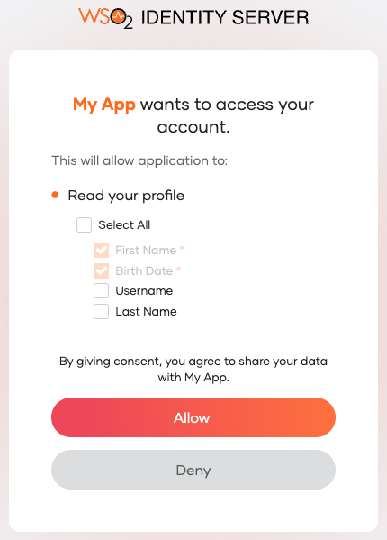
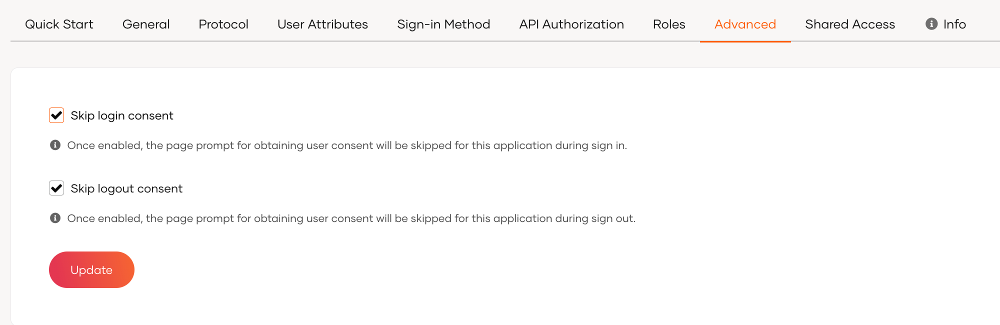

# Manage consent for user attributes

If [user attributes](user-attributes/index.md) are configured to be shared with an application, applications can access these attributes when the user logs in to the app. However, it may be necessary to get the user's consent before sharing the user's information.

In WSO2 Identity Server, you can either display a screen to request consent for user attributes or skip this step, as explained below.

## Get consent for user attributes

Once the user is logged in, WSO2 Identity Server requests consent to share the user's attributes with the application.

If the application requires **mandatory** attributes for which values are not specified in the [user profile](../users/manage-users.md#manage-user-profiles), WSO2 Identity Server will prompt the user to enter those values during login.

The user can do one of the following during login:

- Select specific user attributes and click **Allow**.

    This will share only the selected user attributes with the application. However, note that the user cannot unselect the mandatory user attributes.

- If the user does not want to share any of the requested user attributes, they can click **Deny**.

WSO2 Identity Server will not prompt for consent for the allowed attributes again unless a user revokes the provided consent via MyAccount.

## Enable the consent screen

If user consent is required for your application to access user information, you can enable the consent screen as follows:

1. Sign in to the WSO2 Identity Server and select the application for which you wish to enable user consent.
2. Go to the **Advanced** tab and uncheck the **Skip login consent** checkbox.

    
