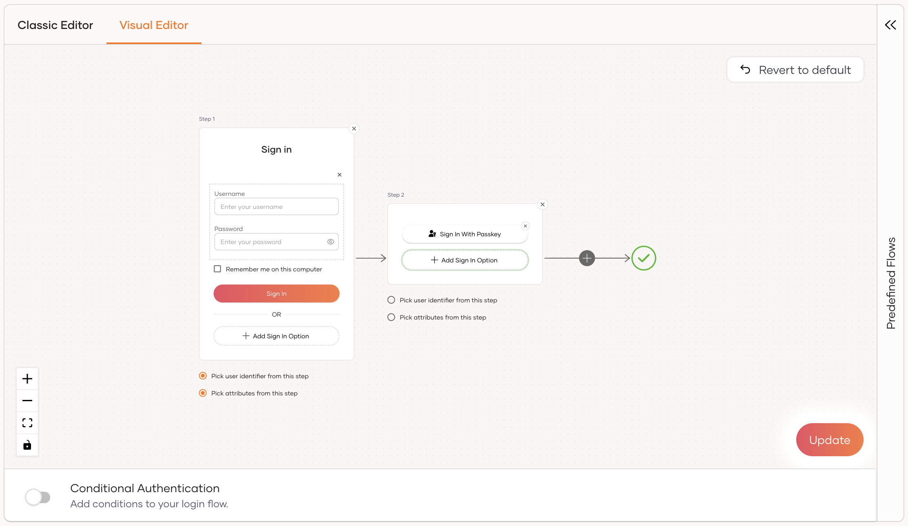
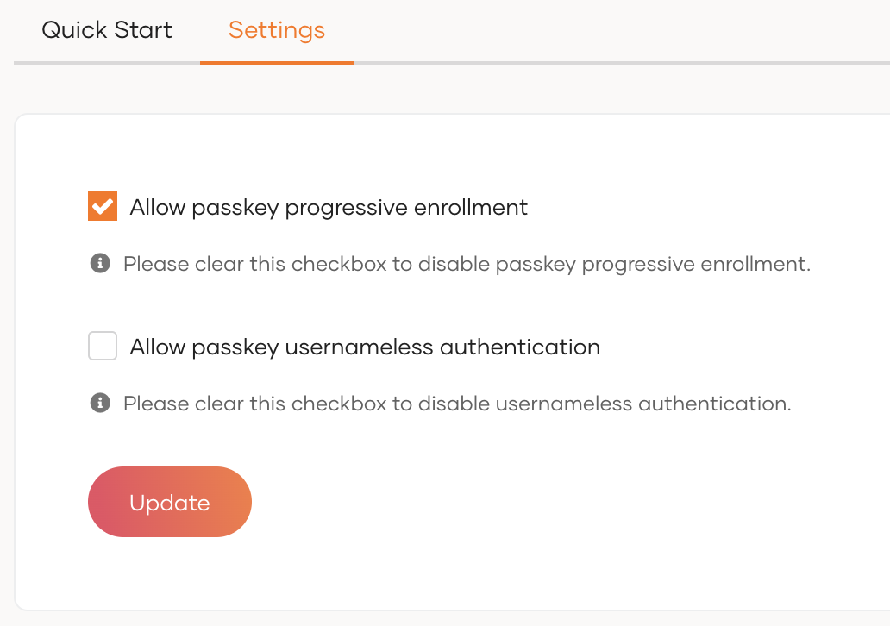
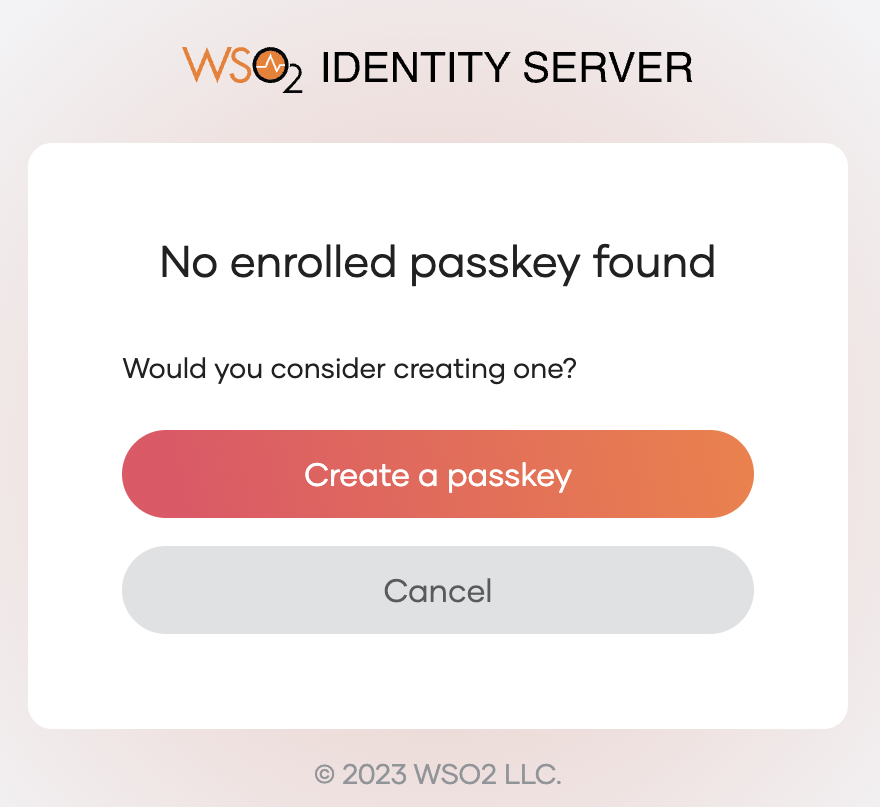
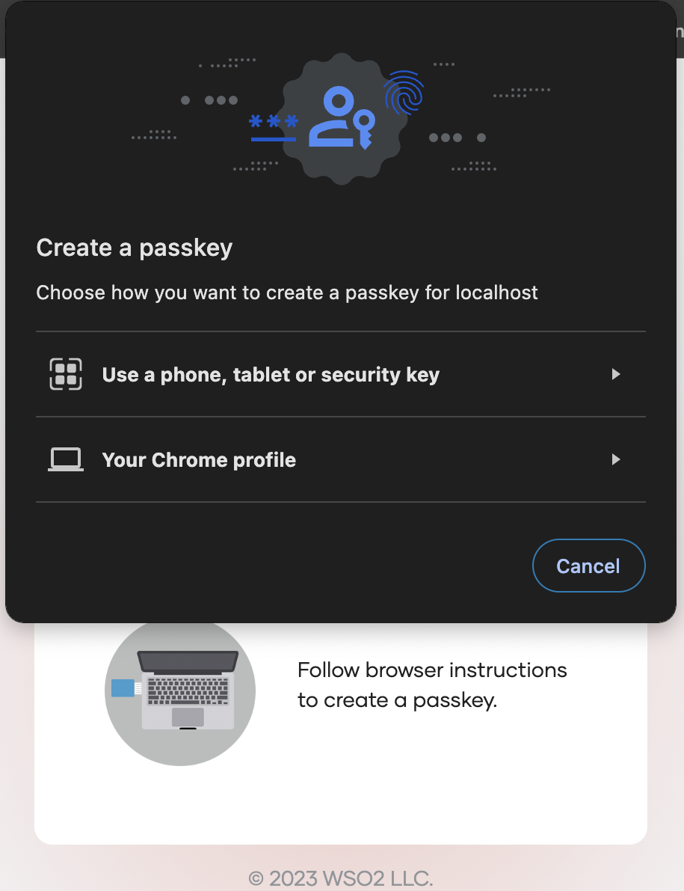
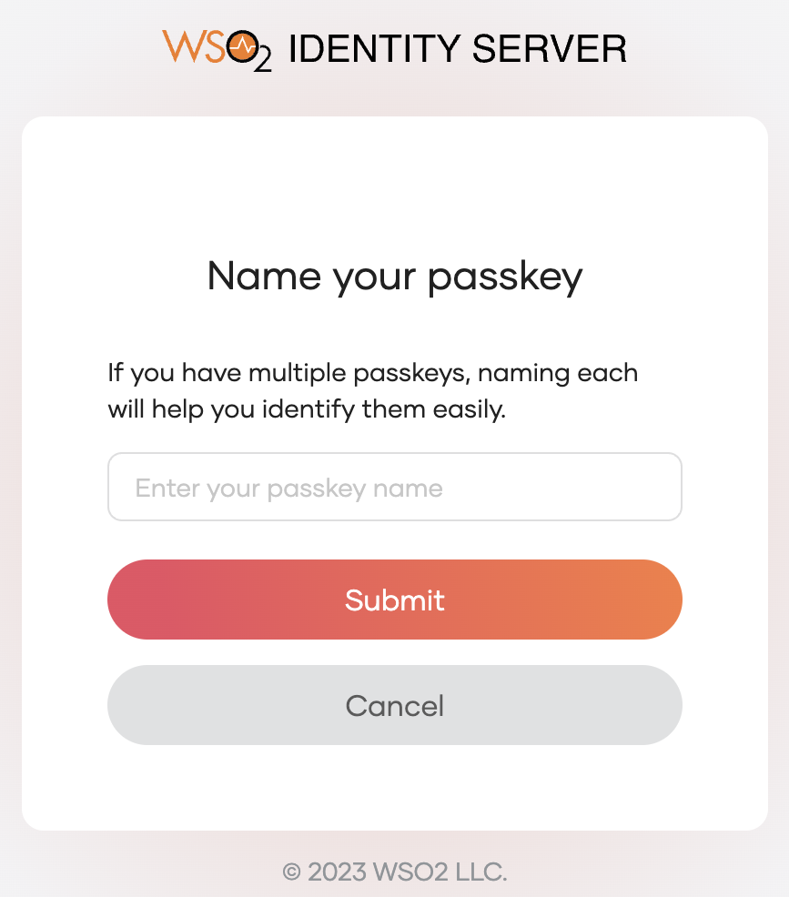

# Add MFA with Passkey

Passkey adds passwordless login to your applications, which allows users to replace traditional passwords with FIDO2-supported hardware security keys or built-in authenticators on their devices. This advanced technology also enables credentials to sync across multiple devices, allowing users to log into applications from any device, even if their credentials are stored on another.

Follow the instructions given below to configure Multi-Factor Authentication (MFA) using Passkey in WSO2 Identity Server.

:::info

- WSO2 Identity Server uses the WebAuthn API to enable FIDO-based authentication for browsers that no longer support the u2f extension.
- The following browser versions support the WebAuthn API by default:
    - Chrome 67 and above
    - Firefox 60 and above
    - Edge 17723 and above
- Passkey login with [platform authenticators](https://developers.yubico.com/WebAuthn/WebAuthn_Developer_Guide/Platform_vs_Cross-Platform.html#:~:text=types%20of%20authenticators%3A-,Platform%20authenticators,-%2C%20also%20known%20as) will NOT work on the Firefox browser in macOS Catalina, Big Sur, and Monterey due to browser limitations.
- Passkey login with [roaming authenticators](https://developers.yubico.com/WebAuthn/WebAuthn_Developer_Guide/Platform_vs_Cross-Platform.html#:~:text=Roaming%20authenticators) will NOT work on the Firefox browser as the browser doesn't support CTAP2 (Client to Authenticator Protocol 2) with PIN.
- Refer to the [passkeys documentation](https://passkeys.dev/device-support/) to stay up-to-date with the device support for FIDO2 passkeys.

:::

<Prerequisites>

## Prerequisites

- To get started, you need to [register an application with WSO2 Identity Server](../../applications/index.mdx). You can register your own application or use one of the [sample applications](../../../get-started/try-samples/index.mdx) provided.

- You need to have a user account in WSO2 Identity Server. If you don't already have one, [create a user account](../../users/manage-users.mdx#onboard-a-user) in WSO2 Identity Server.

- If Passkey progressive enrollment is disabled, [application users](../../users/manage-users.mdx#onboard-a-user) need to register their passkeys via the My Account app prior to using passkey login. Be sure to educate your users on how to [enroll passkeys via My Account.](../../user-self-service/register-passkey.mdx)

</Prerequisites>

## Enable passkey login for an app

Follow the steps given below to enable **Passkey** login for your application.

1. On the WSO2 Identity Server Console, go to **Applications**.

2. Select the application to which you wish to add Passkey.

3. Go to the **Login Flow** tab of the application and add Passkey from your preferred editor:

    
    1. Click **+** to add a second step to the login flow.

    2. Click **Add Sign In Option**, select **Passkey** and click **Add**.

    3. Click **Confirm** to add login with passkey to the sign-in flow.

        

    

4. Click **Update** to save your changes.

## Enable Passkey progressive enrollment

This feature allows users to enroll their passkey seamlessly during the usual login flow, offering a blend of convenience and security. Follow the steps given below to enable **Passkey** progressive enrollment for your application.

1. On the WSO2 Identity Server Console, go to **Connections**.

2. Select the **Passkey** connection.

3. Go to the **Settings** tab of the connection.

4. Enable the option for **Allow passkey progressive enrollment** by checking its checkbox.

    

5. Click **Update** to save your changes.

:::note

Passkey progressive enrollment can only be configured at the organizational level and cannot be modified at the application level.

:::

## Try it out

In this section, let’s try out the scenario where Passkey progressive enrollment is enabled and the user has not previously enrolled a passkey. The following steps will guide you through enrolling a passkey on-the-fly and then using it to sign in.

1. Access the application URL.

2. Click **Login** to access the WSO2 Identity Server login page.

3. Enter your username and password, then click **Sign In**.

4. Click **Create a passkey** to give the consent to create a passkey.

    

6. Follow the instructions given by your browser or device to enroll the passkey.

    

7. Enter a unique name to your passkey for identification.

    

8. Click **Submit** to complete the enrollment. You'll be authenticated in the application.

:::note

For passkeys to function as a second factor alongside federated authenticators, users should have their external accounts already provisioned in WSO2 Identity Server. If, for example, an external user logs in with Google using an account not provisioned in WSO2 Identity Server, attempting a Passkey login will result in an error and the login flow fails.

:::
