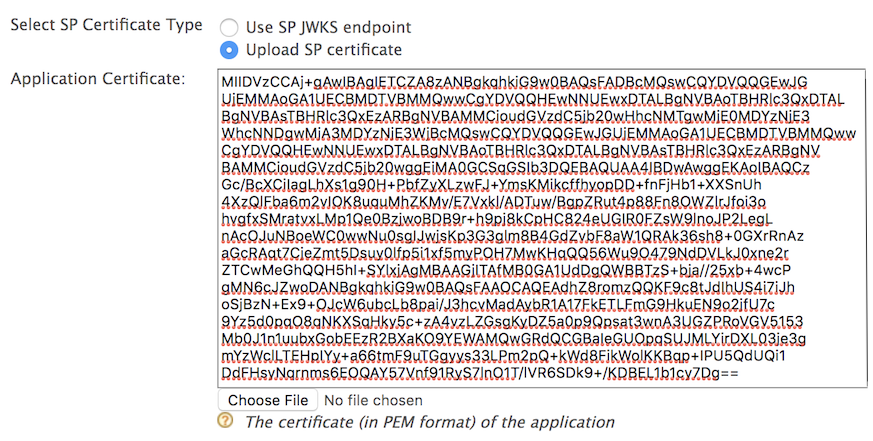
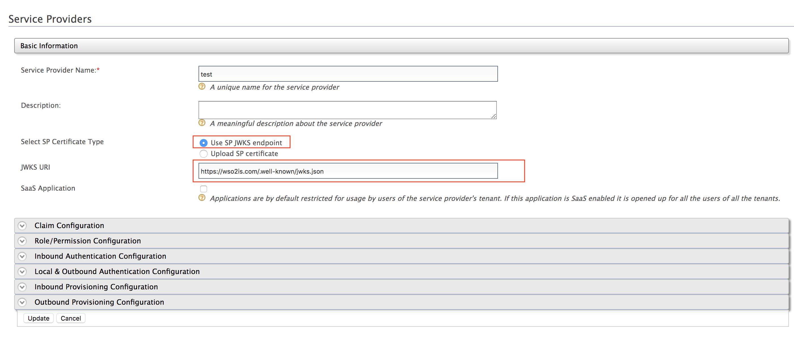
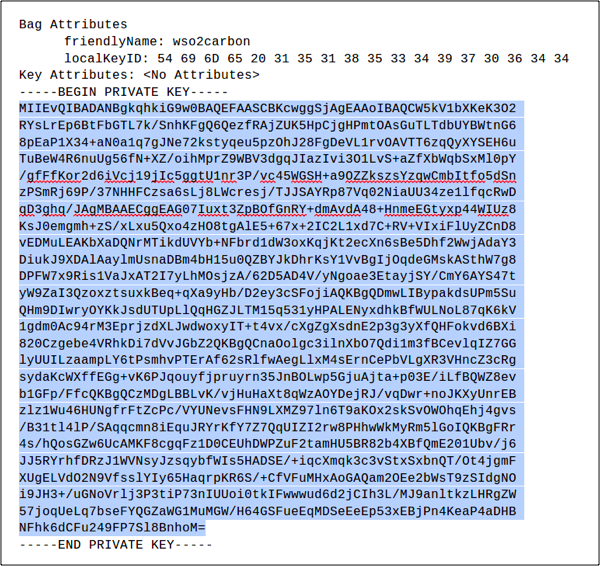

# Encrypt ID tokens

This page guides you through configuring token encryption for ID tokens.

## Register an application

Register an application by following the instructions in the relevant guide based on your application type:

- [Register a standard-based application](../../applications/register-standard-based-app.md)
- [Register an OIDC web application](../../applications/register-oidc-web-app.md)
- [Register a single-page application](../../applications/register-single-page-app.md)
- [Register a mobile application](../../applications/register-mobile-app.md)

----

## Configure the application

Make the following changes to the registered application.

1. On the WSO2 Identity Server Console, go to **Applications**.

2. Select your application and go to its **Protocol** tab.

3. Enter the **Authorized redirect URLs**.

    :::note

    The **Authorized redirect URLs** is the exact location in the application to which an access token will be sent. This URL should be the URL of the page that the user is redirected to after successful authentication.

    :::

4. Select **Enable ID Token Encryption** to enable ID token encryption.

    Once you enable ID token encryption, two select boxes will be visible to choose your preferred encryption algorithm and encryption method.

    - **Encryption Algorithm:** Asymmetric encryption algorithm that is used to encrypt the Content Encryption Key (CEK), using the public key of the application.

    - **Encryption Method:** Symmetric encryption algorithm that is used to encrypt the JWT claims set using the CEK.

    Leave these values as they are if you do not have any specific requirements.

5. Click **Update**.

----

## Configure the public certificate

The following steps describe how to configure an application public certificate.

1. Create a new keystore.

    ```bash
    keytool -genkey -alias wso2carbon -keyalg RSA -keysize 2048 -keystore testkeystore.jks -dname "CN=*.test.com,OU=test,O=test,L=MPL,ST=MPL,C=FR" -storepass wso2carbon -keypass wso2carbon -validity 10950
    ```

2. Create a file and name it as the client ID of the OAuth application. Export the public key of the new keystore to the file you created.

    ```bash
    keytool -export -alias wso2carbon -file <client-id> -keystore testkeystore.jks
    ```

3. Get the cert in X509 format.

    ```bash
    keytool -printcert -rfc -file <client-id>
    ```

    You will see the public certificate in X509 format in the console.

4. Copy the content of the certificate. A sample output is shown below.

    ```bash
    -----BEGIN CERTIFICATE-----
    MIIDVzCCAj+gAwIBAgIETCZA8zANBgkqhkiG9w0BAQsFADBcMQswCQYDVQQGEwJG
    UjEMMAoGA1UECBMDTVBMMQwwCgYDVQQHEwNNUEwxDTALBgNVBAoTBHRlc3QxDTAL
    BgNVBAsTBHRlc3QxEzARBgNVBAMMCioudGVzdC5jb20wHhcNMTgwMjE0MDYzNjE3
    WhcNNDgwMjA3MDYzNjE3WjBcMQswCQYDVQQGEwJGUjEMMAoGA1UECBMDTVBMMQww
    CgYDVQQHEwNNUEwxDTALBgNVBAoTBHRlc3QxDTALBgNVBAsTBHRlc3QxEzARBgNV
    BAMMCioudGVzdC5jb20wggEiMA0GCSqGSIb3DQEBAQUAA4IBDwAwggEKAoIBAQCz
    Gc/BcXCiIagLhXs1g90H+PbfZyXLzwFJ+YmsKMikcffhyopDD+fnFjHb1+XXSnUh
    4XzQlFba6m2vIOK8uquMhZKMv/E7Vxkl/ADTuw/BgpZRut4p88Fn8OWZlrJfoi3o
    hvgfxSMratvxLMp1Qe0BzjwoBDB9r+h9pj8kCpHC824eUGIR0FZsW9lnoJP2LegL
    nAcOJuNBoeWC0wwNu0sgIJwjsKp3G3glm8B4GdZvbF8aW1QRAk36sh8+0GXrRnAz
    aGcRAqt7CjeZmt5Dsuy0lfp5i1xf5myPOH7MwKHqQQ56Wu9O479NdDVLkJ0xne2r
    ZTCwMeGhQQH5hI+SYlxjAgMBAAGjITAfMB0GA1UdDgQWBBTzS+bja//25xb+4wcP
    gMN6cJZwoDANBgkqhkiG9w0BAQsFAAOCAQEAdhZ8romzQQKF9c8tJdIhUS4i7iJh
    oSjBzN+Ex9+OJcW6ubcLb8pai/J3hcvMadAybR1A17FkETLFmG9HkuEN9o2jfU7c
    9Yz5d0pqO8qNKXSqHky5c+zA4vzLZGsgKyDZ5a0p9Qpsat3wnA3UGZPRoVGV5153
    Mb0J1n1uubxGobEEzR2BXaKO9YEWAMQwGRdQCGBaIeGUOpqSUJMLYirDXL03je3g
    mYzWclLTEHpIYy+a66tmF9uTGgyys33LPm2pQ+kWd8FikWolKKBqp+IPU5QdUQi1
    DdFHsyNqrnms6EOQAY57Vnf91RyS7lnO1T/lVR6SDk9+/KDBEL1b1cy7Dg==
    -----END CERTIFICATE-----
    ```

5. On the WSO2 Identity Server Console, go to **Applications** and select your application.

6. Go to the **Advanced** tab.

7. Select **PEM Certificate** under **Certificate type**.

8. Paste the certificate content copied in step 4 in the **PEM Certificate** field.

    

    :::note

    Instead of uploading the application certificate as shown above, you can choose to use the JWKS endpoint as shown below and add the relevant JWKS URI.

    

    :::

9. Click **Update**.

----

## Try it

This section guides you through obtaining an encrypted ID token and decrypting it. Alternatively, you can use a simple Java program to decrypt the token. For instructions, see [Decrypt the ID token](oidc-token-decryption.md).

1. See the relevant OIDC flow implementation guide and try out one of the grant types with the `openid` scope to obtain an access token:
    - [Implement authorization code flow](implement-auth-code.md)
    - [Implement authorization code flow with PKCE](implement-auth-code-with-pkce.md)

2. You will receive an access token and an encrypted ID token.

3. To decrypt the ID token, provide the private key of the client.

    1. Import JKS into a PKCS12 formatted store.

        ```bash
        keytool -importkeystore -srckeystore testkeystore.jks -destkeystore testkeystore.p12 -srcstoretype JKS -deststoretype PKCS12 -srcstorepass wso2carbon -deststorepass wso2carbon -srcalias wso2carbon -destalias wso2carbon -srckeypass wso2carbon -destkeypass wso2carbon
        ```

    2. Extract the private key into a file named `key.pem`.

        ```bash
        openssl pkcs12 -in testkeystore.p12 -out key.pem -passin pass:wso2carbon -passout pass:wso2carbon -nodes -nocerts
        ```

    3. Open the created `key.pem` file using a text editor and you will see the extracted private key.

    4. Copy only the key string as shown in the sample below.

        

    5. Use the private key to decrypt the ID token.

:::info[Related topics]

- [Concept: ID Token](/identity/7.0.0/references/concepts/authentication/id-token/)
- [Guide: Implement authorization code flow](implement-auth-code.md)
- [Guide: Decrypt the ID token](oidc-token-decryption.md)

:::
