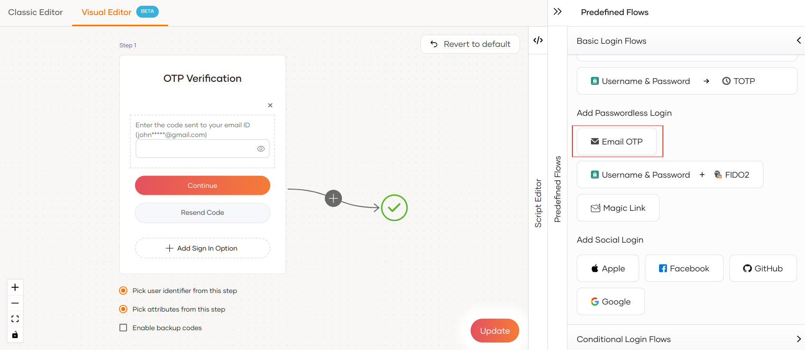
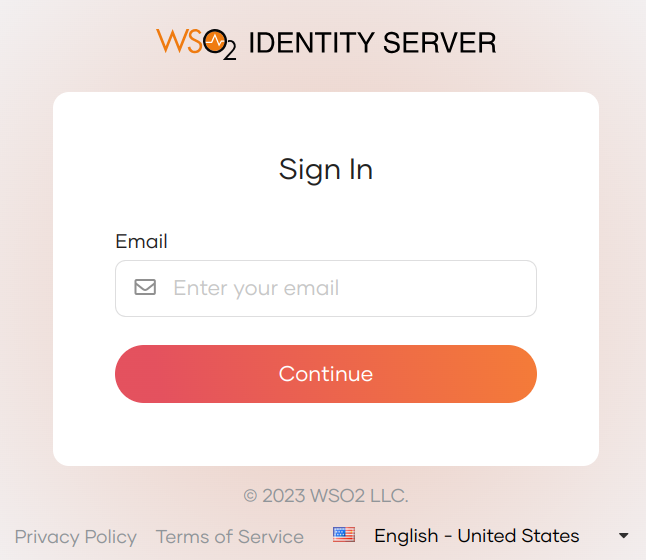
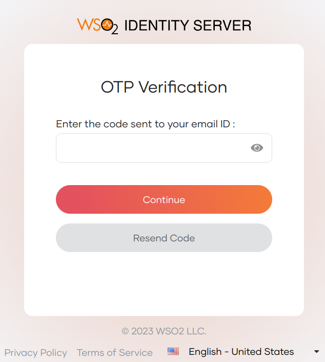
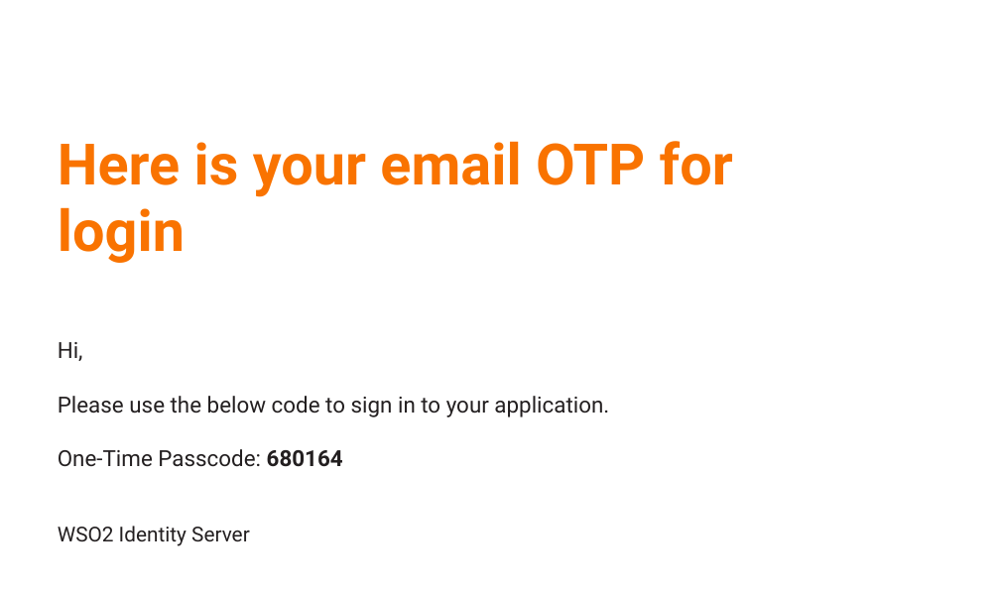

# Add Email OTP login

Email OTP is a form of passwordless authentication. It allows users to log in by providing a one-time passcode sent to their email instead of entering a password.

## Prerequisites
- To get started, you need to [register an application with WSO2 Identity Server](../../applications/index.md). You can register your own application or use one of the [sample applications](../../../get-started/try-samples/index.md) provided.

- You need to have a user account in WSO2 Identity Server. If you don't already have one, [create a user account](../../users/manage-users.md#onboard-a-user) in WSO2 Identity Server.

- You need to [configure the email sending module](../../../../deploy/configure/email-sending-module) for the WSO2 Identity Server to send the email OTP to the users.

## Enable Email OTP login for an app

Follow the steps given below to add **Email OTP** login to the login flow of your application.

1. On the WSO2 Identity Server Console, go to **Applications**.

2. Select the application to which you wish to add email OTP login.

3. Go to the **Login Flow** tab of the application and add email OTP login as follows:

    

    1. Go to **Predefined Flows** > **Basic Flows** > **Add Passwordless login**.

    2. Select **Email OTP**.

    3. Click **Confirm** to add passwordless login with email OTP to the sign-in flow.

        

    

4. Click **Update** to save your changes.

## Try it out

Follow the steps given below.

1. Access the application URL.
2. Click **Login** to open the WSO2 Identity Server login page.
3. On the WSO2 Identity Server login page, enter your username and press **Continue**.

    

    You will be redirected to the below email OTP page.

    

4. Check your inbox for the email containing the one-time passcode. The email reads as follows.

    

5. Enter the received passcode in the email OTP page and click on **Continue**.
