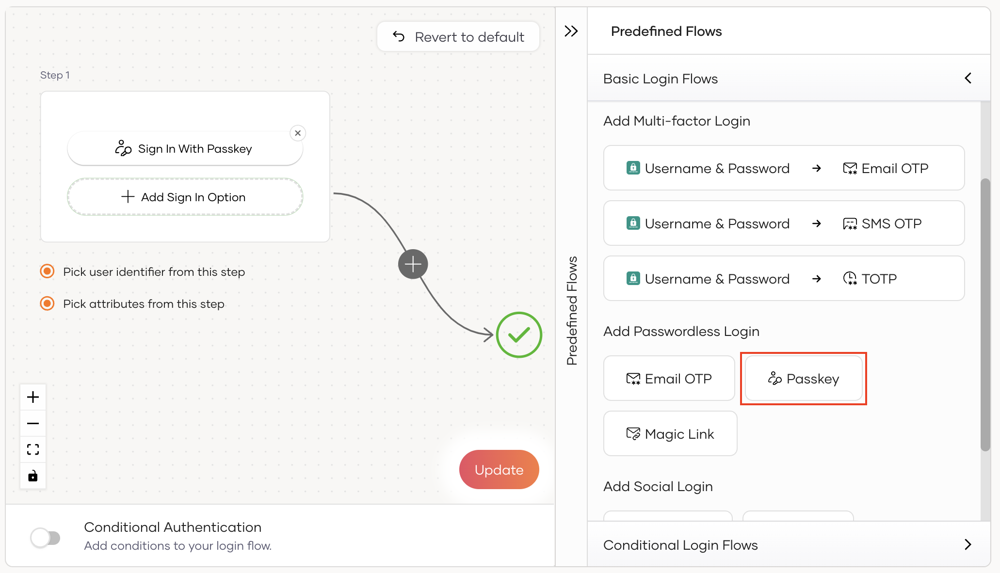
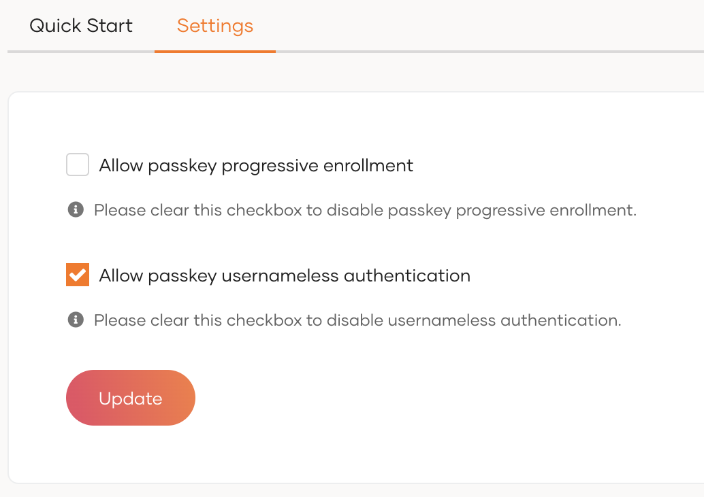
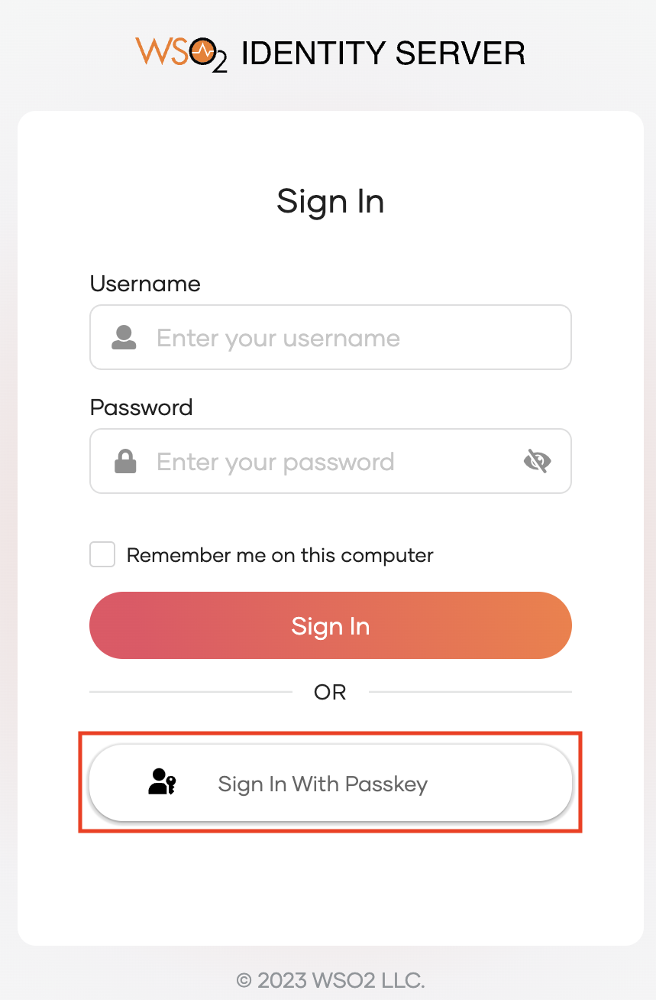
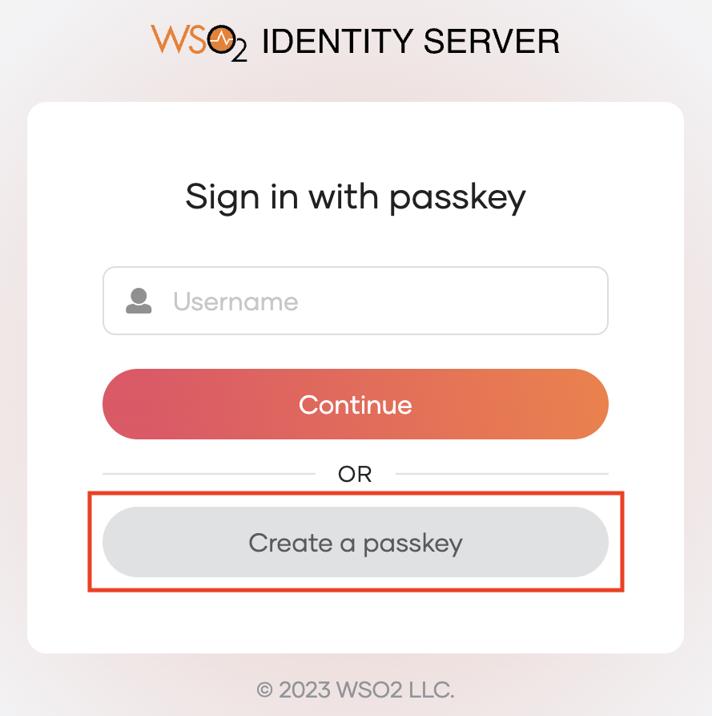
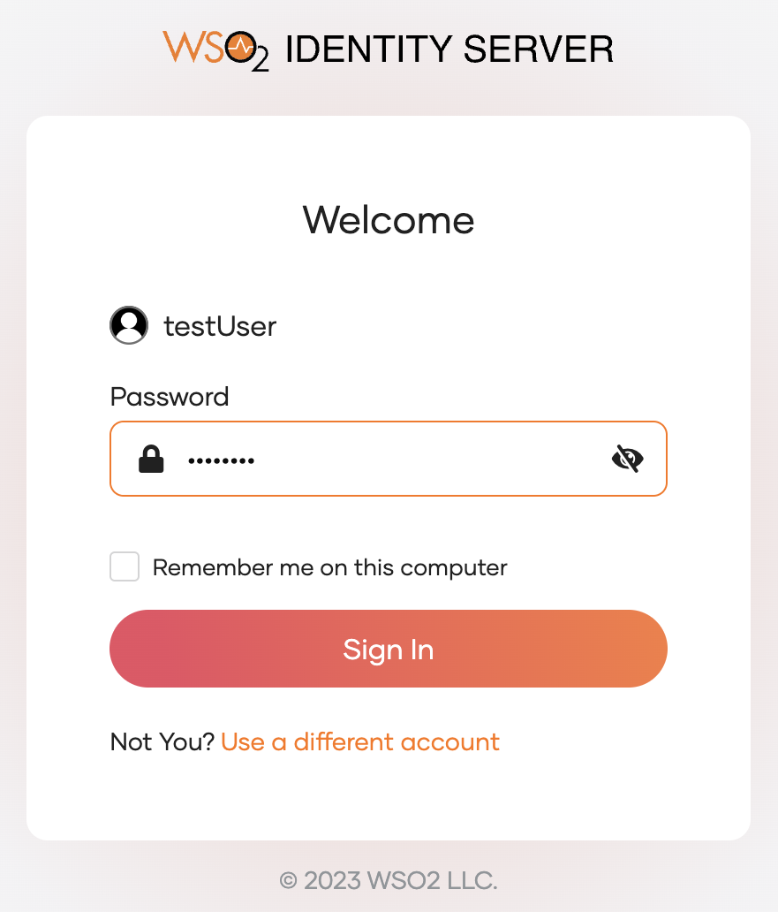
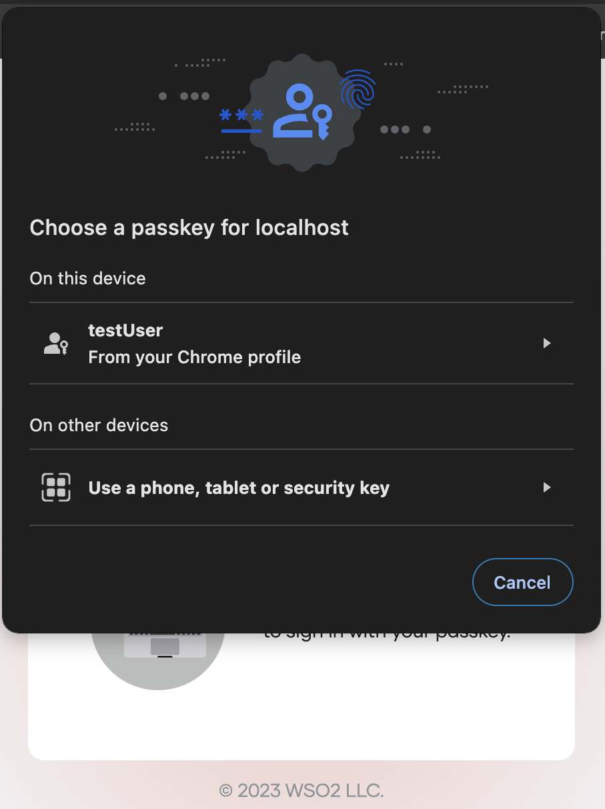

# Add Passkey login

Based on FIDO concepts, **Passkeys** are a replacement for traditional passwords that allows users to log in to applications without a password using the following methods.
    <ul>
    <li><b>Roaming authenticators</b> - platform-independant FIDO2-supported hardware security keys such as YubiKey.</li>
    <li><b>Platform authenticators</b> - built-in biometrics bound to a single device such as fingerprint scanners or facial recognition features.</li>
    </ul>

Passkeys are phishing resistant and they provide an enhanced user experience as users are not required to manage and remember multiple passwords.

:::note[What is FIDO2?]

The FIDO Alliance, whose mission is to reduce the world's reliance on passwords, introduced its latest specifications, collectively called FIDO2. FIDO2 specifications are the World Wide Web Consortium's (W3C) Web Authentication specification (WebAuthn) and FIDO alliance's corresponding Client to Authenticator Protocol (CTAP). Learn more about [FIDO2](https://fidoalliance.org/fido2/).

:::

There are two types of passkeys based on how they are synchronized.

- **Single-Device Passkeys**

    These passkeys are bound to a single device and are not meant to be shared across multiple devices. Single-device passkeys are useful if you want to reduce the impact of an attack if the credentials are compromised.

- **Multi-Device Passkeys**

    These passkeys enable synchronization across multiple devices allowing users to log into an application from any device, even when their credentials are stored on another.

    Major vendors have already introduced their passkey implementations.

    - Apple users will find their passkeys synced across all devices that are signed into the same Apple ID and iCloud Keychain. Refer to the [Apple documentation](https://developer.apple.com/passkeys/) for more information.

    - Android users will have their passkeys synced across all devices linked to their Google account.  Refer to the [Google documentation](https://developers.google.com/identity/passkeys) for more information.

    If the devices do not sync through the cloud, a user can generate a QR code in the other device and scan it using the device that stores the passkeys to successfully log into the application.

    Refer to the [passkeys documentation](https://passkeys.dev/device-support/) to stay up-to-date with the device support for FIDO2 passkeys.

:::info

- WSO2 Identity Server uses the WebAuthn API to enable FIDO-based authentication for browsers that no longer support the u2f extension.
- The following browser versions support the WebAuthn API by default:
    - Chrome 67 and above
    - Firefox 60 and above
    - Edge 17723 and above
- Passkey login with platform authenticators will NOT work on the Firefox browser in macOS Catalina, Big Sur, and Monterey due to browser limitations.
- Passkey login with roaming authenticators will NOT work on the Firefox browser as the browser doesn't support CTAP2 (Client to Authenticator Protocol 2) with PIN.

:::

The following guide explains how you can enable log in with passkeys in your application.

## Prerequisites

- To get started, you need to [register an application with WSO2 Identity Server](../../applications/index.md). You can register your own application or use one of the [sample applications](../../../get-started/try-samples/index.md) provided.

- You need to have a user account in WSO2 Identity Server. If you don't already have one, [create a user account](../../users/manage-users.md#onboard-a-user) in WSO2 Identity Server.

## Enable passkey login

Follow the steps given below to enable login with passkeys for your application.

1. On the WSO2 Identity Server Console, go to **Applications**.

2. Select the application to which you wish to add passkey login.

3. Go to the **Login Flow** tab of the application and add passkey login as follows:

    
    1. Go to **Predefined Flows** > **Basic Flows** > **Add Passwordless login**.

    2. Select **Passkey**.

    3. Click **Confirm** to add passwordless login with passkey to the sign-in flow.

        
    

4. Click **Update** to save your changes.

## Enable users to register passkeys during login

Enabling users to enroll their passkeys on the fly offers a blend of convenience and security. To do so:

1. On the WSO2 Identity Server Console, go to **Connections**.

2. Select the `Passkey` connection and go to its **Settings** tab.

3. Select the **Allow passkey progressive enrollment** checkbox.

    

4. Click **Update** to save your changes.

5. [Add the passkey progressive enrollment adaptive script](../conditional-auth/passkey-progressive-enrollment-based-template.md) to the login flow of the application.

:::note

- If progressive enrollment is disabled, users need to pre-register their passkeys from the MyAccount portal. Learn how to do so in [Register passkeys](../../user-self-service/register-passkey.md).

- Passkey progressive enrollment can only be configured at the organizational level and cannot be modified at the application level.

:::

## Configure usernameless passkey login

Usernameless authentication enhances user experience by eliminating the need for users to enter a username during login with passkeys. This is the default behavior in WSO2 Identity Server. Follow the steps given below to configure passkey usernameless authentication for your application.

1. On the WSO2 Identity Server Console, go to **Connections**.

2. Select the **Passkey** connection.

3. Go to the **Settings** tab of the connection.

4. Select the **Allow passkey usernameless authentication** checkbox to enable usernameless authentication.

    :::note

    If this option is disabled, users are prompted to enter the username during login with passkeys.

    :::

    

5. Click **Update** to save your changes.

:::note

Passkey usernameless authentication can only be configured at the organizational level and cannot be modified at the application level.

:::

## Try it out

The following guides let you try out a scenario where, passkey progressive enrollment is **enabled** and passkey usernameless authentication is **disabled**.

### Enroll a passkey

Follow the steps below to enroll a passkey on the fly during login.

1. Access the application URL.

2. Click **Login** to access the WSO2 Identity Server login page.

3. Select **Sign In With Passkey**.

    

4. To enroll a new passkey, enter your username and select **Create a passkey**.

    

5. Enter the corresponding password for the user and click **Sign In**.

    

6. Follow the instructions given by your browser or device to enroll the passkey.

    

7. Provide a name to uniquely identify your passkey.

    

8. Click **Submit** to complete the enrollment. You'll be authenticated in the application.

### Sign in with passkey

Follow the steps below to use an enrolled passkey to sign in to an application.

1. Navigate to the login page of the application.

1. Click  **Login** to access the WSO2 Identity Server login page.

3. Select **Sign In With Passkey**.

4. Enter your username and select **Continue**.

5. Follow the browser/device instructions to log in with a passkey.

    

:::note

During passkey progressive enrollment, if a user wishes to use a federated authenticator, they should have their external accounts already provisioned within WSO2 Identity Server. If, for example, a user logs in with Google using an account not provisioned in WSO2 Identity Server, passkey enrolment results in an error and the login flow fails.

:::

## Use passkeys with app-native authentication

:::tip[What is app-native authentication?]

App-native authentication is an API-based mechanism that provides users with a seamless login experience right within the application. This eliminates the need to redirect users to an external web browser for authentication. Follow the guide to learn more about [app-native authentication](../app-native-authentication/index.md).

:::

Passkeys support app-native authentication. This is especially useful for mobile applications to provide a seamless, passwordless login experience. Since users enter their passkeys directly within the application, iOS and Android platforms enforce mandatory validation processes to verify an application's association with the identity provider's domain. These validations ensure the authenticity of the authentication requests and help protect against credential theft by malicious actors.

To successfully validate authentication requests, iOS and Android platforms require specific application details to be hosted on your domain at the following publicly accessible URLs:

- For Android - `<your_domain>/.well-known/assetlinks.json`
- For iOS - `<your_domain>/.well-known/apple-app-site-association`

When using passkeys with app-native authentication, make sure you host the required files on your domain and structure the data according to the formats expected by [iOS](https://developer.apple.com/documentation/xcode/supporting-associated-domains) and [Android](https://developer.android.com/identity/sign-in/credential-manager#add-support-dal).
