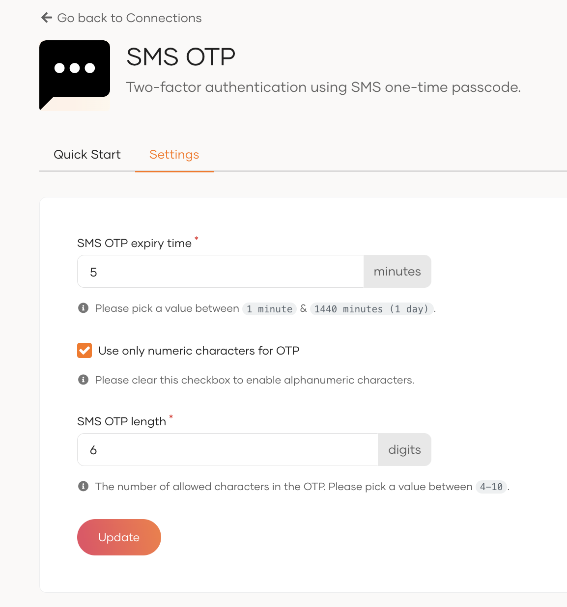
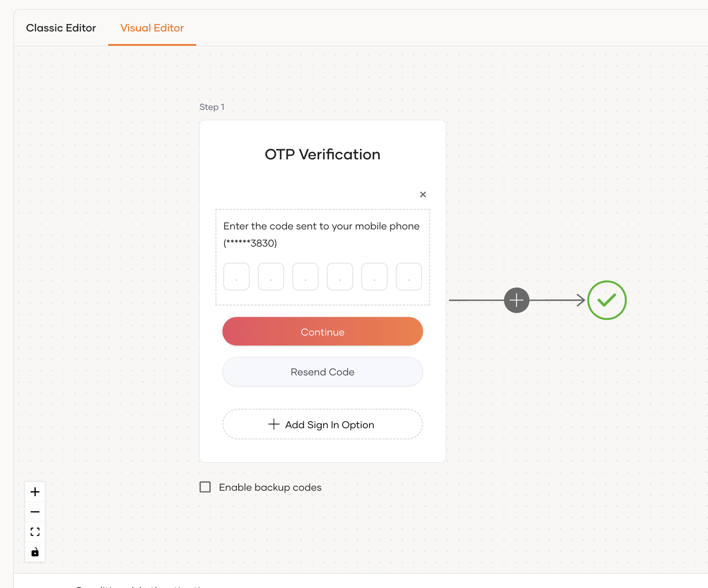
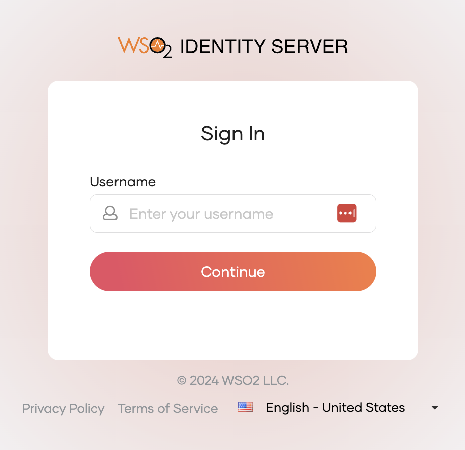
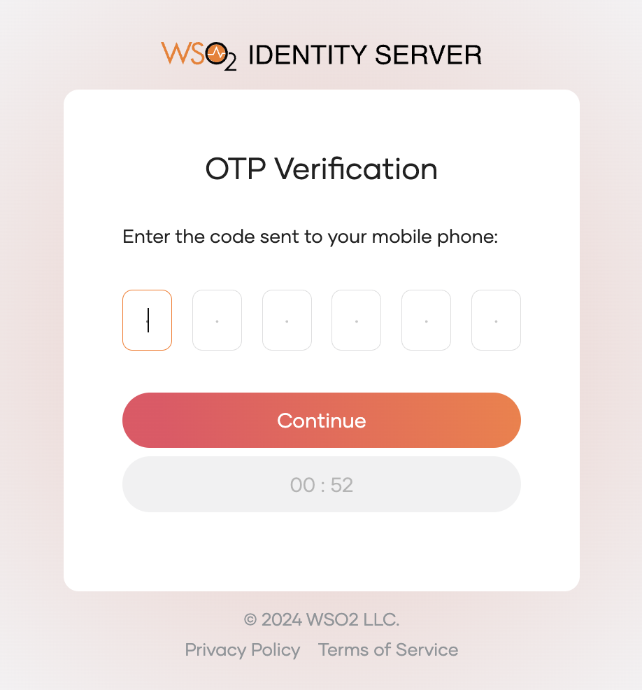

# Add SMS OTP login

An SMS one-time password (OTP) delivers a short-lived code to the user’s registered mobile number. This works as a passwordless authentication mechanism, allowing users to log in without a password by entering the OTP received via SMS.

Follow the instructions given below to implement passwordless login using SMS OTP in WSO2 Identity Server.

## Prerequisites

- To begin, you must [register an application with WSO2 Identity Server](../../applications/index.md). You have the option to register your own application or use one of the [sample applications](../../../get-started/try-samples/index.md) available.

- Ensure you have a user account in WSO2 Identity Server. If not, you can [create a user account](../../users/manage-users.md#onboard-a-user) within WSO2 Identity Server.

- [Update the user profile of the users](../../users/manage-users.md#update-the-profile) with an mobile number to which the user will receive the OTP.

- Configure your preferred SMS provider in WSO2 Identity Server. For detailed instructions, see [Configure SMS providers](../../notification-channels/configure-sms-provider.md).

## Configure SMS OTP

To update the default SMS OTP settings:

1. On the WSO2 Identity Server Console, go to **Connections** and select **SMS OTP**.
2. Update the following parameters in the **Settings** tab:
   
   <table>
         <tr>
           <th>Field</th>
           <th>Description</th>
         </tr>
         <tr>
           <td><code>SMS OTP expiry time</code></td>
           <td>Specifies the OTP expiry time. The generated OTP won't be valid after this time.</td>
         </tr>
         <tr>
           <td><code>Use only numeric characters for OTP</code></td>
           <td>
               Specifies whether to use only numeric characters in the OTP. If this is selected, the generated OTP contains only digits (0-9).
               If this option is not selected, the OTP will contain alphanumeric characters.
           </td>
         </tr>
         <tr>
           <td><code>SMS OTP length</code></td>
           <td>Specifies the number of characters allowed in the OTP.</td>
         </tr>
         <tr>
           <td><code>Allowed OTP resend attempt count</code></td>
           <td>Specifies the number of allowed OTP resend attempts.</td>
         </tr>
   </table>
3. Once you update the SMS OTP settings, click **Update**.

## Enable SMS OTP login for your app

Follow the steps given below to add **SMS OTP** login to the login flow of your application.

1. On the WSO2 Identity Server Console, go to **Applications**.

2. Select the application to which you wish to add SMS OTP login.

3. Go to the **Login Flow** tab of the application and add SMS OTP login as follows:

    

    1. Go to **Predefined Flows** > **Basic Flows** > **Add Passwordless login**.

    2. Select **SMS OTP**.

    3. Click **Confirm** to add passwordless login with SMS OTP to the sign-in flow.

        
    

4. Click **Update** to save your changes.

## Try it out

Follow these steps to test the SMS OTP login:

1. Visit the application URL.
2. Click **Login** to bring up the WSO2 Identity Server login page.
3. On the login page, enter your username and click **Continue**.

    

    This action redirects you to the SMS OTP page.

    

4. Check your phone for the SMS containing the one-time password (OTP).

5. Enter the received OTP on the SMS OTP page and click **Continue**.
