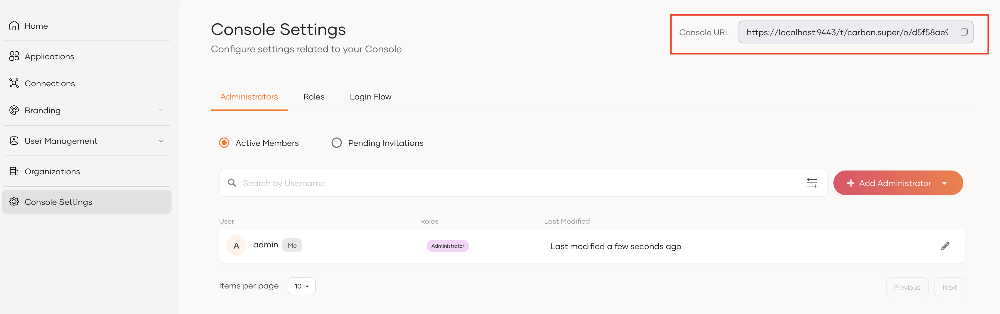

# Administration of organizations

As the organization creator, you may delegate administration of a child organization to a user of that organization. You may facilitate administration for an organization by creating a dedicated administration portal or by using the organization Console. The following guides explain these two scenarios in detail.

## Implement an administration portal

You may implement an administration portal by leveraging the [organization APIs](../../apis/organization-apis/index.mdx). These APIs are tailor-made for managing organizations created under the root organization.

:::note


Your administration portal should be registered as an application in WSO2 Identity Server and be authorized to consume organization APIs. Learn how to do this in [API authorization](../authorization/api-authorization/api-authorization.mdx).

:::

The administration portal should facilitate the following features for organization admins.

### Manage users

Organization admins should be able to perform the following user-related operations within the organization.

- Onboard and manage users. You may facilitate this using the [user management - SCIM2 API](/identity/7.0.0/apis/organization-apis/org-user-mgt/#/).

- Create and manage groups for users. You may facilitate this using the [group management - SCIM2 API](/identity/7.0.0/apis/organization-apis/org-group-mgt/#/).

- Manage roles associated with applications shared with the organization. You may facilitate this using the [role management - SCIM2 API](/identity/7.0.0/apis/organization-apis/org-group-mgt/#/).


### Onboard identity providers

Organization users may already be registered in another identity provider (IdP). In such a scenario, you should facilitate organization admins to onboard IdPs to the organizations. Hence, users may use existing credentials and a familiar interface to log in to applications.

You may facilitate this using the [identity provider API](/identity/7.0.0/apis/organization-apis/org-idp/).

### Define application login flows

The login flows of applications shared by the root organization should be customizable by an organization admin. They should be able to decide the number of login steps that should be configured and what login methods each step should contain.

You may facilitate this using the [application management API](/identity/7.0.0/apis/organization-apis/org-application-management/).

:::note[Extend administration tasks]


Explore the [organization APIs](../../apis/organization-apis/index.mdx) of WSO2 Identity Server that are available for you to enable all the required administration capabilities from your administration portal.

:::

## Use the Console as the administration portal

WSO2 Identity Server Console can also function as an administration portal for your B2B application which is accessible through the following URL:

```

https://localhost:9443/t//o/<organization id>/console

```

However, the following limitations apply.
<ul>
    <li>The Console is not customizable.</li>
    <li>The Console will not reflect the branding customizations of your organization.</li>
    <li>The login flow of the Console does not adhere to the customizations done for the application. (You may change the login flow for the Console under <b>Console settings</b> >  <b>Login Flow</b>.)</li>
    <li>The Console access is governed by separate roles and are not linked to your B2B application roles.</li>
</ul>  

:::note[Find the Console ID]


As the B2B SaaS provider, you may copy the organization URL and share it with your customers/partners. Also, you may integrate the Console URL with your application to provide a seamless experience for your customers/partners.

To locate your organization URL,

1. Log in to the WSO2 Identity Server Console.
2. Go to **Organizations** and select the organization that you want to share the URL of.
3. Switch to that organization.
4. Go to **Console Settings** and click **Copy** next to the **Console URL**.



:::
