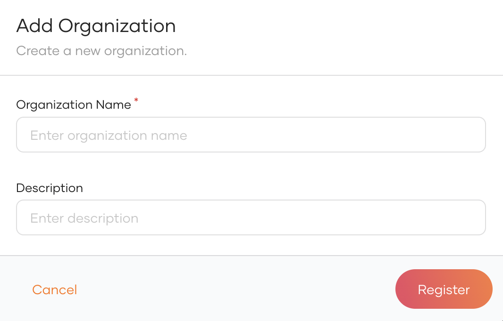
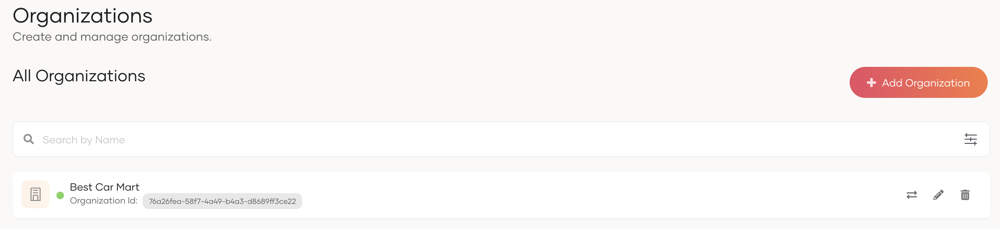
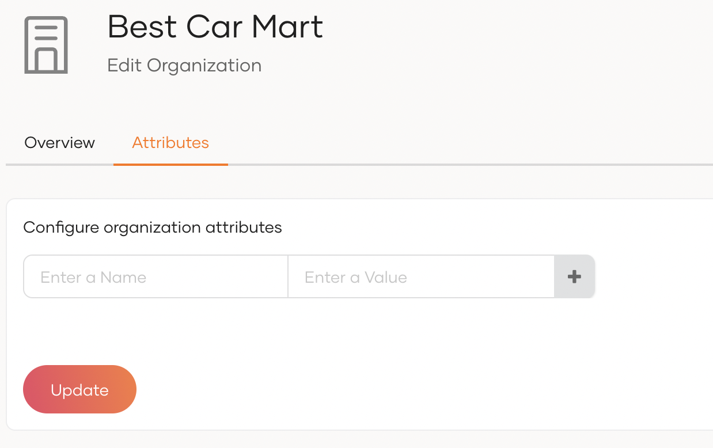
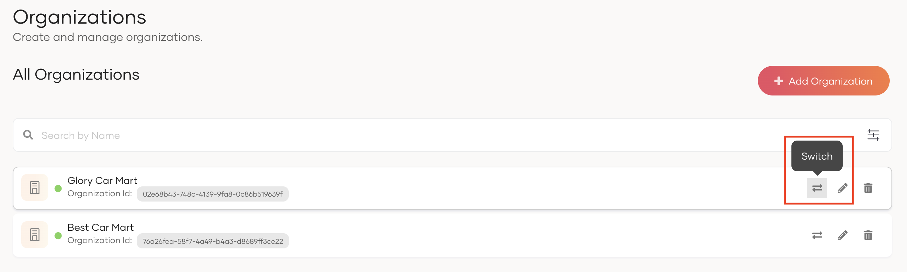

# Set up organizations

As a B2B (Business-to-Business) service provider, you can use WSO2 Identity Server organizations to represent your partner businesses. This guide explains how you can manage these organizations.

<Prerequisites title="Before you begin">

Ensure you have organization management privileges in the organization (root).

</Prerequisites>
    

## Create an organization

Follow the steps given below to create an organization.

1. Login to your organization (root) from the WSO2 Identity Server Console.
2. On the WSO2 Identity Server Console, go to **Organization Management** > **Organizations** and click **Add Organization**.
3. In the **Add Organization** dialog box that opens, enter a name and description for your organization.

    

    

4. Click **Register** to add the new organization.

5. View the created organization under **Organizations**.

    

6. Click the **Switch** icon next to the organization name to switch to its console.

:::note

As the creator of the organization, you will be assigned to the `Administrator` role of the Console application by default, which grants you the following privileges.

- Update / Delete users.
- Create a group and assign users.
- Assign users and groups to roles.
- Create identity providers.
- Update the login options and general information of the applications shared from the organization (root). Learn more about [shared applications](share-applications.mdx).
- Configure the branding of the organization. Learn more about [branding](../branding/configure-ui-branding.mdx).
- Build an organization hierarchy by creating organizations.

:::

## Add organization attributes

WSO2 Identity Server lets you maintain additional data about organizations. For example, you can add information about the organization's location, country, number of employees, etc.

To add additional attributes for your organization:

1. Login to the organization (root) and go to **Organizations**.
2. Select the organization to which you wish to add additional attributes.
3. Go to the **Attributes** tab and add attributes by entering a **Name** and **Value**.
4. Click **+** to add the new organization attribute.

    

5. Click **Update** to save the configurations.

## Switch to an organization

You can switch to a child organization on the WSO2 Identity Server Console by selecting the required organization from the list as shown below.

## Build an organizational hierarchy

Organizations can be structured hierarchically in WSO2 Identity Server. This means that if you are a parent organization, you may have multiple child organizations and each child organization can have their own child organizations and so on. This enables you to easily reflect the real-world structure of your business in WSO2 Identity Server.

If you are a parent organization admin and you wish to create a new organization in your child organization:

1. On the WSO2 Identity Server Console, [switch to your organization](#switch-to-an-organization).
2. Go to **Organizations** and click **Add Organization**.
3. In the **Add Organization** dialog box that opens, enter a unique name and description for your organization.
4. Click **Register** to add the new organization.

## Branding for organizations

You can configure UI branding, and email branding for your own organization from the WSO2 Identity Server Console.

If the organization doesn't have its own branding configurations, it will inherit the UI branding, and email branding configurations from the nearest ancestor that has configured branding.

:::note

See the instructions on:

- [how to configure UI branding](../branding/configure-ui-branding.mdx) for organizations.
- [how to customize email branding](../branding/customize-email-templates.mdx#customize-email-branding) for organizations.

:::
