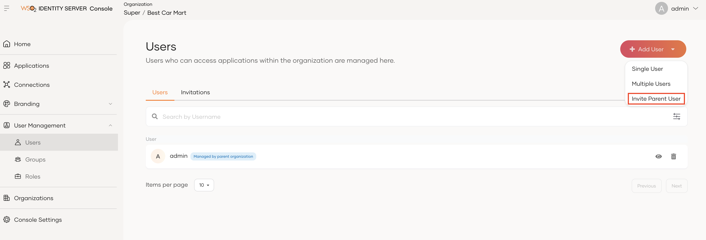
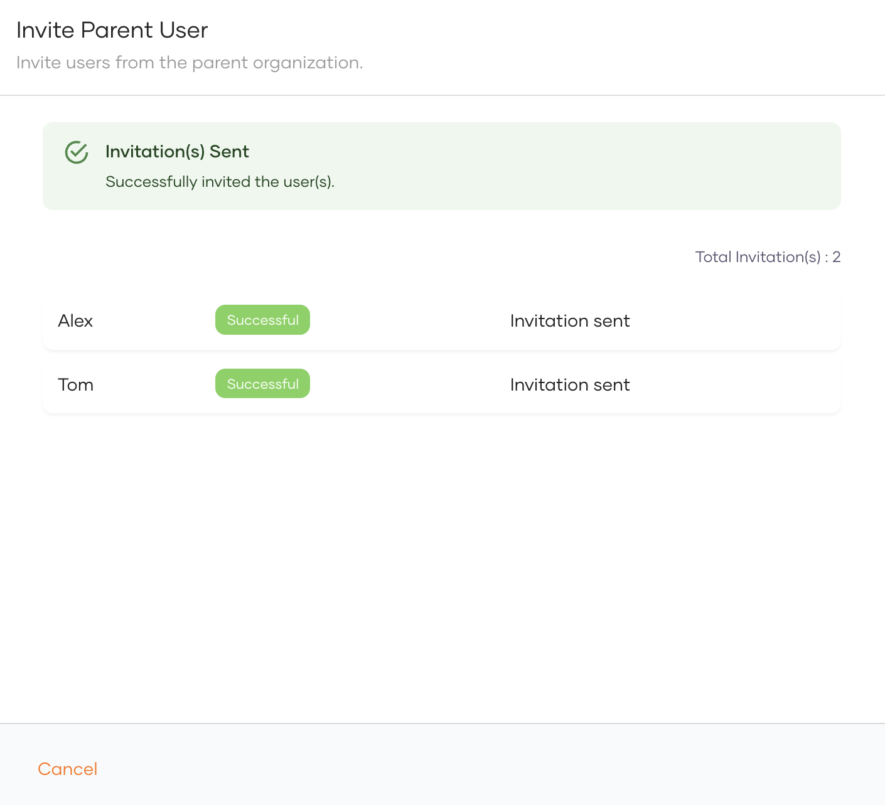
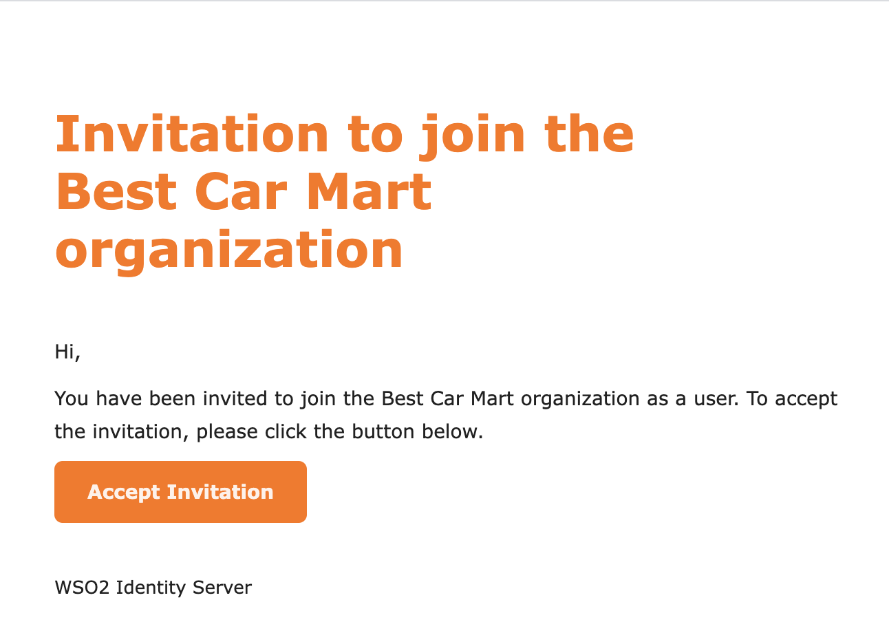
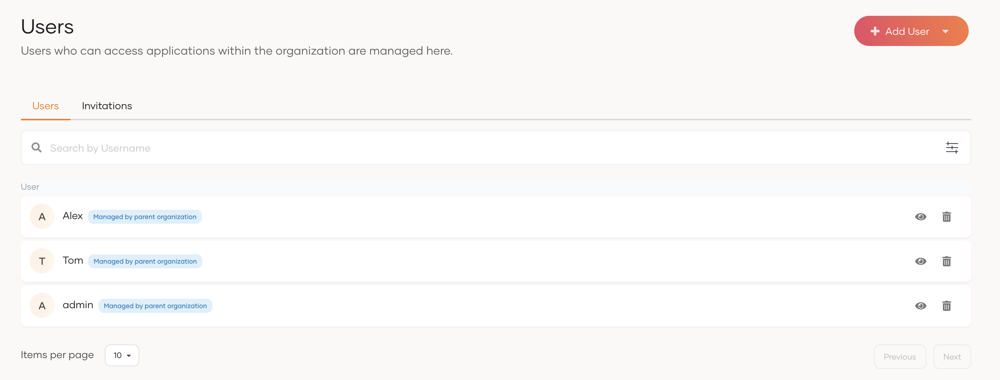
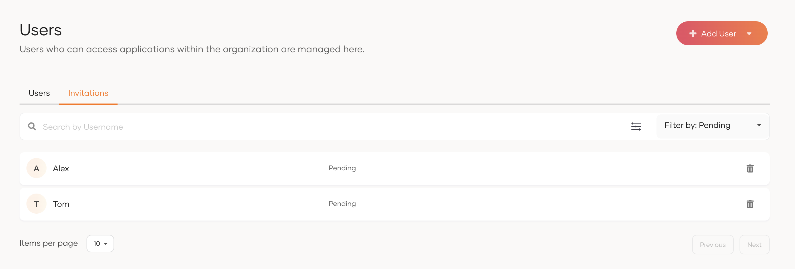

# Onboard users to organizations

Organization administrators can add users to their organization using the following methods.

- Onboard users from

<Prerequisites title="Before you begin">

- Make sure you have created an organization in WSO2 Identity Server and onboarded an administrator. See how to [create an organization](index.mdx) and [onboard admins](onboard-org-admins/index.mdx).
- In the following guides, the organization's management interface is referred to as the Console. Make sure you switch to the correct organization and perform actions within its Console. Learn how to [switch organizations](manage-organizations.mdx#switch-to-an-organization).

</Prerequisites>

## Onboard new users from the Console

Organization administrators can use the Console to create users in the organization. Users can be added individually or as a collection from the Console.

- To add a single user, follow this [guide](../users/manage-users.mdx#onboard-single-user).
- To add multiple users, follow this [guide](../users/manage-users.mdx#onboard-multiple-users).


## Invite existing users from the parent organization

Sometimes, organizations might need help from parent organization members when carrying out administrative tasks. In such cases, organization administrators can invite parent organization users to join. Additionally, if more parent organization members are needed, administrators can delegate the task of joining them to those who have already joined the organization.

When you invite users, you can also assign them to specific roles to provide the right level of permissions. 

<Prerequisites>

### Prerequisites

In order to invite users from the parent organization, get to know the usernames of the users through an offline channel.

</Prerequisites>

### Invite users

If a user of the organization with WSO2 Identity Server Console access needs to invite a user from the parent organization, follow the steps below.

1. Login to your organization using the link 
   
   `https://localhost:9443/t//o/{organization-id}/console`.
   
2. Go to **User Management > Users** and click **Add user**. From there, select **Invite Parent User**.
3. Enter the usernames of the user that you want to invite to the organization. You can enter multiple usernames by pressing enter after each username input.
4. Select the groups that you want to assign to the invited users.
5. Click **Invite**.
6. The invited users will receive an email notification with the invitation link which they can click to accept.

    :::note

    - You can only invite users from your immediate parent organization.
    - WSO2 Identity Server Console allows you to invite users from the PRIMARY user store of your immediate parent. To invite a user from a different user store, use the [invite parent user API](../../apis/organization-apis/organization-user-invitation.mdx#tag/Parent-Organization-User-Invitation/operation/invitationTriggerPost).

    :::

If a user, who is a member of both the organization and parent organization, wishes to invite more members from the parent organization, follow the steps below.

1. Login to your organization (root) on the WSO2 Identity Server Console.
2. Go to **Organizations** and select the organization to which you wish to invite users.
3. [Switch](manage-organizations.mdx#switch-between-organizations) to that organization.
4. Go to **User Management > Users** and click **+ Add user**. From there, select **Invite Parent User**.

    

5. Enter the usernames of the users that you want to invite to the organization. You can enter multiple usernames by pressing enter after each username input.
6. Select the groups that you want to assign to the invited users.
7. Click **Invite**.
8. You can see whether the invitation is successful or not as follows.

    

9. The invited users will receive an email notification with the invitation link. The invited users can accept the invitation by clicking the link.


### Accept invitations

1. The invited users will receive an email similar to the following, containing an invitation link valid for 72 hours.

    

2. Click the **Accept Invitation** button in the email to accept it.
3. Once the invitation is accepted, the invited users will be displayed in the WSO2 Identity Server Console as follows.

    

### Manage invitations

In order to view or delete the invitations via WSO2 Identity Server Console:

1. Login to the relevant organization space of the WSO2 Identity Server Console.
2. Go to **User Management > Users** and click **Invitations** tab.
3. You can view the list of invitations that are sent to the users of the parent organization with their status.

    

4. If required, invitations can be deleted by clicking the **Delete** icon.

### Invite users without sending email notifications from WSO2 Identity Server


In order to disable sending email notifications internally from WSO2 Identity Server, `manageNotificationsInternally` 
property can be set to false in Parent Organization's User Invitation API. The following sample request can be 
used to obtain the confirmation code without sending email notifications.

   ```bash
   curl --location --request POST \
    
    'https://localhost:9443/t//o/api/server/v1/guests/invite' \
    
   --header 'Authorization: Bearer <access-token-obtained-for-the-organization>' \
   --header 'Content-Type: application/json' \
   --data '{
    "usernames": [
       "xyz@gmail.com",
       "abc@gmail.com"
    ],
    "roles": [
       "f5b761ca-62f2-48ba-935b-f7b460f58e5c",
       "657fgq22-62f2-48ba-935b-f7bfgh6438fd"
    ],
    "groups": [
       "48badf-rty20-48ba-935b-f7b460f58e5c",
       "fd234100-c115-45dc-ad11-70846b783866"
    ],
    "properties": [
       {
          "key" : "manageNotificationsInternally",
          "value" : "false"
       }
    ]
   }'
   ```

Sample Response will contain the confirmation code as follows.
   ```json
      [
          {
              "username": "xyz@gmail.com",
              "result": {
                  "status": "Successful"
              },
              "confirmationCode": "390feadd-4e03-404c-95bd-1c451acc2bad"
          },
          {
              "username": "abc@gmail.com",
              "result": {
                  "status": "Successful"
              },
              "confirmationCode": "7474473c-64d4-4a11-8f50-fe5c63bae88f"
          }
      ]
   ```

If you are sending the invitation email through an external service, include this confirmation code, which need to be accepted through following invitation accepting API. If your applications wants to proceed parent user invitation flow without any email sending, applications can invoke the following API call as the next step.

   ```bash
   curl --location --request POST \
    
    'https://localhost:9443/t//o/api/server/v1/guests/invitation/accept' \
    
   --header 'Authorization: Bearer <access-token-obtained-for-the-organization>' \
   --header 'Content-Type: application/json' \
   --data '{
      "confirmationCode": "2663329b-c8c5-4c71-9500-9ea8c4e77d94"
   }'
   ```
