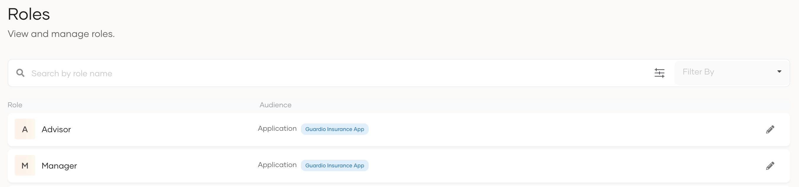

# Configure roles to consume authorized APIs

Organizations have access to two types of roles:

- **Roles associated with shared applications** - The root organization manages these roles. Organizations inherit them as shared roles. Shared applications use only these roles for authorization.

- **Organization-managed roles** - Organization administrators can create and manage roles directly within the organization. These roles govern access to applications managed directly in the organization.

Organizations have roles associated with their shared applications. Shared roles of organizations inherit the permission assignment to the role from the organization (root).

:::note[Roles of an organization]

The shared roles in organizations will inherit the permission to role assignments from the organization (root).
Users and group assignment to the roles should be done separately for the organization, as the organization does not inherit the users or groups from the organization (root).

Organization administrators cannot create new roles, modify the name or permissions of the shared roles, or delete the shared roles, but you can assign these roles to your organization users and groups.

:::

:::note

- To learn more about roles, refer to [Manage roles](../users/manage-roles.md).
- To learn about managing conflicts that can arise due to these two types of roles, refer to [Manage role conflicts in organization](/identity/7.0.0/guides/organization-management/manage-conflicts-in-organizations/#manage-role-conflicts-in-organization).

:::

## Assign organization users to roles

To assign roles to users of the organization:

1. On the WSO2 Identity Server Console, [switch to the organization](manage-organizations.md#switch-between-organizations).
2. Go to **User Management** > **Roles**.
3. Select the role you wish to assign to a user and click **Edit**.
4. Go to **Users** and click **Assign Users**.
5. Select the user to assign to the selected role.
6. Click **Update** to complete the role-to-user assignment.

## Assign organization groups to roles

Organizations maintain the following types of groups, and you can assign your application roles to any of these groups.

- [Groups](#assign-user-groups-to-roles) - A collection of organization users.
- [Federated IdP Groups](#assign-federated-idp-groups-to-roles) - Groups federated from connections in the organization. For example, groups federated from the Google connection.

### Assign user groups to roles

To assign roles to user groups of the organization:

1. On the WSO2 Identity Server Console, [switch to the organization](manage-organizations.md#switch-between-organizations).
2. Go to **User Management** > **Roles**.
3. Select the role you wish to assign to a group and click **Edit**.
4. Go to **Groups** and click **Assign Groups**.
5. Select the group to assign to the selected role.
6. Click **Update** to complete the role-to-group assignment.

### Assign federated IdP groups to roles

To assign roles to federated IdP groups:

:::note[Before you begin]

To get started:

- [Register, configure, and create groups for a connection](../authentication/index.md#manage-connections) in your organization.
- Add this connection to the sign-in flow of the application to which the roles are associated.

:::

1. On the WSO2 Identity Server Console, [switch to the organization](manage-organizations.md#switch-between-organizations).
2. Go to **User Management** > **Roles**.
3. Select the role you wish to assign to a group and click **Edit**.
4. Select the federated IdP from which you want to select groups.
5. Select the group to assign to the selected role.
6. Click **Update** to complete the role-to-group assignment.
