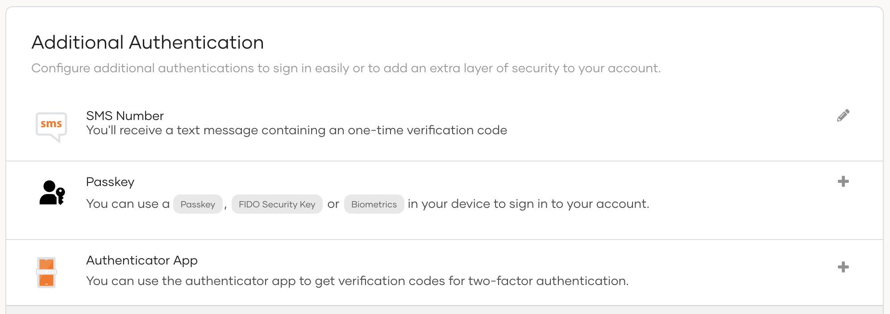

# Enroll TOTP via My Account

Users can set up an authenticator app of their choice from the My Account Portal so that the app can generate TOTPs for multi-factor authentication flows in WSO2 Identity Server.

## Initial setup

Follow the steps given below to set up TOTP using My Account.

1. In the user's MyAccount portal, go to **Security** > **Additional Authentication**.

    

2. Click the **+** icon next to Authenticator App and a QR code will be displayed to you.

3. Scan the QR code using your preferred authenticator application.

    

4. Enter the TOTP displayed in your authenticator app and click **Verify**.

## Access the QR code

The user can view the QR code via the My Account Portal by following the steps below.

1. In the user's MyAccount portal, go to **Security** > **Additional Authentication**.

2. Click the eye icon next to Authenticator App to view the QR code.

    

## Regenerate the QR code

If the user has accidentally deleted the QR code from the authenticator app, follow the steps below to generate a new QR code and register the authenticator app again in the My Account portal.

1. In the user's MyAccount portal, go to **Security** > **Additional Authentication**.

2. Click the eye icon next to Authenticator App and click **Regenerate** to get a new QR code.

    

3. Enter the TOTP code obtained after scanning the QR code and click **Verify**.
