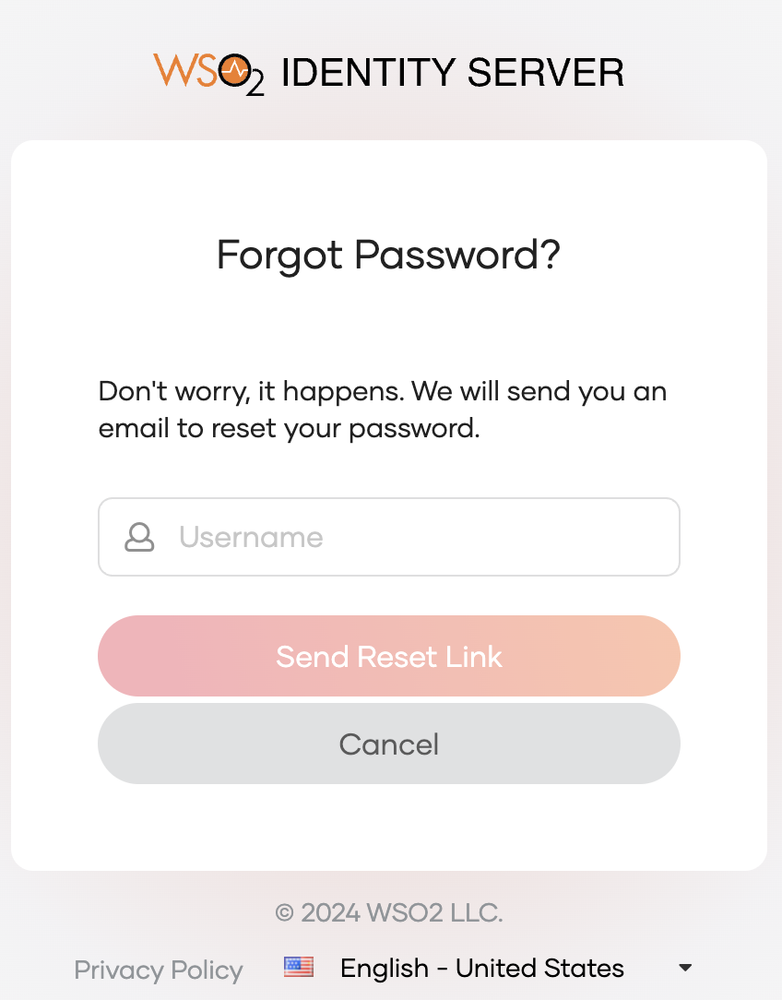
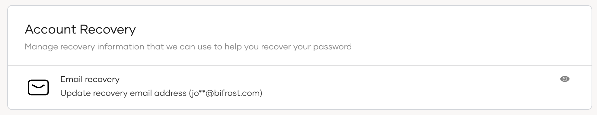

# Password recovery for users

Users may recover a forgotten password from an application sign-in page by following the steps below.

:::note[Before you begin]

Administrators should [enable password recovery](/identity/7.0.0/guides/flows/password-recovery/) for users of the organization.

:::

## Recover a forgotten password

:::warning

Users that onboard from a read-only remote user store are not able to recover their passwords through the My Account portal.

:::

To reset the password, the user should follow these steps.

1. Go to a login page via a business application or the [My Account portal](/identity/7.0.0/guides/user-self-service/customer-self-service-portal/).

    

2. Click **Forgot password?**

3. Enter your username and click **Send Reset Link**. An email notification will be sent to your email address.
        

4. Open the email you received and click **Reset Password**.
        

5. Enter new password and click **Proceed**.

:::note

If the user is already signed in to the My Account portal, the password can be reset from there. Learn how to [change password from the My Account portal](change-password.md).

:::

## Check password recovery email
Users can also check the email address and mobile number to which their password recovery information is sent.

1. In the My Account portal, navigate to **Security** > **Account Recovery**.

    

2. Click the eye icon of the relevant row, to check the recovery email address or the recovery mobile.

3. Click **Done**.
