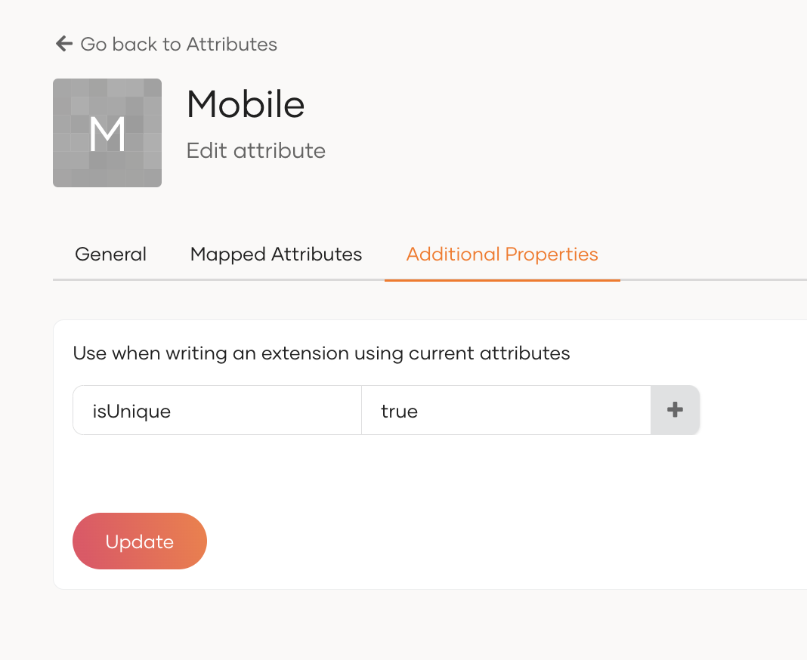

# Configure unique attributes

WSO2 Identity Server can be configured to retain the uniqueness of user attributes. This allows you to keep a user attribute value as a unique value within or across all userstores.

Follow the steps below to configure:

1.  Open the `deployment.toml` file in the `<IS_HOME>/repository/conf` folder and add the following configurations.

    ```toml
    [identity_mgt.user_claim_update.uniqueness]
    enable = true
    scope_within_userstore = false # Optional.
    ```

    :::note

    To keep the uniqueness within a userstore, set `scope_within_userstore` as `true`.

    :::

2.  Restart the WSO2 Identity Server.
3. On the WSO2 Identity Server Console, go to **User Attributes & Stores** > **Attributes**.
2. Click **Attributes** to see the list of attributes.
3. Click **Edit** for the attribute you want to update.
4. Go to the **Additional Properties** tab and add the following property to configure the attribute's uniqueness.
 
    <table>
        <thead>
        <tr className="header">
        <th>Property Name</th>
        <th>Property Value</th>
        </tr>
        </thead>
        <tbody>
        <tr className="odd">
        <td>isUnique</td>
        <td>true</td>
        </tr>
        </tbody>
    </table>

    

6.  Finally, click `+` button and `Update` to save the additional property.

You can now verify the functionality by attempting to add users with an existing attribute value or updating the user attribute value of an existing user.
