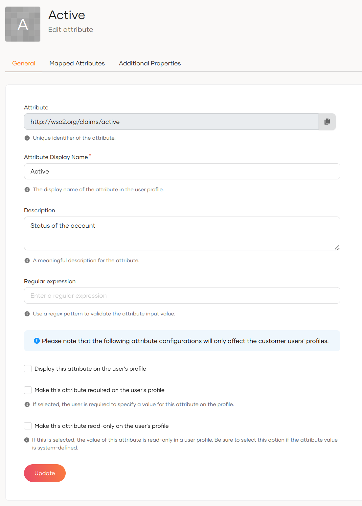
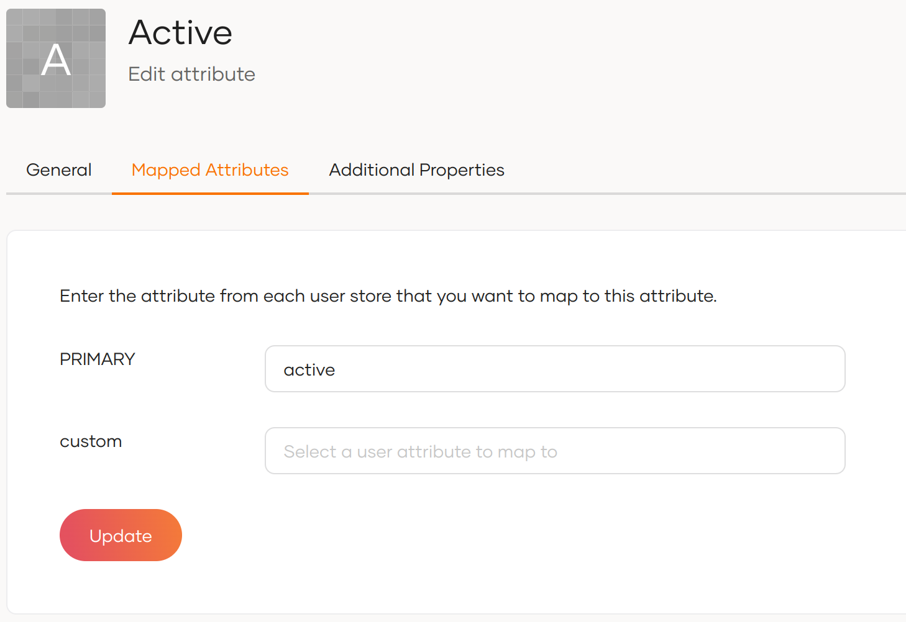
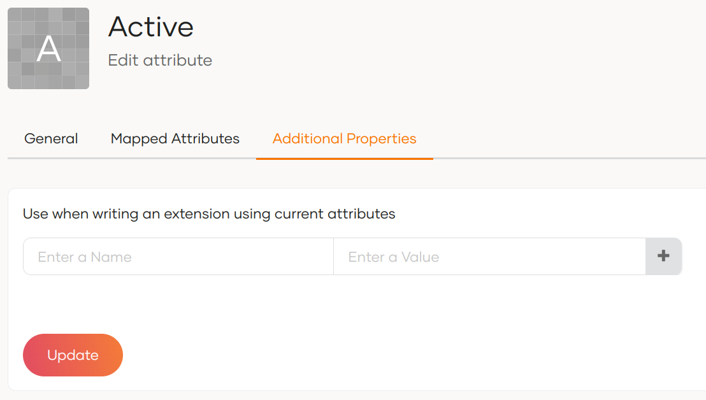

# Configure attributes

This guide walks you through the available configuration options for default and custom attributes.

To configure attributes,


1. On the WSO2 Identity Server Console, go to **User Attributes & Stores** > **Attributes**.
2. Under **Manage Attributes**, click **Attributes** to view the list of all attributes.
3. Click **Edit** for the attribute you want to update.

    

    :::note

    The **Attribute** field specifies the unique identifier of the attribute. It always starts with `http://wso2.org/claims`. This can't be edited.

    :::

4. In the **General** tab, update the following values and click **Update** to save the changes.

    <table>
       <tbody>
            <tr>
                <td><b>Attribute Display Name</b></td>
                <td>Update the display name of the attribute that will show in user profiles.</td>
            </tr>
            <tr>
                <td><b>Description</b></td>
                <td>Update the description for the attribute.</td>
            </tr>
            <tr>
                <td><b>Display this attribute on the user's profile</b></td>
                <td>If you select this checkbox, the attribute appears in user profiles.</td>
            </tr>
            <tr>
                <td><b>Regular expression</b></td>
                <td>The value of the attribute will be validated against the regex pattern specified here.</td>
            </tr>
            <tr>
                <td><b>Make this attribute required on user's profile</b></td>
                <td>If this checkbox is selected, users are required to specify a value for this attribute on their profile.</td>
            </tr>
            <tr>
                <td><b>Make this attribute read-only on user's profile</b></td>
                <td>If this checkbox is selected, the value for this attribute will be read-only in user profiles.</td>
            </tr>
     </tbody>
    </table>

5. Go to the **Attribute Mappings** tab and enter the attribute from each user store that you need to map.

    

6. Optionally, you may use the **Additional Properties** tab to add additional properties that can be used when writing an extension.

    


## Configure the storage location of attributes

WSO2 Identity Server gives you freedom to choose in what databases each attribute gets stored. You can divide attributes into two broad categories and WSO2 Identity Server manages each of them differently as explained in the following sections.

- **User attributes** - Personal information that identifies a user, such as their name, email, or phone number.

- **Identity attributes** - Information that describes the state or status of a user account rather than personal details. Unlike user store attributes, identity attributes focus on account-related properties, such as whether the account is verified, locked, active, or disabled.

### Change the default identity attribute store

By default, WSO2 Identity Server stores identity attributes internally in the user store configured in the `<IS_HOME>/repository/conf/deployment.toml` file. To change this,

1. Add the following configuration to the `deployment.toml` file. The `IdentityDataStoreService` OSGi service uses this value to determine which data store implementation to access.

    ```toml
    [identity_datastore]
    datastore_type = "<Name of the identityDataStore class>"
    ```

    :::note


    The class name configuration for the identity data store is now separate from the listener configurations. If you're using a custom data store class, it's crucial to update your `deployment.toml` file to reflect this choice. This update ensures that your custom class will override the default configuration.

    To either maintain the previous behavior or use your custom data store, simply follow these steps and update your deployment.toml:

    By making this configuration adjustment, you can ensure that your system aligns with your preferred data store class, whether it's the previous default or a custom class you've implemented. This helps you tailor the system to your specific needs.

    :::

2. For each attribute below, open its **Attribute Mappings** tab and map it to the corresponding attribute in the connected store.

    - `http://wso2.org/claims/identity/accountLocked`: Stores the locked status of the user's account.

    - `http://wso2.org/claims/identity/unlockTime`: Time at which the user’s account gets unlocked.

    - `http://wso2.org/claims/identity/failedLoginAttempts`: Tracks the number of consecutive failed login attempts. Account locking happens based on this value.
